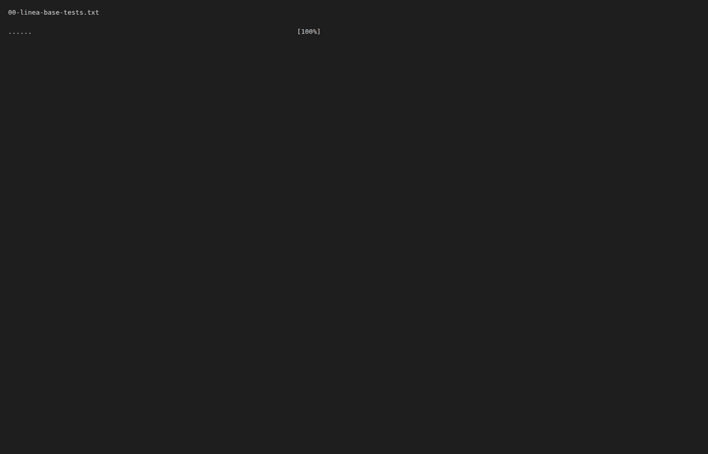
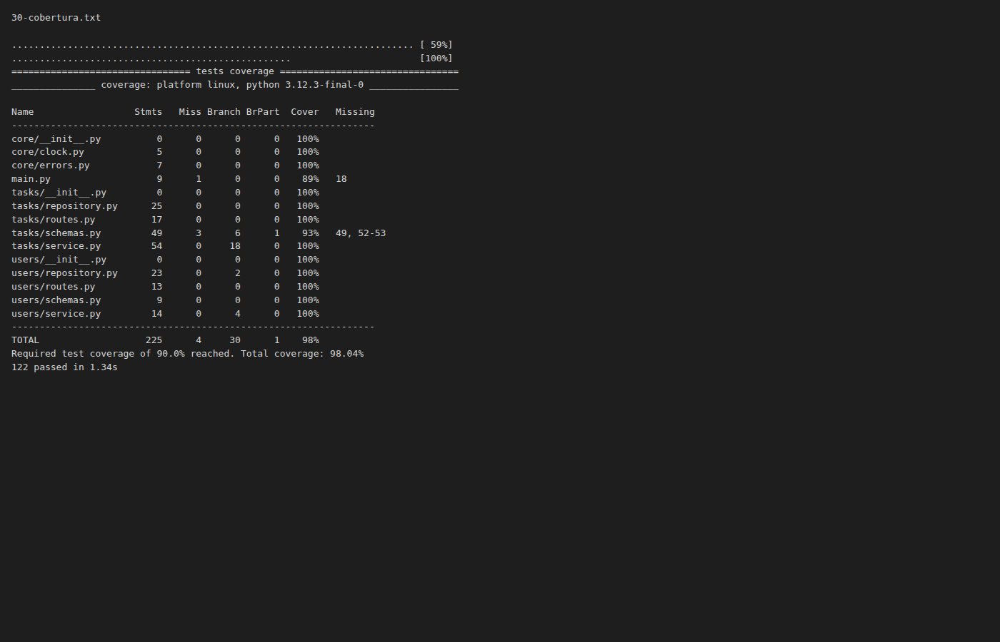
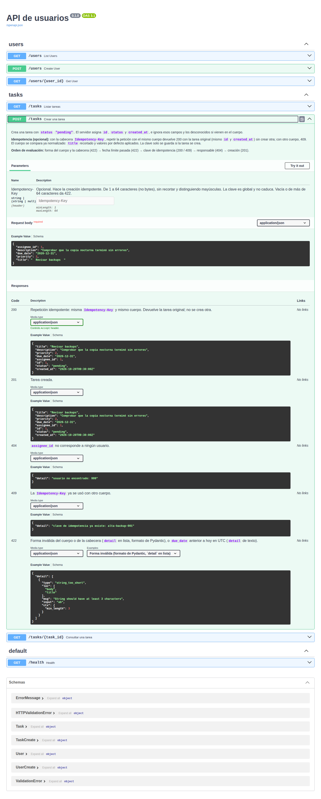

# Evidencia del reto M2 — recurso `tasks`

- **Proyecto:** API de usuarios (FastAPI + Pydantic v2), almacén en memoria.
- **Rama:** `feature/tasks` (23 commits en `main..HEAD`, del 2026-10-20 al 2026-10-21).
- **Herramienta:** Claude Code.
- **Fuentes:** [`bitacora.md`](bitacora.md) (pasos P0–P30), [`logs/`](logs/),
  [`capturas/`](capturas/) y `git log main..HEAD`. Índice literal de prompts en
  [`prompts.md`](prompts.md).

**Línea base (P0)**, antes de empezar: 6 tests en verde, cobertura total 98 % y `ruff`
limpio ([`logs/00-linea-base-cobertura.txt`](logs/00-linea-base-cobertura.txt),
[`logs/00-linea-base-tests.txt`](logs/00-linea-base-tests.txt),
[`logs/00-linea-base-ruff.txt`](logs/00-linea-base-ruff.txt)).



---

## 1. Especificación y contexto

### 1.a Funcionalidad y criterios de aceptación

**Historia de usuario** (P2): como miembro del equipo de operaciones quiero registrar
tareas con responsable, prioridad y fecha límite para que ningún trabajo quede sin
registrar y se pueda rastrear.

**Contrato** (`docs/feature-tasks.md`):

| Endpoint | Descripción | Códigos |
|---|---|---|
| `POST /tasks` | Crea una tarea con `status` `"pending"`. Cuerpo: `title` (obligatorio), `description` (≤ 1000), `priority` (1–5, por defecto 3), `due_date` (`YYYY-MM-DD`), `assignee_id`. Cabecera opcional `Idempotency-Key` (1–64 caracteres). | 201, 200 (repetición idempotente), 404, 409, 422 |
| `GET /tasks` | Lista por `id` ascendente; filtro opcional `?assignee_id=`. | 200, 422 |
| `GET /tasks/{task_id}` | Consulta una tarea. | 200, 404, 422 |

**Criterios de aceptación:** el primer borrador tenía 23 criterios; tras resolver las 15
preguntas abiertas de la IA quedaron **43 criterios (CA-01…CA-43)** en formato
Dado/Cuando/Entonces, más una sección "Decisiones" (1–17) y 5 decisiones propuestas por la
IA y aceptadas (A1–A5). Los principales grupos:

- `title` recortado con `strip`, 3–120 caracteres tras recortar (CA-04…CA-08).
- `description` tal cual, máximo 1000 (CA-09…CA-11).
- `priority` entero estricto 1–5, por defecto 3 (CA-12…CA-14).
- `due_date` solo `YYYY-MM-DD`; anterior a hoy (UTC, vía `core/clock.py`) → 422 (CA-15…CA-19).
- `assignee_id` inexistente → 404; forma inválida → 422 (CA-20…CA-25).
- Idempotencia: misma clave y misma huella → 200 con la misma tarea; huella distinta → 409;
  la clave solo se guarda tras un 201 (CA-26…CA-33).
- Listado, filtro, consulta y `reset()` (CA-34…CA-43).

Orden de evaluación fijado en la especificación (fragmento de P2):

```markdown
1. Forma del cuerpo y de la cabecera → `422` (Pydantic, formato por defecto).
2. `due_date` anterior a hoy → `422` (dominio, `errors.invalid_request`).
3. Búsqueda de la `Idempotency-Key` → `200` (misma huella) o `409` (huella distinta).
4. Existencia del responsable → `404` (`errors.not_found`).
5. Creación → `201`; si hay clave, se guarda junto con la huella y la tarea.
```

Commit: `6e9e2a2` — `docs: especificación y criterios de aceptación de tasks`.

### 1.b Contexto para la IA

**`@archivos` usados en los prompts** (tomados literalmente de los prompts de la bitácora):

| Paso | Archivos referenciados |
|---|---|
| P1 Exploración | `@CLAUDE.md`, `@main.py`, `@core/errors.py`, `@users/routes.py`, `@users/service.py`, `@users/schemas.py`, `@users/repository.py`, `@tests/conftest.py`, `@tests/test_users.py`, `@pyproject.toml` |
| P3 Convenciones | `@CLAUDE.md` |
| P4 Esqueleto | `@CLAUDE.md`, `@docs/feature-tasks.md`, `@users/routes.py`, `@users/service.py`, `@users/schemas.py`, `@users/repository.py` |
| P5 Tests en rojo | `@docs/feature-tasks.md`, `@tests/test_users.py`, `@tests/conftest.py` |
| P6 Happy path | `@main.py` |
| P7 Validaciones | `@tasks/schemas.py`, `@docs/feature-tasks.md` |
| P8 Fecha y responsable | `@tasks/service.py`, `@CLAUDE.md` |
| P9 Idempotencia | `@docs/feature-tasks.md` |
| P10 Integración | `@CLAUDE.md` |
| P11 Cobertura/mutación | `@pyproject.toml` |
| P12 Unitarios | `@tasks/service.py`, `@docs/feature-tasks.md` |
| P13 Integración | `@tests/conftest.py` |
| P15 Mutación | `@docs/feature-tasks.md` |
| P17 Bug | `@docs/feature-tasks.md`, `@tasks/service.py`, `@tasks/repository.py`, `@tests/conftest.py`, `@core/clock.py` |
| P17a Caso de debugging | `@docs/evidencia/bitacora.md` |
| P20 Code smells | `@tasks/service.py`, `@tasks/routes.py`, `@tasks/schemas.py`, `@tasks/repository.py` |
| P23 Code review | `@CLAUDE.md`, `@docs/feature-tasks.md` |
| P24 Docstrings | `@tasks/service.py`, `@tasks/repository.py`, `@core/clock.py`, `@users/service.py`, `@docs/feature-tasks.md` |
| P25 OpenAPI | `@tasks/routes.py`, `@tasks/schemas.py` |
| P26 README | `@README.md`, `@pyproject.toml`, `@requirements.txt`, `@main.py`, `@tasks/routes.py`, `@docs/feature-tasks.md` |
| P27 CHANGELOG/ADR | `@pyproject.toml`, `@main.py` |

En P1 la IA resumió el patrón de capas, el catálogo de errores, el aislamiento entre tests
y los riesgos de añadir un segundo recurso. Al contrastarlo con una lista de control,
añadió el punto que faltaba (`migrations/` y `legacy/` fuera de límites).

**Diff de `CLAUDE.md`** (P3, commit `42f2fbc` — `docs(claude): convenciones para el recurso tasks`):

```diff
@@ -11,8 +11,13 @@ el proyecto corre sin infraestructura.
   - `service.py` — lógica de negocio. Única capa que habla con `repository.py`.
   - `schemas.py` — modelos Pydantic de entrada (`*Create`) y salida.
   - `repository.py` — acceso a datos (aquí, un `dict` en memoria).
+- `tasks/` — tareas de equipo. Mismo patrón de 4 archivos que `users/`
+  (`routes.py`, `service.py`, `schemas.py`, `repository.py`).
 - `core/errors.py` — catálogo de errores. Toda respuesta de error sale de aquí.
-- `tests/` — un archivo por recurso: `test_<recurso>.py`.
+- `core/clock.py` — reloj de la aplicación (fecha actual en UTC). Único punto que consulta
+  la fecha del sistema.
+- `docs/` — especificaciones de features (`feature-<recurso>.md`) y ADR.
+- `tests/` — un archivo por recurso: `test_<recurso>.py` (`test_users.py`, `test_tasks.py`).
 
 ## Convenciones
 
@@ -25,6 +30,14 @@ el proyecto corre sin infraestructura.
   feliz y un caso de error.
 - Rutas específicas antes que rutas con parámetro: `/users/search` debe declararse
   **antes** de `/users/{user_id}`.
+- La lógica que depende de la fecha actual no llama a `date.today()` ni a `datetime.now()`
+  directamente: usa una función de `core/clock.py` para poder mockearla en los tests.
+- Las validaciones de forma (tipos, rangos, longitudes) van en los schemas Pydantic. Las
+  reglas de dominio (fecha pasada, responsable inexistente, idempotencia) van en `service.py`
+  con `core/errors.py`.
+- Un recurso consulta otro recurso a través de su `service.py`, nunca de su `repository.py`.
+- Todo repositorio nuevo expone `reset()` y la fixture autouse de `tests/conftest.py` lo invoca.
+- Docstrings estilo Google en las funciones públicas de `service.py`.
 
 ## Cómo ejecutar
 
@@ -36,9 +49,22 @@ pip install -r requirements.txt
 uvicorn main:app --reload          # API en http://127.0.0.1:8000  ·  /docs para el Swagger
 pytest                             # tests
 pytest --cov=. --cov-report=term-missing   # cobertura
+pytest --cov --cov-branch --cov-report=term-missing   # cobertura de ramas
 ruff check .                       # linter
+mutmut run                         # mutation testing
+mutmut results                     # mutantes supervivientes
 ```
 
+## Definición de hecho
+
+Un cambio está hecho cuando:
+
+- `pytest` está en verde.
+- La cobertura de `tasks/` supera el 90 % (`pytest --cov=tasks --cov-branch`).
+- `ruff check .` está limpio.
+- Las funciones públicas de `service.py` tienen docstrings estilo Google.
+- `README.md` y `CHANGELOG.md` están actualizados.
+
 ## Fuera de límites
```

Validación: `pytest -q` → 6 tests en verde ([`logs/03-tests.txt`](logs/03-tests.txt)).

### 1.c Patrón elegido y justificación

| Patrón | Dónde | Justificación | Señal de alarma vigilada |
|---|---|---|---|
| **Skeleton-first** | P4 | Feature nueva con varias piezas (schemas, repositorio, service, rutas, reloj): conviene fijar antes la estructura. | Que el esqueleto traiga lógica. Se detectó y se corrigió en P4: la ruta desempaquetaba `task, created = ...`. |
| **Test-first** | P5 | Las reglas son verificables y están en los criterios CA-XX. | Que los tests salgan del código y no de los criterios. Se verificó la tabla CA → test (43/43) y que ningún test usa la fecha real. |
| **Incremental** | P6–P9 | Pasos pequeños, revisables y con un commit por paso. | Pasos que mezclen reglas o commits sin tests en verde. |

Evolución del rojo al verde durante el incremental (recuento de líneas `FAILED` de cada log):

| Paso | Qué se implementó | Casos en rojo | Log |
|---|---|---|---|
| P5 | Solo tests + `reset()` | 81 (todos los de `tasks`) | [`05-tests-rojos.txt`](logs/05-tests-rojos.txt) |
| P6 | Happy path | 39 | [`06-tests.txt`](logs/06-tests.txt) |
| P7 | Validaciones de forma | 14 | [`07-tests.txt`](logs/07-tests.txt) |
| P8 | Fecha límite y responsable | 5 | [`08-tests.txt`](logs/08-tests.txt) |
| P9 | Idempotencia | 1 (CA-17 `T00:00:00`) | [`09-tests.txt`](logs/09-tests.txt) |
| P10 | Integración y fix de `due_date` | 0 (87 en verde) | [`10-tests-verde.txt`](logs/10-tests-verde.txt) |


---

## 2. Generación

### 2.a Iteraciones solicitud → revisión → refinamiento

Los prompts completos están en [`prompts.md`](prompts.md). Resumen de cada iteración:

**P4 — Esqueleto.** *Solicitud:* solo firmas, modelos y TODOs con su CA-XX. *Revisión:*
lista de control (¿alguna función con lógica?). *Refinamiento:* se quitó el desempaquetado
de tupla de la ruta y `create_task` devolvió `Task`.

```python
@router.post("", response_model=Task, status_code=status.HTTP_201_CREATED)
def create_task(
    data: TaskCreate,
    # TODO(CA-32): min_length=1, max_length=64 en el Header.
    idempotency_key: str | None = Header(default=None, alias="Idempotency-Key"),
) -> Task:
    # TODO(CA-26, CA-27): responder 200 (no 201) en una repetición idempotente.
    return service.create_task(data, idempotency_key)
```

**P5 — Tests en rojo.** *Solicitud:* un test por CA, a partir de los criterios y no del
código. *Revisión:* tabla CA → test, límites a ambos lados y ausencia de fecha real.
*Refinamiento:* ninguno; los 43 CA tenían test (81 casos con la parametrización).

```python
@pytest.fixture(autouse=True)
def _fixed_today(monkeypatch: pytest.MonkeyPatch) -> None:
    """Los criterios con fecha parten de hoy = 2026-10-20 (UTC)."""
    monkeypatch.setattr("core.clock.today", lambda: TODAY)
```

**P6 — Happy path.** *Revisión:* ruta sin lógica, 404 desde `core/errors.py`, `reset()`
reinicia ids y tests intactos. *Refinamiento:* ninguno; los cuatro puntos se cumplían.

**P7 — Validaciones de forma.** *Revisión:* decidí que `priority` `3.0` diera 422
(modo estricto solo en ese campo). *Refinamiento:* ninguno; ya usaba `Field(strict=True)` y
CA-14 cubría `3.0` y `true`.

```python
priority: Annotated[int, Field(strict=True, ge=1, le=5)] = 3
assignee_id: Annotated[int, Field(strict=True, ge=1)] | None = None
```

**P8 — Fecha límite y responsable.** *Revisión:* `grep` de `users.repository` en `tasks/`
(vacío), sin `date.today`/`datetime.now`, y un espía que confirmó 0 consultas a `users` con
`assignee_id` `None`.

```python
if data.due_date is not None and data.due_date < clock.today():
    raise errors.invalid_request(PAST_DUE_DATE_MESSAGE)
if data.assignee_id is not None:
    # get_user lanza errors.not_found("usuario", assignee_id) si no existe.
    users_service.get_user(data.assignee_id)
```

**P9 — Idempotencia.** *Solicitud:* diseño en 5 líneas y esperar el OK. *Revisión:* se
rechazaron dos puntos del diseño (ver 2.c). *Refinamiento:* `create_task` devuelve
`(task, created: bool)` y la ruta solo asigna `response.status_code`. Prueba manual:
201 → 200 → 409.

### 2.b Integración y linting (P10)

- La IA revisó el código contra `CLAUDE.md` (capas, catálogo de errores, nombres, orden de rutas,
  `migrations/` y `legacy/` sin cambios) y encontró dos incumplimientos:
  1. `tasks/schemas.py`: `due_date` aceptaba `"2026-10-20T00:00:00"`. El primer intento,
     `Field(strict=True)`, rompió 8 tests y se sustituyó por un validador `mode="before"`.
  2. "Definición de hecho": `README.md` no mencionaba `tasks` y no existía `CHANGELOG.md`.
- Resultado: `pytest -q` → 87 en verde ([`logs/10-tests-verde.txt`](logs/10-tests-verde.txt));
  `ruff check .` → `All checks passed!` ([`logs/10-ruff.txt`](logs/10-ruff.txt)).
- Prueba con la app levantada: dos `POST /tasks` con `Idempotency-Key: demo-1` → `201 Created`
  y luego `200 OK`, con el mismo `id` (1) y el mismo `created_at`
  ([`logs/10-curl.txt`](logs/10-curl.txt)).

```python
@field_validator("due_date", mode="before")
@classmethod
def require_date_only(cls, value: object) -> object:
    """Solo acepta `YYYY-MM-DD`: sin hora, aunque sea 00:00:00 (CA-17)."""
    if value is None or isinstance(value, date):
        return value
    if not isinstance(value, str) or not DATE_ONLY_PATTERN.fullmatch(value):
        raise ValueError("la fecha límite debe tener el formato YYYY-MM-DD")
    # Pydantic valida después que sea una fecha real (p. ej. rechaza 2026-02-30).
    return value
```


`ruff check .` quedó limpio en todos los pasos con log: P4, P6–P10, P12, P19, P21.1–P21.3,
P24, P25 y P27 ([`logs/*-ruff.txt`](logs/)).

### 2.c Propuestas aceptadas y rechazadas

| Paso | Propuesta de la IA | Decisión | Motivo |
|---|---|---|---|
| P2 | 15 preguntas abiertas sobre la especificación | Aceptada; las respondí yo | Cerrar la especificación antes de implementar; cada CA debe ser verificable |
| P2 | Decisiones conservadoras A1–A5 | Aceptada | Coherentes con mis decisiones |
| P3 | Consultar `requirements.txt` y `pip list` antes de editar | Rechazada (interrumpida y reenviada) | [PENDIENTE] |
| P4 | `task, created = service.create_task(...)` en la ruta y retorno `tuple[Task, bool]` | Rechazada | Lógica en un esqueleto |
| P4 | `Header(default=None, alias=...)` en lugar de `Header(...)` | Aceptada | `Header(...)` haría obligatoria la cabecera, contra CA-33 |
| P5 | Fijar "hoy" en 2026-10-20 en lugar de 2026-01-15 | Aceptada | Los valores coinciden con los de los criterios |
| P6 | Añadir `clock.now()` | Aceptada | `core/clock.py` es el único punto que consulta la fecha |
| P7 | Validar `Idempotency-Key` en `routes.py` | Aceptada | Es una cabecera, no se puede expresar en `schemas.py` |
| P8 | Reutilizar `users_service.get_user` para el 404 | Aceptada | Mismo 404 y respeta la capa `service` de `users` |
| P9 | `create_task` devuelve `(task, código HTTP)` | Rechazada → `(task, created: bool)` | El service no debe conocer códigos HTTP |
| P9 | 409 con `errors.already_exists` | Rechazada → nueva `errors.conflict()` | En ese momento se juzgó que no encajaba. Revertido en P21.3 y P23 (ver abajo) |
| P10 | `Field(strict=True)` en `due_date` | Descartada → validador `mode="before"` | Rompía 8 tests: FastAPI pasa el cuerpo como `dict` |
| P11 | `source_paths` / `also_copy` en lugar de `paths_to_mutate` | Aceptada | Sintaxis de mutmut 3.8.0, la instalada |
| P12 | Caso 5 (`description` None frente a omitida) resuelto sin preguntar | Aceptada | Decisiones 2 y 8 de la especificación |
| P13 | No instalar pytest-randomly | Aceptada; instalarlo queda [PENDIENTE] | No estaba instalado |
| P15 | Mantener `include=FINGERPRINT_FIELDS` (genera 2 mutantes equivalentes) | Sin decidir: [PENDIENTE] | Guarda explícita de A5 frente a código sobrante |
| P17a | Recrear el fallo real de CA-17 en lugar de uno fabricado | Aceptada | La bitácora documenta ese rojo |
| P20 | 12 code smells | 3 elegidos, 7 descartados | Descartados por cosméticos, bajo impacto o romper la consistencia con `users/` |
| P21.2 | No adelantar el cálculo de la huella | Aceptada | No optimizar sin datos |
| P21.3 | Conservar `errors.conflict` sin uso | Aceptada en el paso | Regla de no borrar abstracciones. Se eliminó después en P23 |
| P23 | Mantener "409 con `conflict()`" como bloqueante pese a mi ejemplo de falso positivo | Aceptada | La decisión 11 exige `already_exists` y prohíbe funciones nuevas en `core/errors.py` |
| P23 | Fusionar los tests en `tests/test_tasks.py` en vez de cambiar la convención | Aceptada | Opción conservadora |
| P23 | Cambiar `users/repository.py` para usar `clock.now()` | Aceptada | La convención de `core/clock.py` la introduce esta rama |
| P24 | Corregir el código en las diferencias 1 y 2 con la especificación | Aceptada | El código incumplía la especificación |
| P25 | Referencia manual a `HTTPValidationError` | Aceptada como riesgo | El componente existe porque lo generan otras rutas |
| P26 | No enlazar `docs/adr/` (aún no existía) | Aceptada | No inventar documentación |
| P27 | Fechar 0.1.0 con el último commit de `main` y sin enlaces de comparación | Aceptada | No hay tags |

---

## 3. Tests

### 3.a Tests unitarios: AAA y mocks (P12)

- Tests unitarios de `tasks/service.py` sin `TestClient` (inicialmente en
  `tests/test_tasks_service.py`; en P23 se movieron a `class TestService` de
  `tests/test_tasks.py`).
- **Dependencias mockeadas** con `monkeypatch`: `core.clock.today` (fijado en 2026-10-20) y
  `users.service.get_user` (fake que registra los ids consultados y lanza
  `errors.not_found` fuera de los ids 1–4).
- **Lógica sin mockear:** validación de fecha, idempotencia y filtro; el repositorio en
  memoria es real.
- Estilo AAA con comentarios `# Arrange / # Act / # Assert`, un caso por test y aserciones
  exactas de `status_code` y `detail`.
- Pregunta de control "¿qué mutación no detectaría?": en la iteración se reforzaron 12 de 19
  tests. Recuento de líneas de mock / sentencias `assert`: antes 39/45, después 38/61.
- Resultado: 109 tests en verde (87 previos + 22 nuevos)
  ([`logs/12-tests.txt`](logs/12-tests.txt)). Commit `dc08bb5`.

```python
def test_misma_clave_cambiando_un_solo_campo_da_409(changed_field: dict) -> None:
    # Arrange
    original, _ = service.create_task(TaskCreate(title="Revisar backups"), idempotency_key=KEY)
    other = TaskCreate(title="Revisar backups", **changed_field)

    # Act
    with pytest.raises(HTTPException) as error:
        service.create_task(other, idempotency_key=KEY)

    # Assert
    assert error.value.status_code == 409
    assert error.value.detail == f"clave de idempotencia ya existe: {KEY}"
    assert tasks_repository.list_all() == [original]
```

En P23 se añadió un unitario de concurrencia que usa dos hilos y una consulta lenta del
responsable (`test_dos_peticiones_simultaneas_con_la_misma_clave_crean_una_sola_tarea`).

### 3.b Tests de integración: fixtures y setup/teardown (P13)

- `test_flujo_alta_de_usuario_y_tareas_con_idempotencia_y_filtro`: app real (`TestClient`),
  repositorios reales y `users` real; solo se fija el reloj. Flujo: crear a "Margaret" →
  `POST /tasks` con `k-1` (201) → repetir (200, mismo id) → tarea para Ada sin clave (201) →
  filtro por Margaret (solo su tarea) → `GET /tasks/{id}`.
- `test_no_queda_estado_de_otro_test`: comprueba que no quedan tareas, que solo están los
  4 usuarios semilla y que `k-1` con otro cuerpo da 201 con id 1.
- **Setup/teardown:** la fixture autouse `_reset_data` de `tests/conftest.py` resetea `users`
  y `tasks` antes y después de cada test; `monkeypatch` deshace el reloj al terminar.

```python
@pytest.fixture(autouse=True)
def _reset_data():
    """Cada test arranca con los datos semilla y no contamina a los demás."""
    users_repository.reset()
    tasks_repository.reset()
    yield
    users_repository.reset()
    tasks_repository.reset()
```

- Dos ejecuciones de la suite con el mismo resultado, 111 en verde
  ([`logs/13-tests-run1.txt`](logs/13-tests-run1.txt),
  [`logs/13-tests-run2.txt`](logs/13-tests-run2.txt)). El orden aleatorio no se probó:
  pytest-randomly no está instalado ([PENDIENTE] de decisión). Commit `f303bbf`.

### 3.c Cobertura y mutación

**Cobertura antes / después** (`pytest --cov --cov-branch --cov-report=term-missing`):

| Momento | Tests | `tasks/` (líneas · ramas) | `core/clock.py` | Total proyecto | Log |
|---|---|---|---|---|---|
| P0 línea base (sin `tasks`) | 6 passed | — | — | 113 stmts, 2 miss · 6 ramas · 98 % | [`00-linea-base-cobertura.txt`](logs/00-linea-base-cobertura.txt) |
| P11 antes | 87 passed | 111 stmts, 0 miss · 22 ramas, 0 parciales · 100 % | 80 % (falta línea 16) | 193 stmts, 2 miss · 28 ramas · 99,10 % | [`11-cobertura-antes.txt`](logs/11-cobertura-antes.txt) |
| P13 | 111 passed | 100 % | 80 % (falta línea 16) | 99,10 % | [`13-cobertura.txt`](logs/13-cobertura.txt) |
| P14 después | 113 passed | 100 % · 100 % | **100 %** | 193 stmts, 1 miss · 28 ramas · **99,55 %** | [`14-cobertura-final.txt`](logs/14-cobertura-final.txt) |
| P20 antes del refactor | 114 passed | 100 % · 100 % | 100 % | 99,55 % | [`20-antes-refactor-cobertura.txt`](logs/20-antes-refactor-cobertura.txt) |
| P21.4 después del refactor | 114 passed | 100 % · 100 % (`service.py` 51 stmts, 18 ramas) | 100 % | 213 stmts, 2 miss · 30 ramas · 99,18 % | [`21-despues-refactor-cobertura.txt`](logs/21-despues-refactor-cobertura.txt) |
| P28 estado final (tras P23–P27) | 122 passed | 145 stmts, 3 miss · 24 ramas, 1 parcial · 97,63 % (calculado a partir del log) | 100 % | 225 stmts, 4 miss · 30 ramas, 1 parcial · 98,04 % | [`28-cobertura-final.txt`](logs/28-cobertura-final.txt), [`30-cobertura.txt`](logs/30-cobertura.txt) (mismas cifras) |

En el estado final, `tasks/` cumple la "Definición de hecho" (> 90 %) pero ya no está al
100 %. `tasks/schemas.py` queda al 93 %: faltan las líneas 49 y 52-53 y hay 1 rama parcial.
Corresponden a la rama de la cabecera `Idempotency-Key` con bytes que no son UTF-8 válido,
añadida en P24 sin test. El resto de `tasks/` y `core/` está al 100 %, y `main.py:18` sigue
sin cubrir.



En P14 el único hueco de `tasks/` y `core/clock.py` era `core/clock.py:16` (`today()`, siempre
mockeado). Se cubrió con 2 tests que fijan solo `core.clock.now` y comprueban la fecha UTC en
el último segundo del día y a medianoche; no se encontró código muerto. La línea que sigue
sin cubrir en el total es `main.py:18` (`/health`), fuera del alcance.


**Mutación** (mutmut 3.8.0, alcance `tasks/` y `core/clock.py`;
[`logs/11-mutmut-version.txt`](logs/11-mutmut-version.txt)):

| Momento | Total | Muertos | Vivos | Equivalentes | A matar con test | Puntuación bruta / sin equivalentes | Log |
|---|---|---|---|---|---|---|---|
| P15 antes | 97 | 88 | 9 | 9 | 0 | 90,7 % / 100 % | [`15-mutmut-run.txt`](logs/15-mutmut-run.txt), [`15-mutmut-results.txt`](logs/15-mutmut-results.txt) |
| P16 después | 97 | 88 | 9 | 9 | 0 | 90,7 % / 100 % | [`16-mutmut-run.txt`](logs/16-mutmut-run.txt), [`16-mutmut-despues.txt`](logs/16-mutmut-despues.txt) |
| P21.4 tras el refactor | 116 | 107 | 9 | 9 | 0 | 92,2 % / 100 % | [`21-despues-refactor-mutmut.txt`](logs/21-despues-refactor-mutmut.txt) (lista de supervivientes; el recuento de `mutmut run` no tiene log: [PENDIENTE]) |
| P30 estado final | 123 | 112 | 11 | 9 + 2 sin clasificar | [PENDIENTE] (2 sin clasificar) | 91,1 % / 98,2 % (los 2 sin clasificar cuentan como no equivalentes) | [`30-mutmut-run.txt`](logs/30-mutmut-run.txt), [`30-mutmut-results.txt`](logs/30-mutmut-results.txt) |

En el estado final sobreviven 11 mutantes: los 9 equivalentes de `_fingerprint` (3, 5, 10,
11, 13, 14, 15, 16 y 20) y 2 nuevos en `tasks/schemas.py::_decode_utf8_header` (5 y 7), que
proceden del arreglo de P24 y no se han clasificado.

Los 9 supervivientes están todos en `tasks/service.py::_fingerprint`
([`logs/15-mutmut-show.txt`](logs/15-mutmut-show.txt)) y se clasificaron como equivalentes:

| Mutante(s) | Qué cambió | Por qué ningún test falla |
|---|---|---|
| 3, 5 | `include=FINGERPRINT_FIELDS` → `None` / eliminado | `TaskCreate` tiene exactamente esos 5 campos: el dump es idéntico (además, código sobrante) |
| 10, 13, 15 | `sort_keys=True` → `None` / eliminado / `False` | `model_dump` ya da un orden fijo |
| 11, 14, 16 | `ensure_ascii=False` → `None` / eliminado / `True` | Otro texto, pero igual de fijo; las huellas solo se comparan entre sí en memoria |
| 20 | `"utf-8"` → `"UTF-8"` | Mismo códec |

En P16 no se escribieron tests: ningún test puede matar un mutante equivalente.


---

## 4. Debugging y refactor

### 4.a Trace, hipótesis, confirmación, fix y regresión (P17a–P19)

**Origen del bug (P17a).** Es un fallo **real**, no fabricado:
`test_ca17[2026-10-20T00:00:00]` siguió en rojo de P6 a P9 como "regla pendiente" (logs
[`07`](logs/07-tests.txt), [`08`](logs/08-tests.txt), [`09`](logs/09-tests.txt)) y se
arregló en P10 (commit `4a55657`). Para el ejercicio se revirtió solo ese fix en el working
tree, sin commit ([`logs/17a-diff-bug.txt`](logs/17a-diff-bug.txt)).

**Trace (P17)** ([`logs/17-bug-trace.txt`](logs/17-bug-trace.txt)):

```text
>       assert response.status_code == 422
E       assert 201 == 422
E        +  where 201 = <Response [201 Created]>.status_code

tests/test_tasks.py:256: AssertionError
=========================== short test summary info ============================
FAILED tests/test_tasks.py::test_ca17_fecha_limite_con_formato_o_fecha_invalidos_devuelve_422[2026-10-20T00:00:00]
```


**Hipótesis (P17), de más a menos probable:**

| # | Hipótesis | Cómo confirmarla | Resultado |
|---|---|---|---|
| 1 | Falta el validador de formato en `tasks/schemas.py:20` y Pydantic v2 en modo laxo acepta un datetime a las 00:00:00 como `date` | Instanciar `TaskCreate` con cada valor de CA-17 y revisar `git diff tasks/schemas.py` | **Confirmada** |
| 2 | Estado no aislado entre tests (`reset()` / fixture autouse) | Ejecutar el nodo aislado | Descartada: falla igual en aislamiento |
| 3 | El mock de `core.clock.today` no se aplica | Comprobar CA-15, CA-16 y CA-19 | Descartada: pasan |

**Confirmación (P18)**, de solo lectura, sin prints ni cambios temporales (salida observada,
sin log guardado: [PENDIENTE: log]):

```text
Schema TaskCreate (due_date):
  '2026-10-20T00:00:00'    -> aceptado como datetime.date(2026, 10, 20)
  '2026-10-20T10:00:00'    -> rechazado: date_from_datetime_inexact
  '20/10/2026'             -> rechazado: date_from_datetime_parsing
  '2026-02-30'             -> rechazado: date_from_datetime_parsing
  '2026-10-20'             -> aceptado como datetime.date(2026, 10, 20)
API POST /tasks con due_date=2026-10-20T00:00:00 -> 201 2026-10-20
```

**Test de regresión en rojo (P19a)** ([`logs/19-regresion-rojo.txt`](logs/19-regresion-rojo.txt)):

```python
def test_regresion_fecha_limite_con_hora_a_medianoche_devuelve_422(client: TestClient) -> None:
    # CA-17: Pydantic convierte un datetime a las 00:00:00 en date; aun así no es YYYY-MM-DD.
    body = {"title": "Revisar backups", "due_date": "2026-10-20T00:00:00"}

    response = _post(client, body)

    assert response.status_code == 422
    assert response.json()["detail"][0]["loc"] == ["body", "due_date"]
    assert client.get("/tasks").json() == []
```


**Fix mínimo (P19):** solo en `tasks/schemas.py` vuelve `require_date_only` (snippet en 2.b)
con `DATE_ONLY_PATTERN`, y se quita el `TODO(CA-17)`. Revisado contra tres criterios de
rechazo (cambiar tests existentes, tocar archivos ajenos, relajar validaciones): ninguno se
incumplía. Resultado: 114 tests en verde ([`logs/19-fix-verde.txt`](logs/19-fix-verde.txt)),
`ruff` limpio ([`logs/19-ruff.txt`](logs/19-ruff.txt)). Commit `da93011`.


### 4.b Refactors y red de seguridad (P20–P23)

**Inventario (P20):** 12 code smells; se eligieron 3 y se descartaron 7. Línea base antes de
refactorizar: 114 en verde, 99,55 %
([`logs/20-antes-refactor-tests.txt`](logs/20-antes-refactor-tests.txt),
[`logs/20-antes-refactor-cobertura.txt`](logs/20-antes-refactor-cobertura.txt)).

**Red de seguridad:** un refactor por paso; tras cada uno, `pytest -q` y `ruff check .`, y
esperar "sigue"; los tests no se tocan; no se borran abstracciones ni se optimiza sin datos.

| Refactor | Commit | Smell | Validación |
|---|---|---|---|
| R1: 7 constantes con nombre (`DESCRIPTION_MAX_LENGTH`, `PRIORITY_MIN/MAX/DEFAULT`, `ASSIGNEE_ID_MIN`, `IDEMPOTENCY_KEY_MIN/MAX_LENGTH`) | `86692b1` | Números mágicos | 114 en verde, ruff limpio ([`21-1-tests`](logs/21-1-tests.txt), [`21-1-ruff`](logs/21-1-ruff.txt)) |
| R2: `create_task` dividida en `_ensure_due_date_not_past`, `_find_replayed_task`, `_ensure_assignee_exists` y `_save_task` | `45fb7ef` | Función larga con 5 responsabilidades | 114 en verde, ruff limpio ([`21-2-tests`](logs/21-2-tests.txt), [`21-2-ruff`](logs/21-2-ruff.txt)) |
| R3: 409 con `errors.already_exists("clave de idempotencia", key)` | `15500cd` | Mensaje duplicado fuera del catálogo | 114 en verde, ruff limpio ([`21-3-tests`](logs/21-3-tests.txt), [`21-3-ruff`](logs/21-3-ruff.txt)) |

```python
def create_task(data: TaskCreate, idempotency_key: str | None) -> tuple[Task, bool]:
    ...
    _ensure_due_date_not_past(data.due_date)

    fingerprint = _fingerprint(data)
    replayed_task = _find_replayed_task(idempotency_key, fingerprint)
    if replayed_task is not None:
        return replayed_task, False

    _ensure_assignee_exists(data.assignee_id)
    return _save_task(data, idempotency_key, fingerprint), True
```

**Code review por categorías (P23):** 17 hallazgos clasificados como 5 bloqueantes, 9 menores y
3 falsos positivos. Se corrigieron los 5 bloqueantes en 4 arreglos, uno a uno, cada uno con su commit y su log:

| # | Bloqueante | Arreglo | Commit | Log |
|---|---|---|---|---|
| 1 + 13 | Dos POST simultáneos con la misma clave creaban dos tareas, y no había test | `threading.Lock` alrededor de buscar la clave, crear y guardar; test con dos hilos (falla antes del arreglo) | `90a09e7` | [`23-tests-arreglo1.txt`](logs/23-tests-arreglo1.txt) (115 en verde) |
| 4 | `errors.conflict()` nueva y sin uso, contra la decisión 11 | Eliminada; `core/errors.py` queda igual que en `main` | `5d2cf28` | [`23-tests-arreglo2.txt`](logs/23-tests-arreglo2.txt) (115) |
| 10 | Tests de `tasks` en 3 archivos de más | Fusionados en `tests/test_tasks.py` (`class TestService` y secciones) | `53e7990` | [`23-tests-arreglo3.txt`](logs/23-tests-arreglo3.txt) (115) |
| 11 | `users/repository.py` con `datetime.now()` directo | `created_at=clock.now()` + test previo que fallaba | `f8b8313` | [`23-tests-arreglo4.txt`](logs/23-tests-arreglo4.txt) (116) |

```python
_create_lock = threading.Lock()
...
    fingerprint = _fingerprint(data)
    with _create_lock:
        replayed_task = _find_replayed_task(idempotency_key, fingerprint)
        if replayed_task is not None:
            return replayed_task, False

        _ensure_assignee_exists(data.assignee_id)
        return _save_task(data, idempotency_key, fingerprint), True
```

Los 9 hallazgos menores (p. ej. `CHANGELOG.md:14` anunciando `conflict()`, `status: str` con
TODO, `mutmut` en las dependencias de la app) no se corrigieron en P23.

### 4.c Resultados

Comparación de `tasks/` entre `da93011` (antes del primer refactor) y `15500cd`
([`logs/22-diff-refactor.txt`](logs/22-diff-refactor.txt): `routes.py` +10/−2,
`schemas.py` +12/−3, `service.py` +37/−15; ningún test modificado):

| Métrica | Antes (`da93011`) | Después (`15500cd`) |
|---|---|---|
| `create_task`: líneas totales / cuerpo sin docstring | 44 / 29 | 24 / 9 |
| `create_task`: complejidad ciclomática | 8 | 2 |
| Decisiones totales del flujo de creación | 7 | 8 |
| Función más larga de `service.py` (cuerpo) | 29 (`create_task`) | 11 (`_save_task`) |
| Constantes con nombre en `tasks/schemas.py` | 3 | 10 |
| Literales numéricos en `Field`/`Header` | 7 | 0 |
| Tests | 114 passed | 114 passed |
| `tasks/` líneas y ramas | 100 % · 100 % | 100 % · 100 % |
| Total proyecto | 99,55 % | 99,18 % (`core/errors.py:28`, `conflict` sin uso; eliminada después en P23) |
| Mutantes total / muertos / vivos | 97 / 88 / 9 | 116 / 107 / 9 |

Las métricas de líneas y complejidad salen de un script `ast` ejecutado en P22, sin log
propio. La incidencia de mutmut en P21.4 (36 mutantes "no tests" por una caché obsoleta) se
resolvió regenerando la caché.

---

## 5. Documentación

### 5.a Docstrings, OpenAPI y README

**Docstrings estilo Google (P24):** funciones públicas de `tasks/service.py` (3),
`tasks/repository.py` (7) y `core/clock.py` (2), además de un docstring de módulo en los
archivos de `tasks/`. El Example de `create_task` se ejecutó como doctest. Al documentar
aparecieron dos diferencias con la especificación; en ambas se corrigió el código y se
añadió un test de regresión:

1. Decisión 10: la longitud de `Idempotency-Key` se contaba en bytes (latin-1); ahora se cuenta
   en caracteres (`test_regresion_decision_10_la_clave_se_cuenta_en_caracteres_no_en_bytes`).
2. Decisión 1: los 422 de forma de `title` y `due_date` usaban mensajes propios; ahora usan los
   de Pydantic (`test_regresion_decision_1_errores_de_forma_con_mensaje_de_pydantic_por_defecto`).

Resultado: 122 en verde ([`logs/24-tests.txt`](logs/24-tests.txt)), ruff limpio
([`logs/24-ruff.txt`](logs/24-ruff.txt)). Fragmento del docstring de `create_task`:

```python
    """Crea una tarea con estado `"pending"`, con idempotencia opcional.
    ...
    Returns:
        Una tupla `(task, created)`. `created` es `True` si la tarea se ha creado (la
        ruta responde 201), o `False` si es una repetición idempotente: misma clave y
        misma huella, devuelve la tarea original con el mismo `id` y `created_at`, y la
        ruta responde 200.

    Raises:
        HTTPException: 422 si `due_date` es anterior a hoy (UTC), aunque la petición
            repita una clave ya guardada. 409 si la clave ya existe con otra huella.
            404 si `assignee_id` no corresponde a ningún usuario.
    """
```

**OpenAPI (P25):** `summary`, `description` y `responses=` en las tres rutas
(200/201/404/409/422 en `POST /tasks`), `Field(description=..., examples=[...])` en todos los
campos, un ejemplo completo de `TaskCreate`, la cabecera `Idempotency-Key` documentada y el
modelo `ErrorMessage` para los 404 y 409. 122 en verde ([`logs/25-tests.txt`](logs/25-tests.txt)),
ruff limpio ([`logs/25-ruff.txt`](logs/25-ruff.txt)). Commit `808cb8c` (P24 + P25).



**README (P26):** reescrito a partir del repo real: descripción, requisitos, instalación,
tabla de endpoints con códigos, "Uso de `tasks`" con curl, "Tests y calidad" y "Guía rápida
para colaboradores". Todos los curl se ejecutaron con la app levantada
([`logs/26-readme-verificacion.txt`](logs/26-readme-verificacion.txt)): alta 201,
`Idempotency-Key` 201 → 200, otro cuerpo 409, título corto 422, fecha pasada 422,
responsable inexistente 404, y listar/filtrar/consultar 200. Correcciones: se dejó sin
enlace `docs/adr/` (no existía todavía), se quitó "tarda varios minutos" de mutmut y la fecha de
ejemplo pasó a `2030-12-31`. Los resultados de `pytest`, cobertura y `mutmut run` de este
paso no tienen log propio. Se volvieron a ejecutar en P28 y P30 sin cambios en `tasks/` desde
P26 y dan las mismas cifras: 122 passed, 98,04 % ([`30-cobertura.txt`](logs/30-cobertura.txt))
y 123 mutantes, 112 muertos y 11 supervivientes ([`30-mutmut-run.txt`](logs/30-mutmut-run.txt)).

### 5.b Changelog y ADR (P27)

- `CHANGELOG.md` en formato Keep a Changelog 1.1.0 + SemVer: `[Unreleased]` vacía,
  `[0.2.0] - 2026-10-21` (Added / Changed / Fixed, a partir de `git log main..HEAD`) y
  `[0.1.0] - 2026-09-16` como base. Versión `0.2.0` en `pyproject.toml` y en `FastAPI(version=)`.
- `docs/adr/0001-idempotencia-en-alta-de-tareas.md` (Aceptada, 2026-10-21): contexto de negocio
  (reducir el trabajo no registrado y mejorar la trazabilidad frente a reintentos y dobles
  envíos), decisión en 7 puntos, 8 alternativas descartadas y consecuencias.
- 122 en verde ([`logs/27-tests.txt`](logs/27-tests.txt)), ruff limpio
  ([`logs/27-ruff.txt`](logs/27-ruff.txt)). Commit `52404ac` (P26 + P27).

```markdown
### Fixed

- Dos peticiones simultáneas con la misma `Idempotency-Key` ya no crean dos tareas: la
  búsqueda de la clave, la creación y el guardado son atómicos.
- Una `due_date` con hora, aunque sea `T00:00:00`, se rechaza con 422.
- La longitud de `Idempotency-Key` se cuenta en caracteres y no en bytes: una clave de 64
  caracteres no ASCII se acepta.
- Los 422 de forma de `title` y `due_date` usan el mensaje de Pydantic por defecto en lugar de
  un texto propio.
```

### 5.c Índice de prompts y capturas

**Prompts:** índice completo, por fase y paso, con el prompt principal y las iteraciones
literales en [`prompts.md`](prompts.md).

**Pasos y commits:**

| Paso(s) | Commit | Mensaje |
|---|---|---|
| P0, P1, P2 | `6e9e2a2` | docs: especificación y criterios de aceptación de tasks |
| P3 | `42f2fbc` | docs(claude): convenciones para el recurso tasks |
| P4 | `619a298` | feat(tasks): esqueleto del recurso |
| P5 | `e05e7be` | test(tasks): tests de aceptación (rojo) |
| P6 | `60423e1` | feat(tasks): alta y consulta de tareas (happy path) |
| P7 | `dcb028c` | feat(tasks): validación de título, prioridad y descripción |
| P8 | `340f75d` | feat(tasks): reglas de fecha límite y responsable |
| P9 | `a5bcc57` | feat(tasks): idempotencia con Idempotency-Key |
| P10 | `4a55657` | chore(tasks): integración y linting |
| P11 | `5db006b` | chore: configuración de cobertura de ramas y mutmut |
| P12 | `dc08bb5` | test(tasks): unitarios del service con reloj y usuarios mockeados |
| P13 | `f303bbf` | test(tasks): flujo de integración users + tasks |
| P14 | `480b421` | test(tasks): cobertura de ramas >90% |
| P15–P19 | `da93011` | test(tasks): due_date con hora 00:00:00 aceptada como fecha + test de regresión |
| P20, P21.1 | `86692b1` | refactor(tasks): constantes con nombre para los límites de validación |
| P21.2 | `45fb7ef` | refactor(tasks): extraer reglas de dominio, idempotencia y persistencia de create_task |
| P21.3 | `15500cd` | refactor(tasks): 409 de idempotencia con errors.already_exists del catálogo |
| P21.4, P22, P23 (arreglo 1) | `90a09e7` | fix(tasks): idempotencia atómica ante peticiones simultáneas con la misma clave |
| P23 (arreglo 2) | `5d2cf28` | fix(tasks): quitar errors.conflict() sin uso, fuera del alcance del spec |
| P23 (arreglo 3) | `53e7990` | fix(tasks): tests de tasks en un solo archivo según la convención de CLAUDE.md |
| P23 (arreglo 4) | `f8b8313` | fix(tasks): created_at de users desde core/clock.py en lugar de datetime.now() |
| P24, P25 | `808cb8c` | docs(tasks): docstrings y documentación OpenAPI |
| P26, P27 | `52404ac` | docs: README, CHANGELOG 0.2.0 y ADR de idempotencia |

Los pasos sin commit propio (P0, P1, P15–P18, P20, P21.4, P22) quedaron registrados en el
commit que incluye sus logs.

**Capturas:**

| Captura | Paso | Contenido | Sección |
|---|---|---|---|
| [`P00-linea-base.png`](capturas/P00-linea-base.png) | P0 | Línea base: tests, cobertura y ruff | Encabezado |
| [`P05-tests-rojos.png`](capturas/P05-tests-rojos.png) | P5 | Tests de aceptación en rojo | 1.c |
| [`P10-swagger.png`](capturas/P10-swagger.png) | P10 | Swagger con los endpoints de `tasks` | 2.b |
| [`P10-curl.png`](capturas/P10-curl.png) | P10 | Respuestas 201 y 200 con `Idempotency-Key` | 2.b |
| [`P14-cobertura.png`](capturas/P14-cobertura.png) | P14 | Informe HTML de cobertura | 3.c |
| [`P14-cobertura-terminal.png`](capturas/P14-cobertura-terminal.png) | P14 | Cobertura en terminal | 3.c |
| [`P15-mutmut-antes.png`](capturas/P15-mutmut-antes.png) | P15 | Resultados de mutmut | 3.c |
| [`P16-mutmut-despues.png`](capturas/P16-mutmut-despues.png) | P16 | Resultados de mutmut después | 3.c |
| [`P17-bug-trace.png`](capturas/P17-bug-trace.png) | P17 | Trace del bug de CA-17 | 4.a |
| [`P19-regresion-rojo.png`](capturas/P19-regresion-rojo.png) | P19a | Test de regresión en rojo | 4.a |
| [`P19-fix-verde.png`](capturas/P19-fix-verde.png) | P19 | Suite en verde tras el fix | 4.a |
| [`P25-openapi.png`](capturas/P25-openapi.png) | P25 | Swagger con `POST /tasks` desplegada | 5.a |
| [`P30-cobertura-final.png`](capturas/P30-cobertura-final.png) | P30 | Cobertura final con ramas | 3.c |

Sin captura: refactor (4.b–4.c), README y CHANGELOG (5.a–5.b).

---

## 6. Reflexión

### Qué funcionó

- **Cerrar la especificación antes de escribir código.** En P2 no dejé que la IA asumiera
  nada: me devolvió 15 preguntas, las respondí y el documento pasó de 23 a 43 criterios con
  valores concretos. Gracias a eso, en P5 la tabla CA → test quedó completa (43/43, 81 casos)
  y cada paso incremental tuvo un objetivo medible. El rojo bajó de 81 a 39, 14, 5, 1 y 0
  casos entre P5 y P10 (logs [`05`](logs/05-tests-rojos.txt) a
  [`10`](logs/10-tests-verde.txt)).
- **Pedir el diseño antes del código.** En P9 pedí el diseño en 5 líneas y esperé a darle el
  OK. Así rechacé `(task, código HTTP)` antes de que existiera una sola línea de código.
- **Hacer revisiones con una lista de control.** En P4 la lista encontró lógica en el
  esqueleto (el desempaquetado de la tupla en la ruta). En P8, un espía demostró 0 consultas
  a `users` con `assignee_id` `None`.
- **Aplicar un refactor por paso y esperar "sigue".** Hice 3 refactors (`86692b1`, `45fb7ef`,
  `15500cd`), cada uno con 114 tests en verde y `ruff` limpio en su propio log, y sin tocar
  ningún test ([`22-diff-refactor.txt`](logs/22-diff-refactor.txt)). La complejidad
  ciclomática de `create_task` bajó de 8 a 2.
- **Hacer la pregunta de control "¿qué mutación no detectaría?" en P12.** Obligó a reforzar 12
  de 19 tests: las sentencias `assert` pasaron de 45 a 61, frente a 38 líneas de mock.
- **Usar una regla de clasificación explícita en el code review (P23).** Los 17 hallazgos
  quedaron en 5 bloqueantes, 9 menores y 3 falsos positivos. Con el mismo prompt repetido 4
  veces se corrigieron los 5 bloqueantes, cada uno con su commit y su log
  (`90a09e7`, `5d2cf28`, `53e7990`, `f8b8313`).
- **Verificar la documentación ejecutándola.** En P26 cada curl del README se ejecutó con la
  app levantada ([`26-readme-verificacion.txt`](logs/26-readme-verificacion.txt)). Eso
  detectó tres errores del borrador: un enlace a `docs/adr/` que todavía no existía, que
  mutmut "tarda varios minutos" y una fecha de ejemplo que caducaba en 2027.

### Qué no funcionó

- **Ignoré un aviso de la IA sobre mi propia especificación (P9).** Rechacé
  `errors.already_exists` y ordené crear `errors.conflict()`. La IA me avisó de que
  contradecía la decisión 11 y la sección "No incluye", y lo volvió a señalar en P10. Lo dejé
  como [PENDIENTE] y no lo resolví hasta P21.3 (`15500cd`) y P23 (`5d2cf28`). Ningún test lo
  detectó, porque el código (409) y el texto del mensaje eran los mismos con las dos
  funciones. En cambio, mi otra mala elección, `Field(strict=True)` en P10, rompió 8 tests en
  ese mismo paso. La diferencia es que un error de comportamiento lo atrapan los tests, y uno
  de diseño o de alcance solo lo atrapa una revisión.
- **Mis prompts contradijeron mi `CLAUDE.md`.** En P3 escribí "un archivo por recurso". Sin
  embargo, en P12 y P13 pedí explícitamente `tests/test_tasks_service.py` y
  `tests/test_tasks_integration.py`, y la IA obedeció sin avisar. Hicieron falta P23 (#10) y
  un commit de fusión (`53e7990`): se pasó de 82 + 23 + 2 + 2 tests repartidos en cuatro
  archivos a 109 en `test_tasks.py`. La instrucción concreta del prompt pesó más que la
  convención.
- **Un rojo sin dueño durante cuatro pasos.** El caso `test_ca17[2026-10-20T00:00:00]` ya
  estaba en rojo en P6 y siguió así en P7, P8 y P9 como "regla pendiente". Ningún incremento
  lo tenía asignado, y P6–P9 se commitearon con tests en rojo (`60423e1`, `dcb028c`,
  `340f75d`, `a5bcc57`). Era una de las señales de alarma que yo mismo fijé en P3, y no la
  apliqué hasta P10.
- **Métricas al 100 % con defectos dentro.** En P14 `tasks/` estaba al 100 % de líneas y
  ramas, y en P15 la mutación daba 88/88 sin contar los equivalentes. Después aparecieron
  defectos que ninguna de las dos métricas vio:
  - en P23, una condición de carrera en la idempotencia;
  - en P24, la longitud de la clave contada en bytes en lugar de caracteres (decisión 10);
  - en P24, mensajes de 422 contrarios a la decisión 1.

  En este proyecto la mutación no destapó ningún defecto real: los 9 supervivientes eran
  equivalentes, y P16 terminó con 0 tests nuevos.
- **El debugging fue en parte un ritual.** En P17a recreé el bug revirtiendo un fix que ya
  conocía (`4a55657`). La hipótesis 1 era la correcta desde el principio; la 2 y la 3 se
  descartaron con dos comprobaciones rápidas (el nodo aislado y CA-15/16/19). El único fallo
  realmente desconocido del proyecto, la condición de carrera, no salió de un trace sino de
  leer el código en P23.
- **Una regla general que conservó código muerto.** "No borres abstracciones" mantuvo
  `errors.conflict` sin uso en P21.3. La cobertura total bajó de 99,55 % a 99,18 %
  (`core/errors.py:28`, [`21-despues-refactor-cobertura.txt`](logs/21-despues-refactor-cobertura.txt))
  y hubo que borrarla después en P23.
- **El estado final quedó peor medido.** El arreglo de P24 añadió una rama que no tiene test.
  La cobertura final de `tasks/` es del 97,63 % (`tasks/schemas.py` al 93 %, faltan 49 y
  52-53), frente al 100 % de P14. Además, `mutmut results` lista 2 supervivientes nuevos en
  `_decode_utf8_header` que nadie ha clasificado
  ([`28-cobertura-final.txt`](logs/28-cobertura-final.txt),
  [`28-mutmut-final.txt`](logs/28-mutmut-final.txt)).
- **Comandos citados sin log.** Varios resultados de la bitácora no tienen log guardado: la
  confirmación de P18, el `mutmut run` de P21.4 y los resultados de P26. En esos pasos la
  evidencia depende de la conversación.

### Aprendizajes

- **La cobertura y la mutación miden si los tests ejercitan y vigilan el código que existe,
  no si el código cumple la especificación.** El código que faltaba (el lock de P23) o que
  medía otra cosa (bytes en P24) no genera líneas sin cubrir ni mutantes.
- **Un test escrito desde el criterio sigue dependiendo de los datos que elige.** CA-32
  probaba claves de longitud 1, 64, 0 y 65, y pasaba aunque se contaran bytes. Solo una clave
  de 64 "ñ" (P24) destapó el defecto.
- **Documentar resultó ser la revisión más eficaz.** Al describir lo que *debe* hacer cada
  función según la especificación (P24), aparecieron 2 incumplimientos que la suite, con más
  de 100 tests en verde, no veía.
- **La IA obedece al prompt aunque contradiga el contexto (P12/P13) o una advertencia suya
  (P9).** Cuando no obedeció del todo, tenía razón:
  - en P12 resolvió el caso 5 con las decisiones 2 y 8 y corrigió mi cita (yo había escrito
    3 y 7);
  - en P23 mantuvo como bloqueante el `conflict()` que mi regla ponía como ejemplo de falso
    positivo.

  Los errores de alcance vinieron de mis instrucciones, no de su iniciativa.
- **Una regla de prompt sin excepciones se aplica también donde perjudica (P21.3).** Hay que
  redactarla con su excepción.

### Mejoras aplicables

1. **Meter en la especificación los requisitos no funcionales desde el día 1**, en
   particular el comportamiento ante peticiones simultáneas. *Motivo:* P23 #1. La pregunta
   "¿debe aguantar la idempotencia peticiones simultáneas?" apareció como algo que la IA "no
   puede juzgar" cuando el código ya estaba terminado.
2. **En cada prompt incremental, exigir la lista de rojos esperados con el paso que los
   cerrará, y no commitear si queda un rojo sin dueño.** *Motivo:* CA-17 en rojo de P6 a P9.
3. **Añadir a los prompts que crean archivos: "si esto contradice `CLAUDE.md`, detente y
   avísame".** *Motivo:* P12/P13 → P23 #10.
4. **Cuando la IA avisa de una contradicción con la especificación, resolverla en ese mismo
   paso** (actualizar la especificación o retirar la orden), sin dejarla como [PENDIENTE].
   *Motivo:* el aviso de P9, repetido en P10, no se resolvió hasta P23.
5. **En los límites de longitud, probar con caracteres no ASCII, y en los errores, comprobar
   también el mensaje y no solo el código.** *Motivo:* las diferencias 1 y 2 de P24.
6. **Hacer un code review tras cada incremento, no solo al final.** *Motivo:* P23 encontró 5
   bloqueantes al final de la rama y obligó a 4 commits de corrección. Dos de ellos
   (`conflict()` y los archivos de tests) existían desde P9 y P12/P13.
7. **Antes de pedir "mata los mutantes", clasificarlos.** *Motivo:* la premisa de P16 era
   falsa (0 mutantes que matar).
8. **Redactar las reglas generales con su excepción**, por ejemplo "no borres abstracciones
   existentes en `main`; las que creó esta rama y quedan sin uso, sí". *Motivo:* P21.3.
9. **Guardar un log de cada comando cuyo resultado se cite.** *Motivo:* P18, P21.4 y P26 sin
   log.
10. **Cubrir la rama de una clave que no es UTF-8 válido y clasificar los 2 supervivientes
    de `_decode_utf8_header`.** *Motivo:* P24 dejó esa rama sin test, y P28 la muestra sin
    cubrir (`tasks/schemas.py` 49, 52-53).

### Prompts que reutilizaría como plantilla

| Prompt | Por qué | Evidencia |
|---|---|---|
| P2: "lista las ambigüedades… como preguntas numeradas para mí. No asumas respuestas: pregúntame" | Convierte un ticket en criterios verificables | De 23 a 43 CA y 17 decisiones |
| P9: "propón el diseño en 5 líneas… y espera mi OK" | Permite rechazar un diseño antes de que exista código | 2 puntos rechazados antes de implementar |
| P17: qué esperaba, qué pasó, cómo reproducirlo, contexto, y 2–3 hipótesis con cómo confirmarlas | Estructura el diagnóstico y prohíbe arreglar antes de entender | Hipótesis 1 confirmada en P18 sin cambios temporales |
| P19: fix mínimo y revisión contra 3 criterios de rechazo | Evita que un fix relaje validaciones o toque tests | 11 líneas añadidas en tests, 0 tests existentes modificados |
| P21.1: un refactor por paso, PARA y espera "sigue", los tests no se tocan | Red de seguridad verificable en cada paso | 3 refactors, 114 en verde en cada uno |
| P23: regla bloqueante / menor / falso positivo, y "corrige SOLO el siguiente bloqueante y para" | El mismo prompt sirve para iterar hasta vaciar la lista | 4 iteraciones idénticas, 5 bloqueantes corregidos |
| P24: si el código incumple la especificación, se corrige el código; si la especificación está desactualizada, se actualiza | Impide documentar como correcto un comportamiento erróneo | 2 incumplimientos corregidos con su test |

Antes de reutilizarlos cambiaría dos: P12/P13, para quitar las rutas de archivo explícitas o
añadir el aviso de la mejora 3, y P16, para condicionarlo a que existan mutantes clasificados
como "matar con un test".

### Tareas que no delegaría a la IA

- **Las decisiones de negocio de la especificación.** Las 15 respuestas de P2 (límites, zona
  horaria, precedencia de errores, alcance de la clave) las tomé yo. Con ellas la IA pudo
  resolver dudas posteriores sin inventar, como el caso 5 de P12.
- **El porqué de negocio de un ADR.** En P27 di yo el motivo: reducir el trabajo no
  registrado frente a reintentos y dobles envíos. La IA solo estructuró las alternativas.
- **Lo que la IA declaró que no podía juzgar en P23:** las claves globales sin caducidad, 200
  frente a 201 en la repetición, si la idempotencia debe soportar concurrencia, y las
  decisiones de arquitectura como dónde se asigna `created_at`.
- **La decisión final sobre un aviso de la IA.** En P9 la IA detectó el problema y la
  decisión equivocada fue mía. Responder a esos avisos en el momento es responsabilidad mía.
- **Elegir el alcance de un refactor.** En P20 la IA listó 12 smells. Elegí 3 y descarté 7 por
  riesgo y por consistencia con `users/`, un criterio que depende del estado del proyecto y
  no solo del código.
