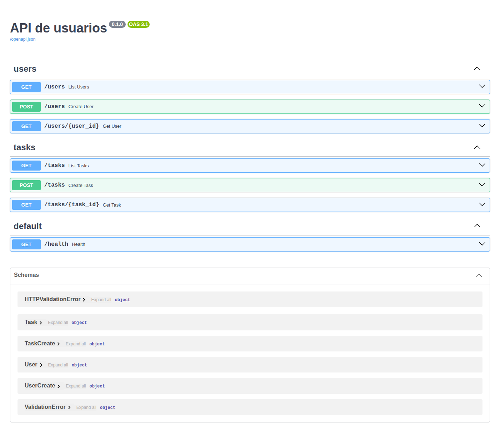
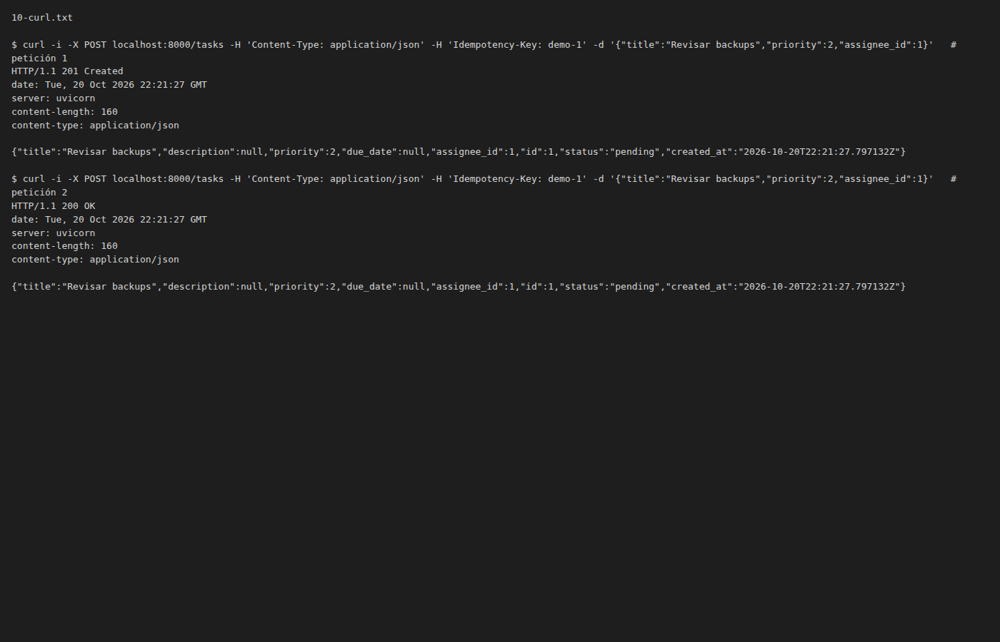
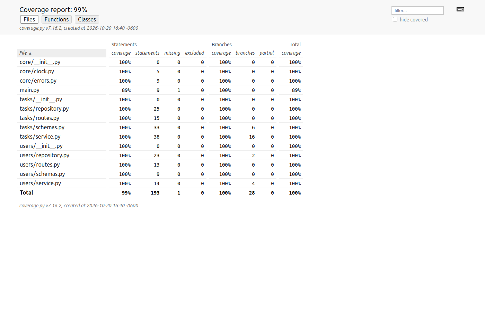
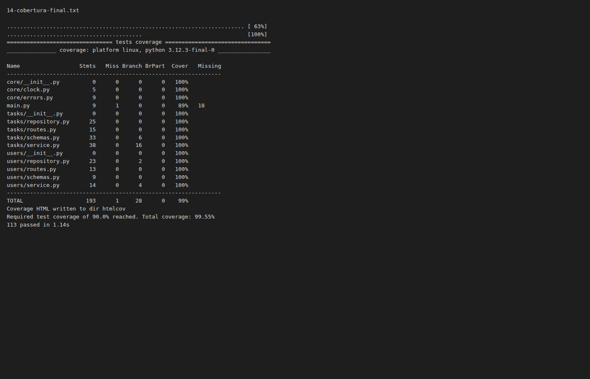
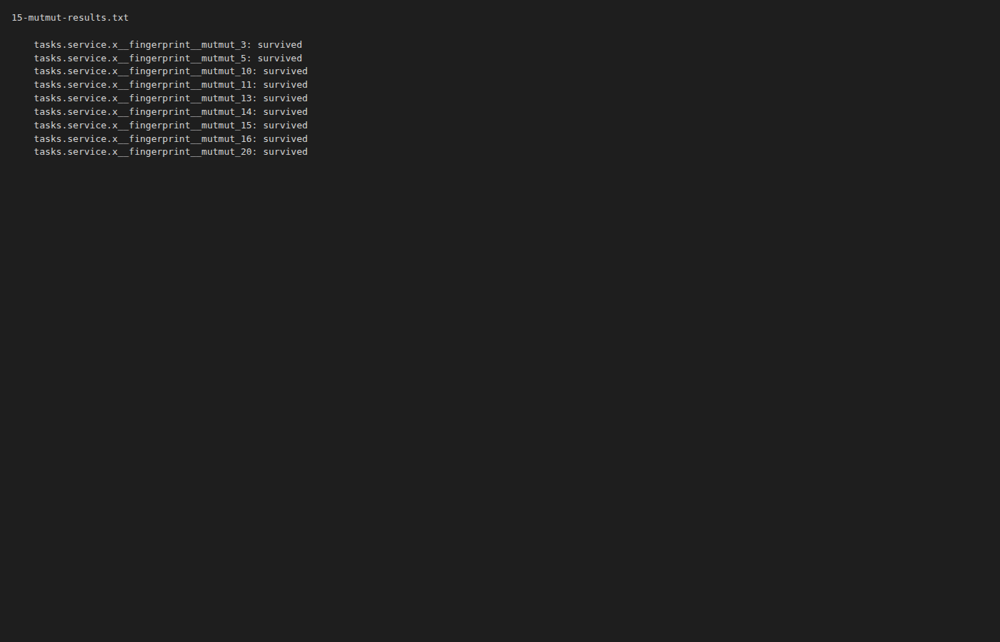
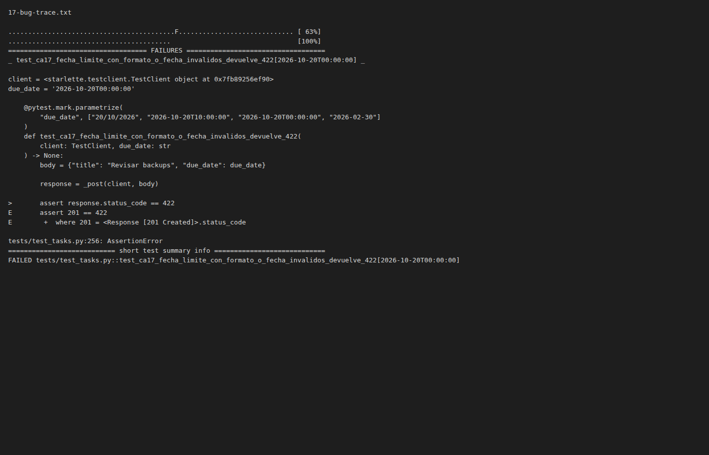
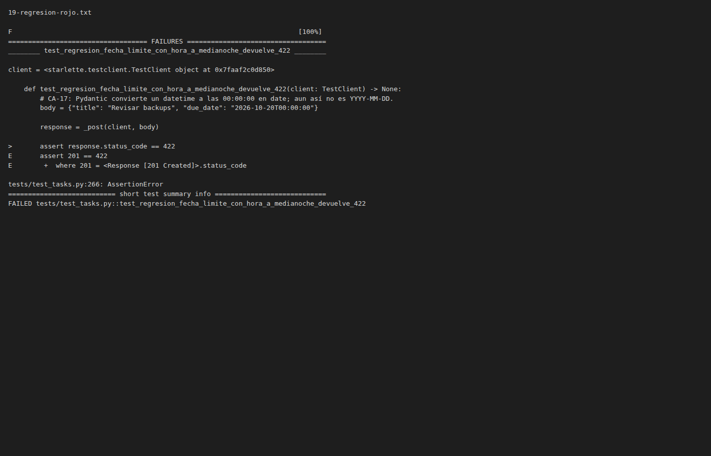
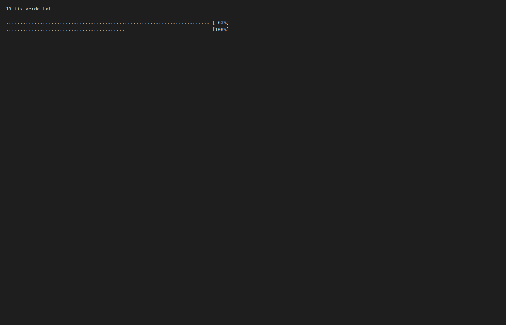

# Bitácora del reto M2 — recurso tasks

- **Fecha:** 2026-10-19
- **Rama:** feature/tasks
- **Herramienta:** Claude Code

## Paso P0 — Línea base del proyecto

- **Prompt usado:**

  ```text
  Antes de empezar el reto, verifica la línea base del proyecto sin tocar nada:
  ejecuta pytest -q, pytest --cov=. --cov-branch --cov-report=term-missing y ruff check .
  Dime si todo está en verde. Si algo falla, detente y explícame qué falla.
  ```

- **Qué propuso la IA:**
  - Ejecutó los tres comandos con `.venv` activado, sin modificar ningún archivo.
  - Informó que la línea base está en verde: 6 tests pasan, cobertura total 98 % y ruff sin avisos.
  - Señaló las dos líneas sin cubrir, que son huecos de cobertura previos y no fallos:
    `core/errors.py:20` (cuerpo de `invalid_request()`, el 422) y `main.py:16` (`GET /health`).
  - Propuso usar ese 98 % como referencia para comparar durante el reto.

  ```text
  Name                  Stmts   Miss Branch BrPart  Cover   Missing
  -----------------------------------------------------------------
  core/errors.py            7      1      0      0    86%   20
  main.py                   7      1      0      0    86%   16
  users/repository.py      23      0      2      0   100%
  users/routes.py          13      0      0      0   100%
  users/service.py         14      0      4      0   100%
  -----------------------------------------------------------------
  TOTAL                   113      2      6      0    98%
  6 passed in 0.11s
  ```

- **Qué acepté / rechacé y por qué:** Aceptado tras revisar que los tres comandos
  terminan con código de salida 0 y que las líneas sin cubrir no corresponden a fallos.
- **Iteraciones:** ninguna.
- **Validación:**
  - `pytest -q` → 6 tests sin fallos (`......  [100%]`). No aparece la línea de resumen
    porque `pyproject.toml` ya define `addopts = "-q"` y el `-q` extra la suprime.
    Log: [`logs/00-linea-base-tests.txt`](logs/00-linea-base-tests.txt)
  - `pytest --cov=. --cov-branch --cov-report=term-missing` → 6 passed, cobertura 98 %
    (faltan `core/errors.py:20` y `main.py:16`).
    Log: [`logs/00-linea-base-cobertura.txt`](logs/00-linea-base-cobertura.txt)
  - `ruff check .` → All checks passed!
    Log: [`logs/00-linea-base-ruff.txt`](logs/00-linea-base-ruff.txt)
- **Captura:** [P00-linea-base.png](capturas/P00-linea-base.png)
- **Commit:** `pendiente`

## Paso P1 — Exploración del repo

- **Prompt usado:**

  ```text
  Voy a añadir un recurso nuevo `tasks/` (gestión de tareas de equipo) a este proyecto.
  Antes de proponer nada, lee @CLAUDE.md, @main.py, @core/errors.py, @users/routes.py,
  @users/service.py, @users/schemas.py, @users/repository.py, @tests/conftest.py,
  @tests/test_users.py y @pyproject.toml.

  Resume en una lista:
  1. El patrón de capas y qué responsabilidad tiene cada archivo.
  2. Cómo se levantan los errores y qué formato tiene la respuesta de error.
  3. Cómo se aísla el estado entre tests.
  4. Las convenciones de nombres, estilo de tests y reglas de linting (pyproject.toml).
  5. Qué riesgos ves al añadir un segundo recurso (p. ej., estado compartido entre tests,
     orden de rutas, validaciones de Pydantic frente a errores de dominio).

  No cambies código todavía.
  ```

- **Qué propuso la IA:**
  - Capas: `routes.py` (solo `APIRouter` + `response_model=` y delega), `service.py` (reglas y
    errores, único que importa `repository`), `schemas.py` (`XBase` / `XCreate` / `X`) y
    `repository.py` (`dict` en memoria, `_next_id`, `_SEED`, `reset()`).
  - Errores: funciones de `core/errors.py` que devuelven `HTTPException` (404 / 422 / 409) con
    `{"detail": "<texto>"}`. Las validaciones de Pydantic también responden 422, pero con `detail` en forma de lista.
  - Aislamiento: fixture `autouse` `_reset_data` en `tests/conftest.py`, que hoy solo resetea `users`.
  - Convenciones: inglés + `snake_case`, mensajes en español, tests `test_<función>_<descripción>`
    con preparación, ejecución y comprobación separadas; ruff `E,F,I,UP,B`, líneas de 100 y py310.
  - Riesgos: reset de `tasks` en `conftest`, orden de rutas, ambigüedad del 422, referencias a
    `users` vía service, copia en updates (`model_copy`), ids dependientes de la semilla y falta
    de especificación de campos.

  ```python
  @pytest.fixture(autouse=True)
  def _reset_data():
      """Cada test arranca con los datos semilla y no contamina a los demás."""
      repository.reset()
      yield
      repository.reset()
  ```

- **Qué acepté / rechacé y por qué:** No rechacé nada del resumen. Pedí contrastarlo con una
  lista de control para asegurar que recogía todas las convenciones obligatorias de CLAUDE.md.
  Acepté la versión completada: confirmaba tres puntos, precisaba dos y añadía el que faltaba.
- **Iteraciones:**

  ```text
  Comprueba tu resumen contra esta lista y completa lo que falte: uso de response_model=
  en todas las rutas, catálogo core/errors.py (sin HTTPException a mano), repository.reset()
  invocado por una fixture autouse de conftest.py, rutas específicas antes que rutas con
  parámetro, y migrations/ y legacy/ fuera de límites. Dime qué puntos ya estaban y cuáles
  añadiste. No cambies código.
  ```

  → La IA indicó que ya estaban el `reset()` autouse y el orden de rutas (este último como
  riesgo), que estaban a medias `response_model=` y la prohibición de `HTTPException` a mano,
  y que faltaba `migrations/` y `legacy/` fuera de límites. También señaló que `GET /health`
  en `main.py` devuelve un `dict` crudo sin `response_model=` (excepción previa, no replicable).
  → Ajuste: el resumen queda completo con las cinco convenciones; sin cambios de código.
- **Validación:** ninguna (paso de solo lectura, sin comandos).
- **Captura:** N/A
- **Commit:** `pendiente`

## Paso P2 — Especificación y criterios de aceptación

- **Prompt usado:**

  ```text
  Este es el ticket de la feature. Redáctalo como documento en docs/feature-tasks.md
  con las secciones: Historia de usuario, Objetivo, Alcance (incluye / no incluye),
  Contrato de la API (request, response y códigos HTTP), Criterios de aceptación
  numerados (CA-01, CA-02, …) en formato Dado/Cuando/Entonces, y Ejemplos de uso con curl.

  Historia: Como miembro del equipo de operaciones quiero registrar tareas con
  responsable, prioridad y fecha límite para que ningún trabajo quede sin registrar
  y se pueda rastrear.

  Contrato:
  - POST /tasks — cuerpo: title (str, obligatorio), description (str, opcional,
    máx. 1000), priority (int 1–5, por defecto 3), due_date (fecha ISO YYYY-MM-DD,
    opcional), assignee_id (int, opcional). Cabecera opcional: Idempotency-Key (1–64 caracteres).
  - GET /tasks — lista; filtro opcional ?assignee_id=<id>.
  - GET /tasks/{task_id} — una tarea.
  - Respuesta Task: id, title, description, priority, due_date, assignee_id,
    status ("pending" al crear), created_at.

  Criterios:
  - 201 al crear, con la tarea en el cuerpo y status "pending".
  - title se recorta (strip); tras recortar debe tener 3–120 caracteres → si no, 422.
  - priority fuera de 1–5 o no entera → 422.
  - due_date anterior a hoy (UTC) → 422; hoy es válido.
  - assignee_id que no existe en users → 404.
  - Misma Idempotency-Key + mismo cuerpo → 200 con la MISMA tarea (no se duplica).
  - Misma Idempotency-Key + cuerpo distinto → 409.
  - Sin Idempotency-Key, dos POST iguales crean dos tareas.
  - GET /tasks/{id} inexistente → 404. GET /tasks?assignee_id=X devuelve solo las de X.
  - Mensajes de error en español, generados con core/errors.py.

  Después de escribir el documento, lista las ambigüedades o casos que NO cubren
  mis criterios (p. ej., límites exactos, tipos inesperados, zona horaria) como
  preguntas numeradas para mí. No asumas respuestas: pregúntame.
  ```

- **Qué propuso la IA:**
  - Redactó `docs/feature-tasks.md` con las seis secciones pedidas: historia, objetivo,
    alcance, contrato con tablas de request, response y códigos, 23 criterios Dado/Cuando/Entonces y ejemplos curl.
  - Añadió dos criterios derivados del contrato: formato inválido de `due_date` → 422 y
    `Idempotency-Key` vacía o de más de 64 caracteres → 422.
  - Planteó 15 preguntas abiertas: límites, tipos laxos de Pydantic, zona horaria,
    precedencia de errores, huella de idempotencia, fallos con clave, filtro con usuario
    inexistente, orden del listado, datos semilla e ids ≤ 0.
  - Tras las respuestas, añadió la sección "Decisiones" con 17 puntos y 5 decisiones
    conservadoras propias (A1–A5). Rellenó los `[AJUSTAR]` con `already_exists` (409) e
    `invalid_request` (fecha pasada) y amplió los criterios a CA-01…CA-43, todos con valores concretos.

  ```markdown
  **Orden de evaluación**

  1. Forma del cuerpo y de la cabecera → `422` (Pydantic, formato por defecto).
  2. `due_date` anterior a hoy → `422` (dominio, `errors.invalid_request`).
  3. Búsqueda de la `Idempotency-Key` → `200` (misma huella) o `409` (huella distinta).
  4. Existencia del responsable → `404` (`errors.not_found`).
  5. Creación → `201`; si hay clave, se guarda junto con la huella y la tarea.

  - **CA-27 — Huella normalizada.**
    - **Dado** un `POST` con `K` y `{"title": "Revisar"}` que devolvió `201`.
    - **Cuando** hago `POST` con `K` y `{"priority": 3, "title": " Revisar "}`.
    - **Entonces** recibo `200` con la misma tarea.
  ```

- **Qué acepté / rechacé y por qué:** Acepté la estructura del documento y las 15 preguntas.
  No dejé que la IA asumiera respuestas: las decidí yo para cerrar la especificación antes
  de implementar y para que cada CA fuera verificable con un test. Pedí aplicar la opción más
  conservadora en lo no cubierto. Acepté las decisiones A1–A5 que propuso la IA.
  - **Decisiones clave:**
    1. Límites de `title` → 3 y 120 inclusivos tras `strip`. Solo espacios → 422 con el
       mensaje por defecto de Pydantic. Si no es texto → 422.
    2. `description` → no se recorta, `""` es válido, omitida = `null`, el máximo de 1000 se
       cuenta sobre el valor recibido y no hay mínimo.
    3. Tipos de `priority` → entero estricto (`3.0`, `"3"`, `true`, `null` → 422). Omitida → 3.
    4. Formato y zona de `due_date` → solo `YYYY-MM-DD`; con hora o fecha inexistente → 422.
       "Hoy" = fecha UTC del servidor vía `core/clock.py`. Sin máximo. Omitida = `null`.
    5. `assignee_id` 0, negativo o `null` → 0 o negativo da 422; ≥ 1 inexistente da 404 con
       `errors.not_found`; `null` = sin responsable.
    6. Precedencia de errores → forma (422), fecha pasada (422), clave (200/409),
       responsable (404), creación. El 422 va antes que el 404.
    7. Campos desconocidos o asignados por el servidor → comportamiento por defecto de
       Pydantic, como en `users`; el servidor pone siempre los suyos.
    8. "Mismo cuerpo" → huella sobre el cuerpo validado y normalizado; no importa el orden
       de claves; `" Revisar "` = `"Revisar"`.
    9. Primera petición con clave que falla → la clave no se guarda (solo tras 201). Cuerpo
       inválido con clave usada → 422.
    10. Alcance de la clave → global, sin caducidad, limpiada por `reset()`, sin `strip`,
        sensible a mayúsculas, 1–64 caracteres por `len()`.
    11. Respuesta repetida → 200 con la Task idéntica. Huella distinta → 409 con la función
        de conflicto del catálogo, sin funciones nuevas.
    12. Filtro con usuario inexistente → 200 `[]` (también 0 y negativos). No entero → 422.
    13. Orden del listado → `id` ascendente.
    14. Datos semilla → almacén vacío; `reset()` vacía tareas y claves.
    15. `GET /tasks/{task_id}` ≤ 0 → 404. No entero → 422.
    - Además: `status` solo `"pending"`, `created_at` en UTC ISO 8601. El 422 de fecha
      pasada se valida en el service con `core/errors.py`.
- **Iteraciones:**

  ```text
  Mis decisiones a tus preguntas (siguen tu numeración):

  1. title
     - Los límites 3 y 120 son inclusivos y se miden tras strip.
     - Título solo de espacios → 422 (queda con longitud 0). Mensaje: el de Pydantic por
       defecto, igual que en users; no hay mensaje propio en español para errores de forma.
     - title que no sea string (número, null) → 422.

  2. description
     - No se le quitan los espacios de los extremos (a diferencia de title); se guarda tal
       cual.
     - "" es válido y se guarda como "". Omitida y null son equivalentes (se guarda null).
     - El máximo de 1000 se cuenta sobre el valor recibido, sin recortar.
     - Sin longitud mínima.

  3. priority
     - Entero estricto: 3.0, 3.5, "3", "alta", true y null → 422.
     - Omitida → 3. Rango 1–5 (0 o 6 → 422).

  4. due_date
     - Solo YYYY-MM-DD. Un datetime con hora → 422, y una fecha inexistente (2026-02-30)
       también.
     - "Hoy" es la fecha UTC del servidor al recibir la petición, calculada con una función
       de core/clock.py, aunque el cliente esté en otra zona horaria. Hoy es válido, ayer → 422.
     - Sin fecha máxima. Omitida y null son equivalentes (se guarda null).

  5. assignee_id
     - 0 o negativo → 422 (forma, no 404). Entero ≥ 1 que no existe en users → 404 con
       errors.not_found.
     - null explícito se acepta y equivale a omitido (tarea sin responsable).

  6. Varios errores a la vez
     - Orden: (1) forma de cuerpo y cabecera → 422; (2) fecha pasada → 422; (3) búsqueda de
       Idempotency-Key → 200 o 409; (4) existencia del responsable → 404; (5) creación.
     - Título corto + responsable inexistente → 422. Fecha pasada + responsable inexistente
       → 422 (el 422 va antes que el 404).

  7. Campos desconocidos o asignados por el servidor (status, id, created_at, foo)
     - Mismo comportamiento que users (el de Pydantic por defecto). Los campos que asigna el
       servidor enviados por el cliente nunca se usan: el servidor siempre pone los suyos.

  8. Idempotencia, "mismo cuerpo"
     - La huella se calcula sobre el cuerpo YA validado y normalizado (tras strip y valores
       por defecto). El orden de claves no importa.
     - {"title":"x"} y {"title":"x","priority":3} son el mismo cuerpo. También " Revisar " y
       "Revisar".

  9. Idempotencia cuando la primera petición falla
     - Si la primera petición con la clave K falla (422 o 404), la clave NO se guarda. Solo
       se guarda tras un 201.
     - Una petición válida posterior con K crea la tarea (201).
     - Cuerpo inválido con una clave ya usada → 422 (no 200 ni 409).

  10. Idempotencia, alcance y duración
      - Clave global (no hay usuarios), sin caducidad. Almacén en memoria que se limpia con
        reset().
      - Sin restricción de caracteres y sin strip. Sensible a mayúsculas ("abc" ≠ "ABC").
      - Longitud 1–64; el límite cuenta caracteres (len()), no bytes. Vacía o más larga → 422.

  11. Idempotencia, respuesta repetida
      - Misma clave + misma huella → 200 con la misma Task, idéntica a la original (mismo id
        y mismo created_at), sin crear tarea nueva.
      - Misma clave + huella distinta → 409 con mensaje en español del catálogo. Se reutiliza
        la función de core/errors.py que ya sirva para conflictos (already_exists u otra
        equivalente); no se añade ninguna nueva. [AJUSTAR: nombre real de la función]

  12. GET /tasks?assignee_id=X con un usuario inexistente → 200 con lista vacía (es un
      filtro, no una consulta del usuario). Vale también para 0 y negativos. Solo un valor
      no entero → 422.

  13. Orden del listado: por id ascendente.

  14. Datos semilla: el almacén de tareas arranca vacío. reset() vacía tareas y claves de
      idempotencia. GET /tasks sin tareas → 200 con [].

  15. GET /tasks/{task_id} con task_id ≤ 0 → 404 (es un entero que no corresponde a ninguna
      tarea). Solo un valor no entero → 422.

  Otras:
  - status: solo "pending" en este sprint; created_at en UTC, formato ISO 8601.
  - El 422 por fecha pasada se valida en el service y su detail sale de una función de
    core/errors.py en español; el resto de 422 de forma usan el formato por defecto de
    Pydantic. [AJUSTAR: nombre de esa función]

  Para cualquier pregunta que no esté aquí, aplica la opción más conservadora y coherente
  con estas decisiones. Añade al documento una sección "Decisiones" con todas ellas y
  asegúrate de que cada criterio CA-XX sea verificable con un test.
  ```

  → La IA añadió la sección "Decisiones" (1–17) y "Decisiones propuestas por la IA y
  aceptadas":
  - A1: `assignee_id` es un entero estricto.
  - A2: repetir con clave cuando la fecha ya ha pasado → 422.
  - A3: el 404 dice "tarea no encontrado" porque se usa el catálogo sin cambios.
  - A4: el recorte es `str.strip()`.
  - A5: la huella solo incluye los cinco campos de entrada.

  Concretó los `[AJUSTAR]` como `errors.already_exists("clave de idempotencia", <clave>)` y
  `errors.invalid_request("la fecha límite no puede ser anterior a hoy (UTC)")`.
  → Ajuste: contrato con tipos estrictos, orden de evaluación y doble formato de 422; los
  criterios pasan de 23 a 43 (CA-01…CA-43), con el reloj fijado en `2026-10-20` para los de fecha.
- **Validación:** ninguna (paso de especificación, sin comandos).
- **Captura:** N/A
- **Commit:** `docs: especificación y criterios de aceptación de tasks`

## Paso P3 — Convenciones en CLAUDE.md

- **Prompt usado:**

  ```text
  Actualiza @CLAUDE.md para incorporar el recurso `tasks/` sin romper lo existente:
  1. En "Estructura", añade `tasks/` con el mismo patrón de 4 archivos y
     `tests/test_tasks.py`. Añade `core/clock.py` y `docs/` (especificaciones y ADR).
  2. En "Convenciones", añade:
     - La lógica que depende de la fecha actual no llama a `date.today()` ni a
       `datetime.now()` directamente: usa una función de `core/clock.py` para poder
       mockearla en los tests.
     - Las validaciones de forma (tipos, rangos, longitudes) van en los schemas
       Pydantic; las reglas de dominio (fecha pasada, responsable inexistente,
       idempotencia) van en service.py con core/errors.py.
     - Un recurso consulta otro recurso a través de su service.py, nunca de su repository.py.
     - Todo repositorio nuevo expone `reset()` y conftest.py lo invoca.
     - Docstrings estilo Google en las funciones públicas de service.py.
  3. En "Cómo ejecutar", añade la cobertura de ramas
     (`pytest --cov --cov-branch --cov-report=term-missing`) y el mutation testing.
  4. Añade una sección "Definición de hecho": tests en verde, cobertura >90 % en
     tasks/, `ruff check .` limpio, docstrings, README y CHANGELOG actualizados.

  Mantén el tono y el formato del archivo y no borres ninguna regla existente.
  Aplica el cambio y muéstrame el diff.
  ```

- **Qué propuso la IA:**
  - En "Estructura" añadió `tasks/` (mismo patrón de 4 archivos), `core/clock.py` como único
    punto que consulta la fecha del sistema, `docs/` (especificaciones y ADR) y los nombres
    `test_users.py` y `test_tasks.py` en la línea de `tests/`.
  - En "Convenciones" añadió las cinco reglas pedidas al final de la lista, sin tocar las existentes.
  - En "Cómo ejecutar" añadió la cobertura de ramas y `mutmut run` / `mutmut results` para
    mutation testing. Avisó de que no verificó que `mutmut` esté instalado.
  - Creó la sección "Definición de hecho" entre "Cómo ejecutar" y "Fuera de límites". Avisó
    de que `CHANGELOG.md` aún no existe.
  - Diff de `CLAUDE.md`:

  ```diff
  diff --git a/CLAUDE.md b/CLAUDE.md
  index 747ece0..c00e925 100644
  --- a/CLAUDE.md
  +++ b/CLAUDE.md
  @@ -11,8 +11,13 @@ el proyecto corre sin infraestructura.
     - `service.py` — lógica de negocio. Única capa que habla con `repository.py`.
     - `schemas.py` — modelos Pydantic de entrada (`*Create`) y salida.
     - `repository.py` — acceso a datos (aquí, un `dict` en memoria).
  +- `tasks/` — tareas de equipo. Mismo patrón de 4 archivos que `users/`
  +  (`routes.py`, `service.py`, `schemas.py`, `repository.py`).
   - `core/errors.py` — catálogo de errores. Toda respuesta de error sale de aquí.
  -- `tests/` — un archivo por recurso: `test_<recurso>.py`.
  +- `core/clock.py` — reloj de la aplicación (fecha actual en UTC). Único punto que consulta
  +  la fecha del sistema.
  +- `docs/` — especificaciones de features (`feature-<recurso>.md`) y ADR.
  +- `tests/` — un archivo por recurso: `test_<recurso>.py` (`test_users.py`, `test_tasks.py`).
   
   ## Convenciones
   
  @@ -25,6 +30,14 @@ el proyecto corre sin infraestructura.
     feliz y un caso de error.
   - Rutas específicas antes que rutas con parámetro: `/users/search` debe declararse
     **antes** de `/users/{user_id}`.
  +- La lógica que depende de la fecha actual no llama a `date.today()` ni a `datetime.now()`
  +  directamente: usa una función de `core/clock.py` para poder mockearla en los tests.
  +- Las validaciones de forma (tipos, rangos, longitudes) van en los schemas Pydantic. Las
  +  reglas de dominio (fecha pasada, responsable inexistente, idempotencia) van en `service.py`
  +  con `core/errors.py`.
  +- Un recurso consulta otro recurso a través de su `service.py`, nunca de su `repository.py`.
  +- Todo repositorio nuevo expone `reset()` y la fixture autouse de `tests/conftest.py` lo invoca.
  +- Docstrings estilo Google en las funciones públicas de `service.py`.
   
   ## Cómo ejecutar
   
  @@ -36,9 +49,22 @@ pip install -r requirements.txt
   uvicorn main:app --reload          # API en http://127.0.0.1:8000  ·  /docs para el Swagger
   pytest                             # tests
   pytest --cov=. --cov-report=term-missing   # cobertura
  +pytest --cov --cov-branch --cov-report=term-missing   # cobertura de ramas
   ruff check .                       # linter
  +mutmut run                         # mutation testing
  +mutmut results                     # mutantes supervivientes
   ```
   
  +## Definición de hecho
  +
  +Un cambio está hecho cuando:
  +
  +- `pytest` está en verde.
  +- La cobertura de `tasks/` supera el 90 % (`pytest --cov=tasks --cov-branch`).
  +- `ruff check .` está limpio.
  +- Las funciones públicas de `service.py` tienen docstrings estilo Google.
  +- `README.md` y `CHANGELOG.md` están actualizados.
  +
   ## Fuera de límites
   
   - `migrations/` y `legacy/` — no modificar.
  ```

- **Qué acepté / rechacé y por qué:**
  - Rechacé la primera ejecución de la IA. Antes de editar, quiso consultar `requirements.txt`
    y los paquetes instalados (`pip list`) para identificar la herramienta de mutation testing.
    Interrumpí esa llamada y reenvié la misma petición. Motivo: [PENDIENTE].
  - Acepté el diff tras revisar que conserva intactas las reglas de `response_model=`, del
    orden de rutas y de `migrations/` y `legacy/`.
  - Registré como decisión del paso el patrón de generación (ver sub-sección).

  ### Patrón elegido (1.c)

  - **Patrón:**
    - Skeleton-first para la estructura: `tasks/schemas.py`, `tasks/repository.py` con
      `reset()`, `tasks/service.py`, `tasks/routes.py`, `core/clock.py`, router en `main.py`
      y reset en `conftest.py`.
    - Seguido de test-first para las reglas.
    - Todo con cadencia incremental: un criterio por iteración y un commit por paso.
  - **Justificación:**
    - Skeleton-first, porque es una feature nueva con varias piezas (schemas, repositorio,
      service, rutas y reloj) y conviene fijar antes la estructura.
    - Test-first para las reglas, porque son verificables y están en los criterios CA-XX de
      `docs/feature-tasks.md`.
    - Incremental, para que cada paso sea pequeño, revisable y quede en verde.
  - **Señales de alarma:**
    - Skeleton-first → que el esqueleto traiga lógica (validaciones, reglas de dominio,
      idempotencia) en vez de solo firmas, modelos y conexiones entre capas.
    - Test-first → que los tests se escriban leyendo el código y no los criterios. Cada test
      debe citar su CA-XX y usar los valores del documento.
    - Incremental → pasos que mezclen varias reglas, o commits sin tests en verde.

- **Iteraciones:**

  ```text
  Revisa tu diff: confirma que siguen intactas la regla del orden de rutas, la de
  migrations/ y legacy/ fuera de límites y la de response_model=. Si alguna se perdió,
  restáurala.
  Además, registra como decisión de este paso el patrón de generación elegido:
  skeleton-first para la estructura (feature nueva con varias piezas: schemas,
  repositorio, service, rutas y reloj), seguido de test-first para las reglas (son
  verificables y están en los criterios), todo con cadencia incremental (un criterio por
  iteración y un commit por paso). Señales de alarma que vigilaré: skeleton-first → que el
  esqueleto traiga lógica; test-first → que los tests se escriban leyendo el código y no
  los criterios; incremental → pasos que mezclen varias reglas o commits sin tests en verde.
  ```

  → La IA comprobó con `grep` que las tres reglas siguen en `CLAUDE.md` (líneas 24, 31-32 y
  70) y que la única línea borrada del diff es la de `tests/`, reemplazada por una versión
  ampliada. No restauró nada porque no faltaba nada. Anotó el patrón de generación y sus
  señales de alarma como decisión del paso.
  → Ajuste: ninguno en `CLAUDE.md`; el patrón queda registrado en esta entrada.
- **Validación:** `pytest -q` → 6 tests sin fallos (`......  [100%]`, exit 0); el cambio
  es solo de documentación y no altera la suite.
  Log: [`logs/03-tests.txt`](logs/03-tests.txt)
- **Captura:** N/A
- **Commit:** `docs(claude): convenciones para el recurso tasks`

## Paso P4 — Skeleton-first: esqueleto de tasks

- **Prompt usado:**

  ```text
  Lee @CLAUDE.md, @docs/feature-tasks.md y usa como ejemplo @users/routes.py,
  @users/service.py, @users/schemas.py y @users/repository.py.

  Crea SOLO el esqueleto del recurso tasks, sin implementar lógica:
  - core/clock.py con `def today() -> date:` (TODO).
  - tasks/__init__.py
  - tasks/schemas.py: TaskBase, TaskCreate, Task con los campos y tipos del contrato
    (sin validadores todavía; deja TODOs donde irían).
  - tasks/repository.py: firmas add, get, list_all, list_by_assignee,
    find_by_idempotency_key, save_idempotency_key y reset, con `raise NotImplementedError`
    y TODOs.
  - tasks/service.py: firmas create_task, get_task, list_tasks con TODOs que nombren
    el criterio CA-XX que implementará cada parte.
  - tasks/routes.py: APIRouter(prefix="/tasks", tags=["tasks"]) con las 3 rutas,
    response_model y status_code, leyendo la cabecera Idempotency-Key con Header(...)
    y delegando en service.

  No registres el router en main.py todavía. No implementes nada: si una función
  tiene lógica, el esqueleto está mal. Al final ejecuta ruff check . y pytest -q y lista
  los archivos creados y los TODOs.
  ```

- **Qué propuso la IA:**
  - Un plan (modo plan) con los 6 archivos, las firmas y los CA-XX de cada TODO, siguiendo
    el patrón de `users/`.
  - `core/clock.py` con `today() -> date` y `tasks/__init__.py` vacío.
  - `tasks/schemas.py`: `TaskBase` (`title: str`, `description: str | None`,
    `priority: int = 3`, `due_date: date | None`, `assignee_id: int | None`), `TaskCreate` y
    `Task` (`id`, `status`, `created_at`), con TODOs de validación por campo.
  - `tasks/repository.py` y `tasks/service.py`: firmas con `raise NotImplementedError`,
    docstrings Google en el service y TODOs en el orden de evaluación del contrato.
  - `tasks/routes.py`: 3 rutas con `response_model=`, `POST` con 201 y cabecera
    `Header(default=None, alias="Idempotency-Key")` (opcional, según CA-33).
  - Dejó fuera del paso `main.py` y la llamada a `reset()` en `conftest.py`, porque
    `NotImplementedError` rompería los tests de `users`.

  ```python
  @router.post("", response_model=Task, status_code=status.HTTP_201_CREATED)
  def create_task(
      data: TaskCreate,
      # TODO(CA-32): min_length=1, max_length=64 en el Header.
      idempotency_key: str | None = Header(default=None, alias="Idempotency-Key"),
  ) -> Task:
      # TODO(CA-26, CA-27): responder 200 (no 201) en una repetición idempotente.
      return service.create_task(data, idempotency_key)
  ```

- **Qué acepté / rechacé y por qué:**
  - Aprobé el plan antes de que se escribiera código.
  - Pedí una revisión con una lista de comprobación (sin lógica, nombres, tipos y
    `Header(...)`) para vigilar la señal de alarma de skeleton-first: que el esqueleto traiga
    lógica.
  - Rechacé el desempaquetado `task, created = service.create_task(...)` en la ruta y el
    retorno `tuple[Task, bool]` del service, por ser lógica en un esqueleto.
  - La cabecera queda opcional (`Header(default=None, alias=...)`) en lugar de `Header(...)`
    literal, que la haría obligatoria y contradiría CA-33. Es una decisión propuesta por la
    IA y aceptada.

- **Iteraciones:**

  ```text
  Revisa tu esqueleto con esta lista y corrige lo que no cumpla, diciéndome qué cambiaste:
  1. ¿Alguna función tiene lógica (if, bucles, cálculos, acceso real a datos)? Si sí,
     vacíala: el esqueleto debe estar "más vacío".
  2. Nombres en inglés y snake_case, sin abreviaturas, como en users/.
  3. Tipos: due_date: date | None, assignee_id: int | None, priority: int.
  4. La ruta POST lee Idempotency-Key con Header(...) y no contiene lógica.
  Vuelve a ejecutar ruff check . y pytest -q.
  ```

  → La IA encontró lógica en la ruta `POST` (el desempaquetado de la tupla). Confirmó que
  los nombres y los tipos ya cumplían, y explicó por qué la cabecera usa
  `Header(default=None, alias="Idempotency-Key")`.
  → Ajuste: la ruta queda como `return service.create_task(...)` con un TODO(CA-26, CA-27);
  `create_task` devuelve `Task` en lugar de `tuple[Task, bool]`.

- **Validación:**
  - `ruff check .` → `All checks passed!`. Log: [`logs/04-ruff.txt`](logs/04-ruff.txt)
  - `pytest -q` → 6 tests sin fallos (`......  [100%]`), todos de `users`; `tasks` aún no
    está montado. Log: [`logs/04-tests.txt`](logs/04-tests.txt)
- **Captura:** N/A
- **Commit:** `feat(tasks): esqueleto del recurso`

## Paso P5 — Test-first: tests de aceptación en rojo

- **Prompt usado:**

  ```text
  Escribe tests/test_tasks.py a partir de los criterios de @docs/feature-tasks.md,
  NO del código. Sigue el estilo de @tests/test_users.py y reutiliza @tests/conftest.py
  (no inventes fixtures paralelas).

  Reglas:
  - Un test por criterio CA-XX, con nombre descriptivo en español que incluya el id
    (p. ej. test_ca03_titulo_con_solo_espacios_devuelve_422).
  - Arrange / act / assert separados por una línea en blanco.
  - Aserciones específicas: status code + el campo del cuerpo que demuestra el criterio
    (nada de `is not None` como única aserción).
  - Para la fecha, NO dependas del día real: fija "hoy" con monkeypatch sobre
    core.clock.today (p. ej. 2026-01-15) y prueba ayer (422), hoy (201) y mañana (201).
  - Incluye los límites: title de 2, 3, 120 y 121 caracteres; priority 0, 1, 5, 6 y
    "alta"; assignee_id inexistente; idempotencia (misma clave y mismo cuerpo, misma
    clave y cuerpo distinto, sin clave).

  Añade al conftest la fixture que resetee también el repositorio de tasks. Si
  tasks.repository.reset() aún lanza NotImplementedError, implementa SOLO reset() para no
  romper los tests de users. No implementes nada más en tasks/. Ejecuta pytest y
  muéstrame que los tests nuevos fallan por la razón correcta (NotImplementedError o 404
  de ruta inexistente), no por errores de sintaxis, y que los de users siguen en verde.
  ```

- **Qué propuso la IA:**
  - Un plan (modo plan) con los 43 tests, uno por CA. Los CA con varios valores usan
    `@pytest.mark.parametrize`, lo que da 81 casos.
  - Implementar solo `tasks.repository.reset()`, que vacía las tareas y las claves y
    reinicia `_next_id`.
  - Ampliar la fixture autouse `_reset_data` de `tests/conftest.py` para que resetee `users`
    y `tasks`, sin fixtures paralelas.
  - Fijar "hoy" en `2026-10-20` (la fecha de los criterios, en lugar de la `2026-01-15` del
    ejemplo) con una fixture autouse en `test_tasks.py`; CA-19 la cambia a `2026-10-21`.
  - Comprobar los 404 de dominio con el texto `"no encontrado"`, para que no pasen con el
    404 genérico `"Not Found"` mientras el router no está montado.
  - Mantener el router fuera de `main.py`: todos los tests de tasks fallan con 404 de ruta.

  ```python
  TODAY = date(2026, 10, 20)


  @pytest.fixture(autouse=True)
  def _fixed_today(monkeypatch: pytest.MonkeyPatch) -> None:
      """Los criterios con fecha parten de hoy = 2026-10-20 (UTC)."""
      monkeypatch.setattr("core.clock.today", lambda: TODAY)


  def test_ca16_fecha_limite_ayer_devuelve_422_con_detalle_en_texto(client: TestClient) -> None:
      body = {"title": "Revisar backups", "due_date": "2026-10-19"}

      response = _post(client, body)

      assert response.status_code == 422
      assert "anterior a hoy" in response.json()["detail"]
  ```

- **Qué acepté / rechacé y por qué:**
  - Aprobé el plan antes de que se escribiera código.
  - Acepté fijar "hoy" en `2026-10-20` en lugar de `2026-01-15`, para que los valores de los
    tests coincidan con los de los criterios. Es una decisión propuesta por la IA y aceptada.
  - Acepté que el router siga fuera de `main.py`, de modo que la razón del rojo sea el 404 de
    ruta inexistente.
  - Antes de dar los tests por buenos pedí una verificación (cobertura CA → test, límites a
    ambos lados y que no se use la fecha real), para vigilar la señal de alarma de test-first:
    que los tests salgan del código y no de los criterios.

- **Iteraciones:**

  ```text
  Antes de dar los tests por buenos, verifica: (1) cada CA-XX de @docs/feature-tasks.md
  tiene al menos un test que lo nombra; dame la tabla CA → test; (2) los límites están a
  ambos lados (ayer/hoy, 2/3 y 120/121 caracteres, priority 0/1 y 5/6); (3) ningún test
  usa la fecha real. Añade lo que falte sin implementar código de producción y vuelve a
  ejecutar pytest -q.
  ```

  → La IA cruzó con un script los 43 `CA-XX —` de la especificación con las funciones
  `test_caXX_` y no faltaba ninguno. Confirmó los límites a ambos lados: fecha
  `2026-10-19`/`2026-10-20`/`2026-10-21`, `title` 2/3 y 120/121, `priority` 0/1 y 5/6, y
  además `description` 1000/1001, clave 1/64 frente a vacía/65 y `assignee_id` 0/1. Con
  `grep` comprobó que no hay `date.today`, `datetime.now`, `utcnow` ni `time.time` en `tests/`.
  → Ajuste: ninguno; no faltaba nada. Se repitió `pytest -q` con el mismo resultado.

  **Tabla CA → test** (`tests/test_tasks.py`):

  | CA | Test |
  |---|---|
  | CA-01 | `test_ca01_creacion_minima_devuelve_201_con_valores_por_defecto` |
  | CA-02 | `test_ca02_creacion_completa_devuelve_los_valores_enviados` |
  | CA-03 | `test_ca03_ignora_campos_del_servidor_y_desconocidos` |
  | CA-04 | `test_ca04_titulo_se_recorta` |
  | CA-05 | `test_ca05_titulo_en_los_limites_3_y_120_devuelve_201` |
  | CA-06 | `test_ca06_titulo_corto_o_vacio_devuelve_422` |
  | CA-07 | `test_ca07_titulo_de_121_caracteres_devuelve_422` |
  | CA-08 | `test_ca08_titulo_ausente_o_no_texto_devuelve_422` |
  | CA-09 | `test_ca09_descripcion_se_guarda_tal_cual` |
  | CA-10 | `test_ca10_descripcion_omitida_o_null_se_guarda_null` |
  | CA-11 | `test_ca11_descripcion_maximo_1000_sobre_el_valor_recibido` |
  | CA-12 | `test_ca12_prioridad_por_defecto_3_y_limites_1_y_5` |
  | CA-13 | `test_ca13_prioridad_fuera_de_rango_devuelve_422` |
  | CA-14 | `test_ca14_prioridad_no_entera_estricta_devuelve_422` |
  | CA-15 | `test_ca15_fecha_limite_hoy_o_futura_devuelve_201` |
  | CA-16 | `test_ca16_fecha_limite_ayer_devuelve_422_con_detalle_en_texto` |
  | CA-17 | `test_ca17_fecha_limite_con_formato_o_fecha_invalidos_devuelve_422` |
  | CA-18 | `test_ca18_fecha_limite_omitida_o_null_se_guarda_null` |
  | CA-19 | `test_ca19_la_referencia_es_el_reloj_del_servidor` |
  | CA-20 | `test_ca20_responsable_existente_devuelve_201` |
  | CA-21 | `test_ca21_responsable_inexistente_devuelve_404` |
  | CA-22 | `test_ca22_responsable_con_forma_invalida_devuelve_422` |
  | CA-23 | `test_ca23_responsable_null_explicito_queda_sin_responsable` |
  | CA-24 | `test_ca24_la_forma_gana_al_responsable_inexistente` |
  | CA-25 | `test_ca25_la_fecha_pasada_gana_al_responsable_inexistente` |
  | CA-26 | `test_ca26_misma_clave_y_mismo_cuerpo_devuelve_200_con_la_misma_tarea` |
  | CA-27 | `test_ca27_la_huella_se_calcula_sobre_el_cuerpo_normalizado` |
  | CA-28 | `test_ca28_misma_clave_y_cuerpo_distinto_devuelve_409` |
  | CA-29 | `test_ca29_un_fallo_no_guarda_la_clave` |
  | CA-30 | `test_ca30_cuerpo_invalido_con_clave_usada_devuelve_422` |
  | CA-31 | `test_ca31_la_clave_distingue_mayusculas` |
  | CA-32 | `test_ca32_longitud_de_la_clave_entre_1_y_64` |
  | CA-33 | `test_ca33_sin_clave_no_hay_deduplicacion` |
  | CA-34 | `test_ca34_listado_vacio_devuelve_lista_vacia` |
  | CA-35 | `test_ca35_listado_completo_ordenado_por_id` |
  | CA-36 | `test_ca36_filtro_por_responsable_devuelve_solo_sus_tareas` |
  | CA-37 | `test_ca37_filtro_sin_coincidencias_devuelve_lista_vacia` |
  | CA-38 | `test_ca38_filtro_no_entero_devuelve_422` |
  | CA-39 | `test_ca39_consultar_tarea_existente_devuelve_la_misma_tarea` |
  | CA-40 | `test_ca40_consultar_tarea_inexistente_devuelve_404` |
  | CA-41 | `test_ca41_task_id_no_entero_devuelve_422` |
  | CA-42 | `test_ca42_reset_limpia_tareas_y_claves` |
  | CA-43 | `test_ca43_errores_de_dominio_en_texto_y_de_forma_en_lista` |

- **Validación:**
  - `pytest -q` → 81 casos de `tests/test_tasks.py` en rojo (43 tests) y 6 de `users` en
    verde. Todos los rojos se deben al 404 de ruta inexistente: `assert 404 == 422` (38),
    `assert 404 == 201` (31), `assert 404 == 200` (6), `'no encontrado' in 'Not Found'` (4),
    `{'detail': 'Not Found'} == []` (1) y `KeyError: 'id'` porque el cuerpo del 404 no trae
    `id` (1). No hay errores de colección, `SyntaxError` ni `ImportError`.
    Log: [`logs/05-tests-rojos.txt`](logs/05-tests-rojos.txt)
  - `ruff check .` → `All checks passed!` (ejecutado en el paso; sin log propio).
- **Captura:** 
- **Commit:** `test(tasks): tests de aceptación (rojo)`

## Paso P6 — Incremental 1: happy path

- **Prompt usado:**

  ```text
  Implementa SOLO lo necesario para que pasen los tests del happy path:
  crear tarea (CA de 201 con status "pending"), GET /tasks/{id} existente e
  inexistente (404) y GET /tasks. Registra el router en @main.py siguiendo cómo se
  registra users_router. Implementa core/clock.py (hoy en UTC).

  No implementes validaciones, idempotencia ni assignee todavía. Fix mínimo:
  no toques los tests. Luego ejecuta pytest -q y ruff check . y dime qué tests pasan
  y cuáles siguen en rojo (deben ser los de las reglas pendientes).
  ```

- **Qué propuso la IA:**
  - Un plan (modo plan) con los cambios mínimos y la previsión de qué tests pasarían a verde
    y cuáles seguirían en rojo.
  - Registrar `tasks_router` en `main.py` igual que `users_router`.
  - En `core/clock.py`, `today()` en UTC y además `now()` para `created_at`, porque
    `CLAUDE.md` dice que `core/clock.py` es el único punto que consulta la fecha del sistema.
  - En `tasks/repository.py`, implementar `add` (con `status="pending"`), `get` y `list_all`
    con el patrón de `users`. `list_by_assignee` y las funciones de idempotencia siguen en
    `NotImplementedError`.
  - En `tasks/service.py`, `create_task` delega en `repository.add` sin comprobaciones,
    `get_task` da 404 con `errors.not_found` y `list_tasks` sin filtro llama a `list_all`.
  - No tocar `routes.py`, `schemas.py` ni los tests.

  ```python
  def get_task(task_id: int) -> Task:
      task = repository.get(task_id)
      if task is None:
          raise errors.not_found("tarea", task_id)
      return task


  def list_tasks(assignee_id: int | None) -> list[Task]:
      if assignee_id is None:
          return repository.list_all()
      # TODO(CA-36, CA-37): implementar repository.list_by_assignee (sin comprobar que el
      #     usuario exista).
      return repository.list_by_assignee(assignee_id)
  ```

- **Qué acepté / rechacé y por qué:**
  - Aprobé el plan antes de que se escribiera código.
  - Acepté añadir `clock.now()`, que no estaba pedido, para cumplir la regla de `CLAUDE.md`
    sobre el único punto de consulta de la fecha. Es una decisión propuesta por la IA y
    aceptada.
  - Acepté que el filtro por responsable siga llamando a `list_by_assignee` sin implementar,
    para que CA-36/37 queden en rojo con `NotImplementedError` explícito.
  - Pedí revisar el diff contra cuatro condiciones (ruta sin lógica, 404 desde
    `core/errors.py`, `reset()` reinicia ids, tests intactos) antes de darlo por bueno.

- **Iteraciones:**

  ```text
  Revisa tu diff completo y confírmame punto por punto, corrigiendo lo que no cumpla:
  la ruta no tiene lógica; los 404 salen de core/errors.py; repository.reset() reinicia
  también el contador de ids; no se tocó ningún test. Vuelve a ejecutar pytest -q.
  ```

  → La IA confirmó los cuatro puntos:
  - `tasks/routes.py` no está en el diff y sus rutas son un solo `return service...`.
  - El único 404 de tasks es `errors.not_found("tarea", task_id)`; no hay ningún
    `HTTPException` en `tasks/`.
  - `reset()` pone `_next_id = 1`, y lo confirman CA-01 y CA-42.
  - `git diff -- tests/` sale vacío.

  → Ajuste: ninguno. Se repitió `pytest -q` con el mismo resultado.

- **Validación:**
  - `pytest -q` → 48 verdes y 39 rojos, con los 6 de `users` en verde. Los 39 rojos son reglas
    pendientes:
    - strip y longitud de `title`.
    - `description` > 1000.
    - `priority` estricto y en rango.
    - Fecha pasada y formato `T00:00:00`.
    - Responsable.
    - Idempotencia y longitud de la clave.
    - Filtro por responsable (`NotImplementedError`).
    - CA-43.

    Log: [`logs/06-tests.txt`](logs/06-tests.txt)
  - `ruff check .` → `All checks passed!`. Log: [`logs/06-ruff.txt`](logs/06-ruff.txt)
- **Captura:** N/A
- **Commit:** `feat(tasks): alta y consulta de tareas (happy path)`

## Paso P7 — Incremental 2: validaciones de forma

- **Prompt usado:**

  ```text
  Implementa las validaciones de forma en @tasks/schemas.py para los criterios y
  decisiones de title, priority, description, assignee_id e Idempotency-Key de
  @docs/feature-tasks.md:
  - title: strip; 3–120 caracteres tras recortar; solo espacios → 422.
  - priority: entero 1–5, por defecto 3 (rechaza "alta" y 3.5).
  - description: opcional, máx. 1000.
  - assignee_id: entero ≥ 1 si se informa.
  Usa las herramientas de Pydantic v2 (Field, StringConstraints o field_validator);
  explícame en 3 líneas por qué elegiste cada una. No toques service ni los tests.
  Ejecuta pytest -q y ruff check .
  ```

- **Qué propuso la IA:**
  - Un plan (modo plan) con una herramienta de Pydantic v2 por campo y la previsión de qué
    tests pasarían a verde.
  - `title`: `field_validator`, que recorta con `str.strip()` de Python (A4) y mide la
    longitud 3–120 sobre el valor ya recortado. Se descartó
    `StringConstraints(strip_whitespace=True)` porque recorta en pydantic-core, no con
    `str.strip()`.
  - `priority` y `assignee_id`: `Annotated[int, Field(strict=True, ge=..., le=...)]`, para
    rechazar `3.0`, `"3"` y `true` (decisión 3 y A1). Al ir dentro de `| None`,
    `assignee_id` sigue aceptando `null`.
  - `description`: `Field(default=None, max_length=1000)`, sin recorte ni mínimo.
  - `Idempotency-Key`: `Header(..., min_length=1, max_length=64)` en `tasks/routes.py`, porque
    es una cabecera y no un campo del cuerpo. La ruta sigue sin lógica.

  ```python
  class TaskBase(BaseModel):
      title: str
      description: str | None = Field(default=None, max_length=1000)
      priority: Annotated[int, Field(strict=True, ge=1, le=5)] = 3
      # TODO(CA-17): solo formato YYYY-MM-DD y fecha real (sin hora).
      due_date: date | None = None
      assignee_id: Annotated[int, Field(strict=True, ge=1)] | None = None

      @field_validator("title")
      @classmethod
      def strip_title(cls, value: str) -> str:
          """Recorta con `str.strip()` y mide la longitud ya recortada."""
          title = value.strip()
          if not TITLE_MIN_LENGTH <= len(title) <= TITLE_MAX_LENGTH:
              raise ValueError(...)
          return title
  ```

- **Qué acepté / rechacé y por qué:**
  - Aprobé el plan antes de que se escribiera código.
  - Acepté la validación de `Idempotency-Key` en `tasks/routes.py`, ya que no se puede
    expresar en `schemas.py`. Es una decisión propuesta por la IA y aceptada.
  - Decidí que `priority` `3.0` dé 422: el contrato dice "int" y aceptar floats ocultaría
    errores del cliente, así que `3.5` y `3.0` deben tratarse igual. Pedí modo estricto solo
    en ese campo y comprobar que un entero normal sigue funcionando y que `true` da 422.
  - `assignee_id` se mantiene estricto por A1. La IA interpretó "solo en ese campo" como "a
    nivel de campo y no de modelo" (decisión propuesta por la IA y aceptada).

- **Iteraciones:**

  ```text
  Decisión: priority 3.0 → 422, porque el contrato dice "int" y aceptar floats ocultaría
  errores del cliente (3.5 y 3.0 deben tratarse igual). Usa modo estricto solo en ese
  campo (p. ej. Field(strict=True) o StrictInt) y comprueba que el envío JSON normal con
  un entero sigue funcionando y que true también da 422. Si no hay un test para 3.0 y
  para true, añádelos en tests/test_tasks.py con el CA de priority. Vuelve a ejecutar
  pytest -q y ruff check .
  ```

  → La IA comprobó que `priority` ya usaba `Field(strict=True)` a nivel de campo, sin
  `ConfigDict(strict=True)` en el modelo. Con peticiones reales: `3` → 201 con `priority`
  `3`; `3.0`, `true` y `3.5` → 422 (`int_type`). CA-14 ya incluía `3.0` y `true`, y los 11
  casos de CA-12/13/14 están en verde.
  → Ajuste: ninguno; no se añadieron tests ni se cambió código.

- **Validación:**
  - `pytest -q` → 73 verdes y 14 rojos, con los 6 de `users` en verde. Los 14 rojos son reglas
    pendientes: fecha pasada (CA-16, 19, 25), `due_date` con `T00:00:00` (CA-17), responsable
    inexistente (CA-21, CA-29 `tras_404`), idempotencia (CA-26, 27, 28), filtro por
    responsable (CA-36, 37 → `NotImplementedError`) y CA-43.
    Log: [`logs/07-tests.txt`](logs/07-tests.txt)
  - `ruff check .` → `All checks passed!`. Log: [`logs/07-ruff.txt`](logs/07-ruff.txt)
- **Captura:** N/A
- **Commit:** `feat(tasks): validación de título, prioridad y descripción`

## Paso P8 — Incremental 3: fecha límite y responsable

- **Prompt usado:**

  ```text
  Implementa en @tasks/service.py las reglas de dominio:
  - due_date < clock.today() → errors.invalid_request con mensaje en español (422).
    Hoy es válido.
  - assignee_id informado que no existe → errors.not_found("usuario", assignee_id) (404).
    Consulta los usuarios a través de users.service (no del repositorio de users
    directamente), respetando las capas de @CLAUDE.md.
  - Filtro GET /tasks?assignee_id=X.
  Fix mínimo, no toques los tests. Ejecuta pytest -q y ruff check .
  ```

- **Qué propuso la IA:**
  - Un plan (modo plan) que respeta el orden de evaluación del contrato: primero la fecha,
    después el hueco de la idempotencia y luego el responsable.
  - Fecha pasada: `data.due_date < clock.today()` lanza
    `errors.invalid_request("la fecha límite no puede ser anterior a hoy (UTC)")`, el texto
    de la decisión 17. Hoy es válido porque la comparación es `<`. Se llama a `clock` a
    través del módulo para que funcione el `monkeypatch`.
  - Responsable: si llega `assignee_id`, se llama a `users_service.get_user(...)`, que ya lanza
    `errors.not_found("usuario", id)`. Se reutiliza en lugar de duplicar la regla.
  - Filtro: `repository.list_by_assignee` con una comprensión de lista sobre `_tasks`, sin
    consultar `users` (decisión 12). Es el único cambio fuera de `service.py`.

  ```python
  if data.due_date is not None and data.due_date < clock.today():
      raise errors.invalid_request(PAST_DUE_DATE_MESSAGE)
  # TODO(CA-26, CA-27, CA-28, CA-30, CA-31, CA-33): si hay clave, buscarla; ...
  if data.assignee_id is not None:
      # get_user lanza errors.not_found("usuario", assignee_id) si no existe.
      users_service.get_user(data.assignee_id)
  ```

- **Qué acepté / rechacé y por qué:**
  - Aprobé el plan antes de que se escribiera código.
  - Acepté reutilizar `users_service.get_user` en lugar de llamar a `errors.not_found` a mano:
    produce el mismo 404 y respeta la capa `service` de `users`. Es una decisión propuesta
    por la IA y aceptada.
  - Acepté implementar `list_by_assignee` en `tasks/repository.py`, porque el acceso a datos
    vive en el repositorio. Es una decisión propuesta por la IA y aceptada.
  - Pedí verificar las capas, el uso de `core.clock.today()` y que `assignee_id` `None` no
    consulte `users` antes de dar el paso por bueno.

- **Iteraciones:**

  ```text
  Verifica y corrige si hace falta: (1) tasks/ no importa users.repository en ningún
  archivo (muéstrame el grep); (2) la comparación de due_date es entre objetos date
  usando core.clock.today(), sin date.today() ni datetime.now() en tasks/;
  (3) assignee_id None no consulta users. Vuelve a ejecutar pytest -q.
  ```

  → La IA mostró las comprobaciones:
  - (1) El `grep` de `users.repository` en `tasks/` sale vacío; la única importación de
    `users` es `from users import service as users_service`.
  - (2) No hay `date.today`, `datetime.now` ni `utcnow` en `tasks/`. La comparación es
    `date | None` frente a `clock.today() -> date`.
  - (3) Un espía sobre `users_service.get_user` registra 0 llamadas con `assignee_id`
    omitido o `null`, y 1 con `assignee_id` `1`.

  → Ajuste: ninguno. Se repitió `pytest -q` con el mismo resultado.

- **Validación:**
  - `pytest -q` → 82 verdes y 5 rojos, con los 6 de `users` en verde. Los 5 rojos son reglas
    pendientes:
    - Idempotencia: CA-26 y CA-27 (`201 == 200`), CA-28 (`201 == 409`).
    - CA-43, que depende del 409.
    - CA-17 con `2026-10-20T00:00:00`, por el formato estricto de `due_date`.

    Log: [`logs/08-tests.txt`](logs/08-tests.txt)
  - `ruff check .` → `All checks passed!`. Log: [`logs/08-ruff.txt`](logs/08-ruff.txt)
- **Captura:** N/A
- **Commit:** `feat(tasks): reglas de fecha límite y responsable`

## Paso P9 — Incremental 4: idempotencia

- **Prompt usado:**

  ```text
  Implementa la idempotencia de POST /tasks según @docs/feature-tasks.md:
  - La cabecera Idempotency-Key es opcional (1–64 caracteres).
  - Guarda la clave junto con una huella del cuerpo normalizado.
  - Misma clave + misma huella → devuelve la tarea existente con 200.
  - Misma clave + huella distinta → 409 desde el catálogo de errores
    (si hace falta una función nueva en core/errors.py, propónla antes de crearla).
  - El almacén de claves se limpia en tasks.repository.reset().

  Antes de escribir código, propón el diseño en 5 líneas (dónde vive la huella, cómo
  se devuelve 200 frente a 201 sin meter lógica en la ruta, qué error usa el 409) y
  espera mi OK.
  ```

- **Qué propuso la IA:**
  - Un diseño en 5 puntos (modo plan):
    1. Huella SHA-256 en `service.py`.
    2. Orden fecha → clave → responsable → alta → guardar la clave.
    3. `create_task` devuelve `(task, código HTTP)`.
    4. 409 con `errors.already_exists`.
    5. `reset()` sin cambios.
  - Tras aprobarse el plan, lo implementó: 86 verdes y 1 rojo (CA-17 `T00:00:00`, fuera del
    paso).
  - `tasks/repository.py`: `find_by_idempotency_key` y `save_idempotency_key` sobre el dict
    `clave -> (huella, tarea)`.
  - `tasks/service.py`: `_fingerprint()` hace un SHA-256 de
    `model_dump(mode="json", include=<5 campos>)` con `sort_keys=True`. La clave se guarda
    solo después de crear la tarea (CA-29).
  - `tasks/routes.py`: parámetro `response: Response` para fijar 201 o 200.

  ```python
  fingerprint = _fingerprint(data)
  if idempotency_key is not None:
      stored = repository.find_by_idempotency_key(idempotency_key)
      if stored is not None:
          stored_fingerprint, stored_task = stored
          if stored_fingerprint != fingerprint:
              raise errors.conflict(
                  f"clave de idempotencia ya existe: {idempotency_key}"
              )
          return stored_task, False
  ...
  if idempotency_key is not None:
      repository.save_idempotency_key(idempotency_key, fingerprint, task)
  return task, True
  ```

- **Qué acepté / rechacé y por qué:**
  - **Aceptado:** la huella SHA-256 del cuerpo validado (`model_dump(mode="json")`, claves
    ordenadas), calculada por el service y solo guardada por el repositorio.
  - **Aceptado:** el orden de evaluación y que la clave se guarde solo tras un 201.
  - **Aceptado:** `reset()` limpia tareas, contador de ids y claves.
  - **Rechazado:** que `create_task` devuelva `(task, código HTTP)`. Debe devolver
    `(task, created: bool)` y la ruta solo asigna `response.status_code` según `created`. La
    decisión vive en el service, pero el service no conoce códigos HTTP.
  - **Rechazado:** el 409 con `errors.already_exists`. No encaja, porque el problema no es que
    la tarea exista sino que la clave se reutilizó con otro cuerpo. Se añade a
    `core/errors.py` la función genérica `conflict(message: str)`, con el estilo de
    `invalid_request`.
  - La IA advirtió que `conflict()` contradice la decisión 11 y la sección "No incluye" de
    `docs/feature-tasks.md`. Mantuvo el texto del contrato
    (`"clave de idempotencia ya existe: <clave>"`). Actualizar la especificación queda
    [PENDIENTE].

- **Iteraciones:**

  ```text
  OK al diseño con estas condiciones (si tu propuesta difiere, ajústala a esto y dime qué
  cambiaste y por qué lo rechazo):
  1. La decisión 200/201 vive en service: create_task devuelve (task, created: bool) y la
     ruta solo asigna response.status_code según created. Nada de lógica ni HTTPException
     en la ruta.
  2. La huella es un hash (sha256) del cuerpo validado serializado con claves ordenadas
     (model_dump con mode="json"); la calcula service, el repositorio solo la guarda.
  3. Para el 409 añade a core/errors.py una función genérica conflict(message: str) con el
     mismo estilo y docstring que invalid_request; already_exists no encaja porque el
     problema no es que la tarea exista, sino que la clave se reutilizó con otro cuerpo.
  4. reset() limpia tareas, contador de ids y claves.
  Impleméntalo y ejecuta pytest -q y ruff check .
  ```

  → La IA cambió dos puntos de su propuesta (los otros dos ya coincidían):
  - (1) **Rechazado:** `(task, código HTTP)` pasa a `(task, created: bool)`. La ruta asigna
    `HTTP_201_CREATED if created else HTTP_200_OK`, sin `raise` ni `HTTPException`.
  - (3) **Rechazado:** `errors.already_exists` pasa a `errors.conflict(...)`, nueva en
    `core/errors.py`.
  - (2) y (4) ya coincidían y no se modificaron.

  → Ajuste: `core/errors.py` (nueva `conflict`), `tasks/service.py` (retorno `bool` y
  `conflict`) y `tasks/routes.py` (asignación según `created`). Prueba manual con la clave
  `K`: 201 → 200 (cuerpo normalizado) → 409 `"clave de idempotencia ya existe: K"`.

- **Validación:**
  - `pytest -q` → 86 verdes y 1 rojo, con los 6 de `users` en verde. CA-26, 27, 28 y 43 pasan
    a verde. Sigue en rojo `test_ca17[2026-10-20T00:00:00]`: Pydantic acepta una fecha con
    hora `00:00:00` y el contrato solo admite `YYYY-MM-DD` (regla de forma pendiente).
    Log: [`logs/09-tests.txt`](logs/09-tests.txt)
  - `ruff check .` → `All checks passed!`. Log: [`logs/09-ruff.txt`](logs/09-ruff.txt)
- **Captura:** N/A
- **Commit:** `feat(tasks): idempotencia con Idempotency-Key`

## Paso P10 — Integración y estilo

- **Prompt usado:**

  ```text
  Verifica la integración de tasks con el proyecto:
  1. Ejecuta pytest -q y ruff check .: ¿todo en verde y sin avisos?
  2. ¿El router está registrado y /docs mostrará los 3 endpoints con sus response_model?
  3. Revisa contra @CLAUDE.md: capas, catálogo de errores, nombres, orden de rutas y
     que no se tocaron migrations/ ni legacy/ (git diff main --stat).
  4. Lista cualquier incumplimiento con archivo:línea y corrígelo con el cambio mínimo.
  5. Levanta la app en segundo plano (uvicorn main:app --port 8000), ejecuta dos veces
     curl -i -X POST localhost:8000/tasks -H 'Content-Type: application/json'
     -H 'Idempotency-Key: demo-1' -d '{"title":"Revisar backups","priority":2,"assignee_id":1}'
     (debe dar 201 y luego 200), muéstrame ambas respuestas y detén la app.
  ```

- **Qué propuso la IA:**
  - Un plan (modo plan) basado en comprobaciones de solo lectura:
    - pytest daba 86 verdes y 1 rojo (CA-17 `T00:00:00`); ruff limpio y sin avisos.
    - Cobertura de `tasks/` al 100 %.
    - El OpenAPI expone los 3 endpoints con `Task` / `list[Task]`.
    - Capas, catálogo de errores, nombres y orden de rutas conformes con `CLAUDE.md`.
    - `git diff main --stat` sin cambios en `migrations/` ni `legacy/`.
  - Incumplimiento 1 — `tasks/schemas.py:19-20`: `due_date` aceptaba
    `"2026-10-20T00:00:00"`, contra la decisión 4 y la "Definición de hecho" (pytest en verde).
    Se propuso `Field(strict=True)`.
  - Incumplimiento 2 — "Definición de hecho": `README.md` no mencionaba `tasks` y
    `CHANGELOG.md` no existía. Se añaden 3 filas en la tabla de endpoints del README y un
    `CHANGELOG.md` con `[Unreleased]`.
  - Al implementar, `Field(strict=True)` rompió 8 tests: FastAPI valida el cuerpo en modo
    Python y el modo estricto rechaza también `"2026-12-31"`. Se sustituyó por un validador
    `mode="before"` que solo admite `YYYY-MM-DD`; Pydantic comprueba después que la fecha
    exista.
  - Solo se informó, sin cambiarlo:
    - Queda un TODO de CA-01 (`status: str`).
    - `docs/feature-tasks.md` (decisión 11) sigue diciendo `already_exists`.

  ```python
  DATE_ONLY_PATTERN = re.compile(r"[0-9]{4}-[0-9]{2}-[0-9]{2}")

  @field_validator("due_date", mode="before")
  @classmethod
  def require_date_only(cls, value: object) -> object:
      """Solo acepta `YYYY-MM-DD`: sin hora, aunque sea 00:00:00 (CA-17)."""
      if value is None or isinstance(value, date):
          return value
      if not isinstance(value, str) or not DATE_ONLY_PATTERN.fullmatch(value):
          raise ValueError("la fecha límite debe tener el formato YYYY-MM-DD")
      # Pydantic valida después que sea una fecha real (p. ej. rechaza 2026-02-30).
      return value
  ```

- **Qué acepté / rechacé y por qué:**
  - Aprobé el plan.
  - Se descartó `Field(strict=True)` para `due_date` porque rompía 8 tests: FastAPI pasa el
    cuerpo como `dict` y el modo estricto exige un objeto `date`. Se reemplazó por el
    validador de formato (decisión propuesta por la IA y aceptada).
  - Crear `CHANGELOG.md` y ampliar `README.md` se aceptó para cumplir la "Definición de
    hecho" de `CLAUDE.md`.
  - El TODO de `status` y la contradicción de `docs/feature-tasks.md` con `conflict()` quedan
    sin cambiar: [PENDIENTE].

- **Iteraciones:** ninguna; un único mensaje de trabajo en el paso.

- **Validación:**
  - `pytest -q` → 87 verdes, 0 rojos y sin avisos (`pytest -rw`). Cobertura
    `pytest --cov=tasks --cov-branch` → 100 %.
    Log: [`logs/10-tests-verde.txt`](logs/10-tests-verde.txt)
  - `ruff check .` → `All checks passed!`. Log: [`logs/10-ruff.txt`](logs/10-ruff.txt)
  - Dos `curl -i -X POST /tasks` con `Idempotency-Key: demo-1` y la app levantada → `201 Created`
    y luego `200 OK`, con el mismo `id` (`1`) y el mismo `created_at`. La app se detuvo al
    terminar. Log: [`logs/10-curl.txt`](logs/10-curl.txt)
  - `git diff main --stat -- migrations legacy` → vacío.
- **Captura:**
  - 
  - 
- **Commit:** `chore(tasks): integración y linting`

## Paso P11 — Configuración de cobertura y mutación

- **Prompt usado:**

  ```text
  Configura @pyproject.toml para medir bien la cobertura y la mutación:
  - [tool.coverage.run]: branch = true, source = ["core", "users", "tasks"] más main.py
    (o el equivalente) y omite tests/, legacy/ y migrations/.
  - [tool.coverage.report]: show_missing = true y fail_under = 90.
  - Añade mutmut a requirements.txt e instálalo. Comprueba la versión instalada
    (mutmut --version) y usa la sintaxis de configuración de ESA versión para mutar solo
    tasks/ y core/clock.py; si necesita copiar otros paquetes para correr los tests
    (core/, users/, main.py), configúralo.
  - Añade a .gitignore los artefactos de mutmut (p. ej. mutants/ o .mutmut-cache) y
    verifica que htmlcov/ y .coverage ya están.
  Muéstrame el diff y ejecuta pytest --cov --cov-report=term-missing para ver la línea base.
  ```

- **Qué propuso la IA:**
  - `[tool.coverage.run]` con `branch = true`, `source = ["core", "users", "tasks", "main"]`
    (`main` se resuelve como módulo importable, equivalente a `main.py`) y `omit` de
    `tests/*`, `legacy/*` y `migrations/*`.
  - `[tool.coverage.report]` con `show_missing = true` y `fail_under = 90`.
  - `mutmut>=3.8` en `requirements.txt`; versión instalada 3.8.0.
  - Al revisar el código de mutmut 3.8.0 instalado, la IA vio que `paths_to_mutate` y
    `tests_dir` (previstos en su plan inicial) están deprecados: usó `source_paths`, que
    admite un archivo suelto (`core/clock.py`), y `also_copy` para `core/`, `users/` y
    `main.py` (`tests/` y `pyproject.toml` se copian por defecto).
  - `.gitignore`: añadidos `mutants/` y `.mutmut-cache`; `htmlcov/` y `.coverage` ya estaban.

  ```toml
  [tool.coverage.run]
  branch = true
  source = ["core", "users", "tasks", "main"]
  omit = ["tests/*", "legacy/*", "migrations/*"]

  [tool.coverage.report]
  show_missing = true
  fail_under = 90

  [tool.mutmut]
  source_paths = ["tasks/", "core/clock.py"]
  also_copy = ["core/", "users/", "main.py"]
  ```

- **Qué acepté / rechacé y por qué:**
  - Aprobé el plan. El cambio de `paths_to_mutate`/`tests_dir` a `source_paths` se aceptó
    porque el prompt pedía usar la sintaxis de la versión instalada (3.8.0).
  - Las líneas sin cubrir (`core/clock.py:16`, cuerpo de `today()`, mockeado en los tests;
    `main.py:18`, `/health` sin test) quedan anotadas como línea base, sin cambios en este
    paso: los mutantes de `today()` sobrevivirán en `mutmut run`. [PENDIENTE] decidir si se
    cubren.

- **Iteraciones:** ninguna; un único mensaje de trabajo en el paso.

- **Validación:**
  - `pytest --cov --cov-branch --cov-report=term-missing` → 87 passed, cobertura total
    99,10 % (umbral 90 % alcanzado); `tasks/` y `users/` al 100 %, `core/clock.py` 80 %
    (falta línea 16), `main.py` 89 % (falta línea 18).
    Log: [`logs/11-cobertura-antes.txt`](logs/11-cobertura-antes.txt)
  - `mutmut --version` → `mutmut, version 3.8.0`.
    Log: [`logs/11-mutmut-version.txt`](logs/11-mutmut-version.txt)
  - `ruff check .` → `All checks passed!` (ejecutado en el paso, sin log guardado).
- **Captura:** N/A
- **Commit:** `chore: configuración de cobertura de ramas y mutmut`

## Paso P12 — Tests unitarios del service

- **Prompt usado:**

  ```text
  Crea tests/test_tasks_service.py con tests UNITARIOS de @tasks/service.py
  (sin TestClient). Unidad: create_task, get_task, list_tasks.
  Reglas: las de @docs/feature-tasks.md.
  Qué es dependencia y qué es lógica:
  - Dependencias (mockear con monkeypatch): core.clock.today (reloj) y la consulta de
    usuarios a users.service (I/O simulado).
  - Lógica bajo prueba (NO mockear): validación de fecha, idempotencia, filtro.
  Casos (happy path primero, luego edge cases):
  1. Crea tarea válida → status "pending" e id incremental.
  2. due_date = ayer → 422; = hoy → OK; = None → OK.
  3. assignee inexistente → 404 (el mock levanta not_found); assignee None → no consulta usuarios.
  4. Idempotencia: misma clave y mismo cuerpo → misma tarea y created False;
     misma clave y otro cuerpo → 409; claves distintas → dos tareas.
  5. Huella del cuerpo: el mismo contenido con description None frente a omitida (decide
     el comportamiento esperado y pregúntame si no está en la especificación).
  6. list_tasks con filtro sin coincidencias → lista vacía.
  Estilo: AAA con comentarios # Arrange / # Act / # Assert, un caso por test, nombre
  en español, aserciones específicas (pytest.raises con .value.status_code y el detail).
  Pregunta de control para cada test: "¿qué mutación no detectaría?". Si encuentras
  alguno débil, refuérzalo. Ejecuta pytest -q y ruff check .
  ```

- **Qué propuso la IA:**
  - Nuevo `tests/test_tasks_service.py` con 19 tests (22 casos con la parametrización), sin
    tocar código de producción.
  - Dos fixtures autouse con `monkeypatch`: `core.clock.today` fijado en 2026-10-20 y un
    fake de `users.service.get_user` que registra los ids consultados y levanta
    `errors.not_found("usuario", id)` fuera de los ids 1–4. El repositorio en memoria es real.
  - Aserciones exactas de `status_code` y `detail` (`PAST_DUE_DATE_MESSAGE`,
    `"usuario no encontrado: 999"`, `"clave de idempotencia ya existe: <clave>"`,
    `"tarea no encontrado: 999"`).
  - Refuerzos por la pregunta de control: 409 cambiando un solo campo de la huella
    (parametrizado: description `""` frente a None, priority, due_date, assignee_id),
    un 404 previo que no reserva la clave (CA-29), filtro con coincidencias y listado sin filtro.
  - Mutantes equivalentes previstos: `sort_keys` y `ensure_ascii` de `json.dumps` en `_fingerprint`.

  ```python
  @pytest.mark.parametrize(
      "changed_field",
      [
          {"description": ""},
          {"priority": 4},
          {"due_date": TODAY + timedelta(days=1)},
          {"assignee_id": 2},
      ],
      ids=["description_vacia_frente_a_none", "priority", "due_date", "assignee_id"],
  )
  def test_misma_clave_cambiando_un_solo_campo_da_409(changed_field: dict) -> None:
      # Arrange
      original, _ = service.create_task(TaskCreate(title="Revisar backups"), idempotency_key=KEY)
      other = TaskCreate(title="Revisar backups", **changed_field)

      # Act
      with pytest.raises(HTTPException) as error:
          service.create_task(other, idempotency_key=KEY)

      # Assert
      assert error.value.status_code == 409
      assert error.value.detail == f"clave de idempotencia ya existe: {KEY}"
      assert tasks_repository.list_all() == [original]
  ```

- **Qué acepté / rechacé y por qué:**
  - Aprobé el plan.
  - **Decisión (caso 5):** el prompt planteaba qué hacer con `description` None frente a
    omitida y pedía preguntar si no estaba en la especificación. La IA no preguntó: lo
    resolvió con `docs/feature-tasks.md` (decisión 2, omitida y null son equivalentes;
    decisión 8, la huella usa el cuerpo normalizado). Comportamiento esperado: misma huella.
    Mi respuesta lo fijó como decisión: son el mismo cuerpo; con la misma clave se
    devuelve la misma tarea, con `created False` y sin 409. El test se deja así. Yo cité
    las decisiones 3 y 7; la IA señaló que en la especificación corresponden a la 2 y la 8,
    y el comentario del test cita la 2.
  - Exigí que ningún test mockeara la lógica bajo prueba y que hubiera más líneas de
    aserción que de mock, con el recuento y refuerzo de los que no cumplieran: aceptado.

- **Iteraciones:**

  ```text
  Caso 5: description omitida y description None son el mismo cuerpo (decisión 3 y 7 de la
  especificación): misma clave → misma tarea, created False, sin 409. Deja el test así.
  Revisa además que ningún test mockea la lógica bajo prueba y que hay más líneas de
  aserción que de mock; dame el recuento (líneas de mock / líneas de assert) y refuerza
  los que no cumplan. Vuelve a ejecutar pytest -q.
  ```

  → La IA confirmó que solo hay dos `monkeypatch.setattr`, ambos sobre dependencias
  (`core.clock.today`, `users.service.get_user`). Contó por test líneas de mock (los 2
  `setattr` autouse más las que manipulan el fake) frente a sentencias `assert`: antes
  39/45 en total, con 12 de 19 tests sin cumplir.
  → Ajuste: se reforzaron los 12 con aserciones que comprueban algo nuevo (contenido exacto
  del almacén, `created`, títulos y responsables del listado, una tarea previa en el 404 de
  `get_task`) y se quitó `user_lookups.clear()` del test de filtro sin coincidencias. Después:
  38/61 en total, los 19 tests con más asserts que mocks.

- **Validación:**
  - `pytest -q` → 109 tests en verde (87 previos + 22 nuevos), código de salida 0.
    Log: [`logs/12-tests.txt`](logs/12-tests.txt)
  - `ruff check .` → `All checks passed!`. Log: [`logs/12-ruff.txt`](logs/12-ruff.txt)
  - `pytest tests/test_tasks_service.py --cov=tasks --cov-branch` (ejecutado en el paso,
    sin log guardado) → `tasks/service.py` al 100 % solo con los unitarios.
- **Captura:** N/A
- **Commit:** `test(tasks): unitarios del service con reloj y usuarios mockeados`

## Paso P13 — Test de integración users + tasks

- **Prompt usado:**

  ```text
  Crea tests/test_tasks_integration.py con 1–2 tests de INTEGRACIÓN que usen la app
  real (TestClient de @tests/conftest.py), el repositorio en memoria real y el recurso
  users real. Solo se fija el reloj (core.clock.today) con monkeypatch.

  Mapa de dependencias: routes → tasks.service → tasks.repository y users.service →
  users.repository. Nada de eso se mockea.

  Flujo (receta numerada):
  1. Estado inicial: usuarios semilla (Ada id=1) y ninguna tarea.
  2. POST /users crea a "Margaret" → guarda su id.
  3. POST /tasks asignada a Margaret con Idempotency-Key "k-1" → 201.
  4. Repite el mismo POST con "k-1" → 200 y mismo id.
  5. POST /tasks asignada a Ada sin clave → 201.
  6. GET /tasks?assignee_id=<Margaret> → exactamente 1 tarea, la del paso 3.
  7. GET /tasks/{id} → coincide con lo creado.
  Éxito = todas las aserciones y que no haya estado filtrado de otros tests.

  Documenta en el docstring del módulo el setup/teardown (fixture autouse de reset).
  Ejecuta la suite completa dos veces y, si pytest-randomly está instalado, una tercera
  en orden aleatorio. Dime si todas las ejecuciones dan el mismo resultado.
  ```

- **Qué propuso la IA:**
  - Nuevo `tests/test_tasks_integration.py` con 2 tests, sin mocks salvo `core.clock.today`
    (fijado en 2026-10-20 con una fixture autouse).
  - Docstring del módulo con el mapa de dependencias y el setup/teardown: `_reset_data`
    (autouse, `conftest.py`) restaura los 4 usuarios semilla y vacía tareas y claves antes y
    después de cada test; monkeypatch deshace el reloj al terminar.
  - `test_flujo_alta_de_usuario_y_tareas_con_idempotencia_y_filtro`: la receta 1–7, un
    comentario por paso. En el paso 3 la tarea vence hoy, para ejercitar también el reloj fijado.
  - `test_no_queda_estado_de_otro_test`: se ejecuta después del flujo y comprueba que no
    quedan tareas, que solo están los 4 usuarios semilla y que `k-1` con otro cuerpo da 201
    con id 1 (la clave no sobrevivió).
  - pytest-randomly no está instalado; la IA no lo instaló. Como sustituto manual ejecutó los
    2 tests nuevos en orden inverso.

  ```python
  # 4. Repetición con la misma clave: 200 y la misma tarea.
  response = client.post("/tasks", json=body, headers={"Idempotency-Key": "k-1"})
  assert response.status_code == 200
  assert response.json() == margaret_task

  # 5. Tarea para Ada sin clave.
  response = client.post("/tasks", json={"title": "Revisar backups", "assignee_id": 1})
  assert response.status_code == 201
  assert response.json()["id"] == margaret_task["id"] + 1

  # 6. El filtro por Margaret devuelve solo su tarea.
  response = client.get("/tasks", params={"assignee_id": margaret_id})
  assert response.status_code == 200
  assert response.json() == [margaret_task]
  ```

- **Qué acepté / rechacé y por qué:**
  - Aprobé el plan.
  - Aceptado tras revisar que las dos ejecuciones de la suite dan el mismo resultado
    (111 passed) y que el test de fuga de estado pasa también en orden inverso.
  - La ejecución en orden aleatorio no se hizo porque pytest-randomly no está instalado;
    instalarlo queda [PENDIENTE] de decisión.

- **Iteraciones:** ninguna; un único mensaje de trabajo en el paso.

- **Validación:**
  - `pytest -q` (ejecución 1) → 111 tests en verde, código de salida 0.
    Log: [`logs/13-tests-run1.txt`](logs/13-tests-run1.txt)
  - `pytest -q` (ejecución 2) → 111 tests en verde, código de salida 0: mismo resultado.
    Log: [`logs/13-tests-run2.txt`](logs/13-tests-run2.txt)
  - `pytest --cov --cov-branch --cov-report=term-missing` → 111 passed, cobertura total
    99,10 % (umbral 90 % alcanzado); `tasks/` al 100 %; faltan `core/clock.py:16` y
    `main.py:18`, igual que en P11.
    Log: [`logs/13-cobertura.txt`](logs/13-cobertura.txt)
  - Orden inverso de los 2 tests nuevos (ejecutado en el paso, sin log guardado) → 2 passed.
  - `ruff check .` → `All checks passed!` (ejecutado en el paso, sin log guardado).
- **Captura:** N/A
- **Commit:** `test(tasks): flujo de integración users + tasks`

## Paso P14 — Cerrar huecos de cobertura

- **Prompt usado:**

  ```text
  Ejecuta pytest --cov --cov-branch --cov-report=term-missing y toma las líneas de
  tasks/ y core/clock.py con sus columnas Missing y BrPart.
  Para cada línea o rama faltante dime: qué caso de negocio representa, si vale la
  pena probarlo o es código muerto, y el test concreto que la cubre. No escribas
  tests que solo "ejecuten" líneas: cada test debe afirmar un resultado de la
  especificación. Si encuentras código muerto, elimínalo en lugar de testearlo.
  Después añade los tests acordados y vuelve a ejecutar la cobertura añadiendo
  --cov-report=html. Objetivo: >90 % de líneas y de ramas en tasks/.
  ```

- **Qué propuso la IA:**
  - Ejecutó la cobertura: `tasks/` ya estaba al 100 % de líneas y ramas (BrPart 0 en todos
    los archivos). El único hueco del alcance era `core/clock.py:16` (`return now().date()`
    en `today()`).
  - Análisis de `core/clock.py:16`:
    - **Caso de negocio:** decisión 4 de `docs/feature-tasks.md`, "hoy" es la fecha UTC del
      servidor; es la referencia del 422 por fecha pasada.
    - **¿Código muerto?** No: `tasks/service.py:35` llama a `clock.today()` en producción.
      Aparecía sin cubrir porque todos los tests lo sustituyen con monkeypatch.
    - **¿Vale la pena?** Sí: ningún test comprobaba que `today()` devuelva la fecha UTC de
      `now()`, y `core/clock.py` está en el alcance de mutmut (P11).
  - Nuevo `tests/test_clock.py` con 2 tests que fijan solo `core.clock.now` y ejecutan el
    `today()` real: el último segundo del día UTC sigue siendo ese día, y a medianoche UTC
    cambia al siguiente.
  - `main.py:18` (`/health`) queda fuera del alcance pedido y no se toca.

  ```python
  def test_hoy_es_la_fecha_utc_del_ultimo_segundo_del_dia(monkeypatch: pytest.MonkeyPatch) -> None:
      # Arrange: en UTC+2 este instante ya sería el día 21.
      instant = datetime(2026, 10, 20, 23, 59, 59, tzinfo=timezone.utc)
      monkeypatch.setattr("core.clock.now", lambda: instant)

      # Act
      today = clock.today()

      # Assert
      assert today == date(2026, 10, 20)
  ```

- **Qué acepté / rechacé y por qué:**
  - Aprobé el plan.
  - Aceptado tras revisar que el test afirma un resultado de la especificación (decisión 4)
    y no solo ejecuta la línea, y que la cobertura final de `tasks/` y `core/clock.py` es 100 %.
  - **Código muerto eliminado:** ninguno. No se encontró código muerto en `tasks/` ni en
    `core/clock.py`.
  - Primera versión de `tests/test_clock.py` con 2 líneas de más de 100 caracteres (E501 de
    ruff): se extrajo el instante a una variable `instant`.

- **Iteraciones:** ninguna; un único mensaje de trabajo en el paso.

- **Cobertura antes / después (líneas y ramas):**

  | Archivo | P11 (antes) | P13 (antes) | P14 (después) |
  |---|---|---|---|
  | `core/clock.py` | 5 stmts, 1 miss (línea 16) · 0 ramas · 80 % | 5 stmts, 1 miss (línea 16) · 0 ramas · 80 % | 5 stmts, 0 miss · 0 ramas · **100 %** |
  | `tasks/repository.py` | 25 / 0 miss · 0 ramas · 100 % | igual | igual |
  | `tasks/routes.py` | 15 / 0 miss · 0 ramas · 100 % | igual | igual |
  | `tasks/schemas.py` | 33 / 0 miss · 6 ramas, 0 parciales · 100 % | igual | igual |
  | `tasks/service.py` | 38 / 0 miss · 16 ramas, 0 parciales · 100 % | igual | igual |
  | **`tasks/` (suma)** | 111 stmts, 0 miss · 22 ramas, 0 parciales | igual | igual: **100 % líneas y ramas** |
  | **Total proyecto** | 193 stmts, 2 miss · 28 ramas, 0 parciales · 99,10 % | igual · 99,10 % | 193 stmts, 1 miss · 28 ramas, 0 parciales · **99,55 %** |
  | Tests | 87 passed | 111 passed | 113 passed |

  Fuentes: [`logs/11-cobertura-antes.txt`](logs/11-cobertura-antes.txt),
  [`logs/13-cobertura.txt`](logs/13-cobertura.txt),
  [`logs/14-cobertura-final.txt`](logs/14-cobertura-final.txt). La línea que falta en el
  total final es `main.py:18`.

- **Validación:**
  - `pytest --cov --cov-branch --cov-report=term-missing --cov-report=html` → 113 passed,
    cobertura total 99,55 % (umbral 90 % alcanzado); `tasks/` y `core/clock.py` al 100 % de
    líneas y ramas; HTML en `htmlcov/`.
    Log: [`logs/14-cobertura-final.txt`](logs/14-cobertura-final.txt)
  - `ruff check .` → `All checks passed!` (ejecutado en el paso, sin log guardado).
- **Captura:**
  - 
  - 
- **Commit:** `test(tasks): cobertura de ramas >90%`

## Paso P15 — Mutation testing

- **Prompt usado:**

  ```text
  Ejecuta mutmut run y mutmut results. Para cada mutante superviviente ejecuta
  mutmut show <id>.
  Para cada uno: explica qué cambió el mutante, qué criterio de @docs/feature-tasks.md
  debería haberlo detectado y por qué ningún test falló (¿aserción débil, límite sin
  probar, código equivalente?). Clasifícalos en una tabla: matar con un test / mutante
  equivalente (justificar) / código sobrante. Dame los totales (muertos / vivos /
  equivalentes). No cambies código todavía.
  Si mutmut no puede ejecutarse en este entorno, dímelo con el error exacto y haz en su
  lugar estas mutaciones manuales UNA a UNA en tasks/service.py, ejecutando pytest -q
  tras cada una y restaurando el código original después: (1) `<` → `<=` en la
  comparación de due_date; (2) invertir la condición de la huella de idempotencia;
  (3) devolver created=True siempre; (4) quitar el filtro por assignee_id. Entrega la
  tabla mutación | resultado | test que la mató.
  ```

- **Qué propuso la IA:**
  - mutmut 3.8.0 se ejecutó sin errores en el entorno (WSL2, Python 3.12.3): no hizo falta
    el plan B de mutaciones manuales.
  - 97 mutantes en `tasks/` y `core/clock.py`: 88 muertos y 9 supervivientes, todos en
    `tasks/service.py::_fingerprint`. Ningún mutante de `core/clock.py` sobrevivió.
  - Antes de clasificar, la IA comprobó las premisas con el código real: los campos de
    `TaskCreate` son exactamente `FINGERPRINT_FIELDS`; `model_dump` devuelve las claves
    siempre en el orden de definición; los campos desconocidos no llegan al dump;
    `utf-8` y `UTF-8` son el mismo códec.
  - Clasificación: los 9 son equivalentes; 0 se pueden matar con un test; 2 (3 y 5) señalan
    código sobrante (`include=FINGERPRINT_FIELDS`, redundante hoy).
  - No se cambió código ni tests.

  ```diff
  # mutmut show tasks.service.x__fingerprint__mutmut_3: survived
   def _fingerprint(data: TaskCreate) -> str:
       """Huella del cuerpo normalizado, independiente del orden de las claves."""
  -    normalized = data.model_dump(mode="json", include=FINGERPRINT_FIELDS)
  +    normalized = data.model_dump(mode="json", include=None)
       canonical = json.dumps(normalized, sort_keys=True, ensure_ascii=False)
       return hashlib.sha256(canonical.encode("utf-8")).hexdigest()
  ```

- **Clasificación de supervivientes:**

  | Mutante(s) | Qué cambió | Criterio que debería detectarlo | Por qué ningún test falló | Clasificación |
  |---|---|---|---|---|
  | 3, 5 | `include=FINGERPRINT_FIELDS` → `include=None` / eliminado | A5: la huella solo incluye title, description, priority, due_date y assignee_id | `TaskCreate` tiene exactamente esos 5 campos y Pydantic descarta los desconocidos: el dump es idéntico con o sin `include`. Ninguna entrada de `create_task` los distingue. | **Equivalente / código sobrante** |
  | 10, 13, 15 | `sort_keys=True` → `None` / eliminado / `False` | Decisión 8 y CA-27: el orden de las claves no importa | `model_dump` ya da un orden fijo; ordenar no cambia nada. CA-27 pasa igual. | **Equivalente** |
  | 11, 14, 16 | `ensure_ascii=False` → `None` / eliminado / `True` | Decisión 8: mismo cuerpo normalizado, misma huella | Con `True`, "ó" pasa a `ó`: otro texto, pero igual de fijo e inequívoco. Las huellas solo se comparan entre sí en memoria y no se guardan. | **Equivalente** |
  | 20 | `"utf-8"` → `"UTF-8"` | — | Mismo códec: bytes y huella idénticos. | **Equivalente** |

- **Totales:**

  | Total | Muertos | Vivos | Equivalentes (de los vivos) | A matar con test | Código sobrante |
  |---|---|---|---|---|---|
  | 97 | 88 | 9 | 9 | 0 | 2 (mutantes 3 y 5, misma línea) |

  Puntuación de mutación: 88/97 = 90,7 % bruta; 88/88 = 100 % sin contar equivalentes.

- **Qué acepté / rechacé y por qué:**
  - Aprobé el plan.
  - Aceptado tras revisar la clasificación y las comprobaciones de equivalencia con el código real.
  - Decisión abierta propuesta por la IA (no aplicada, "no cambies código todavía"):
    mantener `include=FINGERPRINT_FIELDS` como guarda explícita de A5 o eliminarlo.
    Recomendación de la IA: mantenerlo. [PENDIENTE] decidir.

- **Iteraciones:** ninguna; un único mensaje de trabajo en el paso.

- **Validación:**
  - `mutmut run` → 97/97 mutantes: 88 muertos, 9 supervivientes, 0 timeout, 0 sospechosos.
    El log es de una segunda ejecución, que reutilizó los resultados en caché de la primera
    del paso ("0.00 mutations/second"), con los mismos totales.
    Log: [`logs/15-mutmut-run.txt`](logs/15-mutmut-run.txt)
  - `mutmut results` → 9 supervivientes, todos `tasks.service.x__fingerprint__mutmut_*`
    (3, 5, 10, 11, 13, 14, 15, 16, 20).
    Log: [`logs/15-mutmut-results.txt`](logs/15-mutmut-results.txt)
  - `mutmut show <id>` de cada superviviente → 9 diffs.
    Log: [`logs/15-mutmut-show.txt`](logs/15-mutmut-show.txt)
  - `git status --short` → limpio salvo la evidencia: no hubo cambios de código.
- **Captura:** 
- **Commit:** `pendiente`

## Paso P16 — Matar mutantes supervivientes

- **Prompt usado:**

  ```text
  Escribe los tests que matan los mutantes clasificados como "matar con un test".
  Cada test debe nombrar el criterio que protege. No modifiques el código de
  producción. Ejecuta de nuevo mutmut (o la mutación manual) y muéstrame la tabla
  antes/después: total, muertos, vivos y equivalentes; y la cobertura con ramas.
  ```

- **Qué propuso la IA:**
  - En P15 la categoría "matar con un test" quedó en 0: los 9 supervivientes de
    `_fingerprint` son equivalentes. La IA no escribió tests, porque ningún test puede
    hacer fallar un mutante equivalente y uno que solo lo aparentara no protegería ningún
    criterio.
  - Volvió a ejecutar mutmut y la cobertura con ramas: mismos resultados, porque ni el
    código de producción ni los tests cambiaron.
  - La única forma de reducir supervivientes es un cambio de producción (quitar
    `include=FINGERPRINT_FIELDS`, que eliminaría los mutantes 3 y 5), fuera de lo permitido
    en este paso. La IA mantiene la recomendación de conservarlo como guarda de A5.
  - Sin snippet de código: el paso no añadió ni cambió código.

- **Mutación antes / después:**

  | | Total | Muertos | Vivos | Equivalentes | A matar con test |
  |---|---|---|---|---|---|
  | Antes (P15) | 97 | 88 | 9 | 9 | 0 |
  | Después (P16) | 97 | 88 | 9 | 9 | 0 |

  Puntuación: 90,7 % bruta; 100 % sin contar equivalentes.

- **Cobertura con ramas antes / después:**

  | Ámbito | Antes (P14) | Después (P16) |
  |---|---|---|
  | `tasks/` (111 stmts, 22 ramas) | 100 % líneas · 100 % ramas (BrPart 0) | igual |
  | `core/clock.py` | 100 % | igual |
  | Total proyecto | 193 stmts, 1 miss · 28 ramas, 0 parciales · 99,55 % | igual |
  | Tests | 113 passed | 113 passed |

- **Qué acepté / rechacé y por qué:**
  - Aceptado tras revisar que no había mutantes clasificados como "matar con un test"
    y que las mediciones antes/después coinciden.
  - La eliminación de `include=FINGERPRINT_FIELDS` sigue [PENDIENTE] de decisión
    (cambio de producción, no permitido en este paso).

- **Iteraciones:** ninguna; un único mensaje de trabajo en el paso.

- **Validación:**
  - `mutmut run` → 97/97: 88 muertos, 9 supervivientes, 0 timeout, 0 sospechosos;
    reutilizó los resultados en caché porque el código no cambió ("0.00 mutations/second").
    Log: [`logs/16-mutmut-run.txt`](logs/16-mutmut-run.txt)
  - `mutmut results` → los mismos 9 supervivientes de P15.
    Log: [`logs/16-mutmut-despues.txt`](logs/16-mutmut-despues.txt)
  - `pytest --cov --cov-branch --cov-report=term-missing` → 113 passed, cobertura 99,55 %;
    `tasks/` y `core/clock.py` al 100 %. Log: [`logs/16-cobertura.txt`](logs/16-cobertura.txt)
- **Captura:** 
- **Commit:** `pendiente`

## Paso P17a — Preparación del caso de debugging

- **Prompt usado:**

  ```text
  Prepara el caso de debugging del reto, con honestidad:
  1. Revisa @docs/evidencia/bitacora.md (P5–P16): ¿hubo algún fallo real (tests en rojo
     inesperados, comodín de "tests en rojo", errores 500, tests inestables)?
  2. Si lo hubo, recréalo temporalmente en el working tree revirtiendo SOLO su fix.
  3. Si no lo hubo, reprodúcelo a propósito desde un estado realista: quita la limpieza de
     las claves de idempotencia en tasks.repository.reset(). Ejecuta pytest -q; si ningún
     test falla con ese cambio, revierte y usa en su lugar la comparación de due_date
     invertida a `<=` en tasks/service.py.
  4. Confirma que pytest -q falla. No hagas commit ni arregles nada.
  Dime en una línea qué opción usaste (real o reproducido) y qué cambiaste.
  ```

- **Qué propuso la IA:**
  - **El bug es REAL, no reproducido a propósito.** En la bitácora,
    `test_ca17[2026-10-20T00:00:00]` siguió en rojo de P6 a P9 como "regla pendiente"
    (logs 07, 08 y 09) sin que ningún incremento lo planificara. Era un comodín de "tests en
    rojo": Pydantic, en modo laxo, acepta `"2026-10-20T00:00:00"` como `date`, y CA-17 y la
    decisión 4 solo admiten `YYYY-MM-DD`. En P10 se detectó como "incumplimiento 1" y se
    arregló en el commit `4a55657`.
  - Otros candidatos descartados:
    - El rojo de `Field(strict=True)` en P10 (8 tests) nunca llegó a commit, así que no
      hay fix aislado que revertir.
    - No hubo errores 500 ni tests inestables (P13: dos ejecuciones con el mismo resultado).
  - No hizo falta la opción reproducida (`reset()` sin limpiar claves, ni `<` → `<=`).
  - **Qué se cambió:** en el working tree se revirtió solo el fix de `4a55657` en
    `tasks/schemas.py` (`git show 4a55657 -- tasks/schemas.py | git apply -R`). Se quitaron
    el validador `require_date_only`, `DATE_ONLY_PATTERN` e `import re`, y volvió el
    `# TODO(CA-17)`. Sin commit y sin arreglo.

  ```diff
  -    @field_validator("due_date", mode="before")
  -    @classmethod
  -    def require_date_only(cls, value: object) -> object:
  -        """Solo acepta `YYYY-MM-DD`: sin hora, aunque sea 00:00:00 (CA-17)."""
  -        if value is None or isinstance(value, date):
  -            return value
  -        if not isinstance(value, str) or not DATE_ONLY_PATTERN.fullmatch(value):
  -            raise ValueError("la fecha límite debe tener el formato YYYY-MM-DD")
  -        # Pydantic valida después que sea una fecha real (p. ej. rechaza 2026-02-30).
  -        return value
  ```

- **Qué acepté / rechacé y por qué:**
  - Aprobé el plan: recrear el fallo real en lugar de uno fabricado, porque el reto pide
    honestidad y la bitácora documenta ese rojo.
  - Aceptado tras revisar que `git diff` solo toca `tasks/schemas.py` (aparte de la
    bitácora) y que falla un único test, el esperado.

- **Iteraciones:** ninguna; un único mensaje de trabajo en el paso.

- **Validación:**
  - `pytest -q` (ejecutado en el paso, sin log guardado) → 1 failed, 112 passed:
    `FAILED tests/test_tasks.py::test_ca17_fecha_limite_con_formato_o_fecha_invalidos_devuelve_422[2026-10-20T00:00:00]`
    con `assert 201 == 422`.
  - `git diff -- tasks/schemas.py` → 1 inserción y 13 borrados, solo en `tasks/schemas.py`.
    Se limitó la ruta porque un `git diff` completo incluiría también las entradas de
    P15–P16 de la bitácora, aún sin commitear.
    Log: [`logs/17a-diff-bug.txt`](logs/17a-diff-bug.txt)
- **Captura:** N/A
- **Commit:** `pendiente` (el bug recreado no se commitea)

## Paso P17 — Reproducir y presentar el bug

- **Prompt usado:**

  ```text
  Ejecuta pytest -q. Tengo un fallo. Te lo presento:
  - Qué esperaba: que toda la suite pase y que cada test cumpla su criterio CA-XX de
    @docs/feature-tasks.md partiendo de un estado limpio (fixture autouse de reset).
  - Qué pasó: el stack trace COMPLETO de la salida de pytest (léelo entero, no solo la
    última línea).
  - Cómo reproducirlo: pytest -q, y después el nodo exacto del primer test que falla
    (pytest <archivo>::<test> -q).
  - Contexto: @tasks/service.py @tasks/repository.py @tests/conftest.py @core/clock.py.

  Primero resume qué está pasando y en qué línea de MI código empieza el problema
  (ignora los frames de FastAPI/Starlette). Después dame 2–3 hipótesis de la causa,
  de más a menos probable, y cómo confirmar cada una. No cambies código todavía.
  ```

- **Qué propuso la IA:**
  - Ejecutó `pytest -q` y el nodo aislado: falla solo
    `test_ca17_fecha_limite_con_formato_o_fecha_invalidos_devuelve_422[2026-10-20T00:00:00]`
    con `assert 201 == 422`. Los otros 3 valores de CA-17 sí dan 422.
  - **Frames de mi código en el trace** (el trace no tiene frames de FastAPI/Starlette; es
    un fallo de aserción, no una excepción):
    - `tests/test_tasks.py:254` → `response = _post(client, body)` con
      `body = {"title": "Revisar backups", "due_date": "2026-10-20T00:00:00"}`.
    - `tests/test_tasks.py:256` → `assert response.status_code == 422` →
      `AssertionError: assert 201 == 422`.
  - **Dónde empieza el problema:** `tasks/schemas.py:20`, `due_date: date | None = None`
    sin validador. Falta `require_date_only` (`field_validator("due_date", mode="before")`);
    en su lugar queda un `# TODO(CA-17)`. Service, repository, conftest y clock no intervienen.
  - **Hipótesis, de más a menos probable:**
    1. **Falta el validador de formato en `schemas.py` y Pydantic v2 (modo laxo) acepta un
       datetime con hora exactamente 00:00:00 como `date`.** Explica que solo falle
       `T00:00:00` y no `T10:00:00`. Cómo confirmarla: instanciar
       `TaskCreate(title="abc", due_date=<valor>)` con cada valor de CA-17, y revisar
       `git diff tasks/schemas.py`. → **Confirmada**: con `T00:00:00` devuelve
       `2026-10-20`; los otros tres lanzan `ValidationError`.
    2. **Estado no aislado entre tests (fallo de `reset()` / fixture autouse).** Cómo
       confirmarla: ejecutar el nodo aislado. → **Descartada**: falla igual en aislamiento,
       y un 201 en lugar de un 422 de forma no lo explica el estado residual.
    3. **El mock del reloj (`core.clock.today`) no se aplica.** Cómo confirmarla: comprobar
       CA-15, CA-16 y CA-19, que dependen del reloj. → **Descartada**: pasan, y
       `2026-10-20` es "hoy" en el mock, así que la regla de fecha pasada no lo rechazaría.
  - **Arreglo propuesto** (no aplicado): restaurar `require_date_only` en `tasks/schemas.py`
    (regex `[0-9]{4}-[0-9]{2}-[0-9]{2}` con `fullmatch`) y quitar el TODO.

  ```text
  >       assert response.status_code == 422
  E       assert 201 == 422
  E        +  where 201 = <Response [201 Created]>.status_code

  tests/test_tasks.py:256: AssertionError
  ```

- **Qué acepté / rechacé y por qué:**
  - Aprobé el plan de diagnóstico. El arreglo queda pendiente, porque el prompt pedía
    no cambiar código todavía; no se tocó código.

- **Iteraciones:** ninguna; un único mensaje de trabajo en el paso.

- **Validación:**
  - `pytest -q` → 1 test en rojo (`F`) de 113, el esperado de CA-17 (`assert 201 == 422`).
    La salida guardada no incluye la línea de recuento `N failed, M passed`.
    Log: [`logs/17-bug-trace.txt`](logs/17-bug-trace.txt)
- **Captura:** 
- **Commit:** `pendiente`

## Paso P18 — Confirmación de la hipótesis

- **Prompt usado:**

  ```text
  Ejecuta la confirmación que propusiste para la hipótesis 1 (print temporal, test
  focalizado o lectura del código), muéstrame la salida observada y dime si la confirma
  o la descarta. Si la descarta, haz lo mismo con la hipótesis 2 y luego con la 3.
  Retira cualquier print o cambio temporal que hayas añadido. No corrijas el bug todavía.
  ```

- **Qué propuso la IA:**
  - **Hipótesis evaluada: solo la 1.** Falta el validador de formato de `due_date` en
    `tasks/schemas.py` y Pydantic v2, en modo laxo, acepta un datetime con hora
    exactamente 00:00:00 como `date`.
  - **Cómo se confirmó:** sin prints ni cambios temporales; todo de solo lectura.
    1. Lectura del código: `git diff --stat -- tasks/schemas.py` (1 inserción, 13 borrados)
       y `grep` en `tasks/schemas.py`. No quedan `require_date_only` ni `DATE_ONLY_PATTERN`;
       solo el `TODO(CA-17)` (línea 19) y `due_date: date | None = None` (línea 20).
    2. Prueba focalizada con `python -I -c`, sin escribir archivos: se instanció
       `TaskCreate` con los cuatro valores de CA-17 y uno válido, y se hizo un `POST /tasks`
       con `TestClient`.
  - **Resultado observado:** solo `T00:00:00` se acepta como fecha; con otra hora, Pydantic
    lo rechaza (`date_from_datetime_inexact`). La API devuelve `201`, lo que coincide con el
    `assert 201 == 422` del test.

    ```text
    Schema TaskCreate (due_date):
      '2026-10-20T00:00:00'    -> aceptado como datetime.date(2026, 10, 20)
      '2026-10-20T10:00:00'    -> rechazado: date_from_datetime_inexact
      '20/10/2026'             -> rechazado: date_from_datetime_parsing
      '2026-02-30'             -> rechazado: date_from_datetime_parsing
      '2026-10-20'             -> aceptado como datetime.date(2026, 10, 20)
    API POST /tasks con due_date=2026-10-20T00:00:00 -> 201 2026-10-20
    ```

  - **Hipótesis confirmada: la 1.** Las hipótesis 2 (estado no aislado entre tests) y 3 (mock
    del reloj sin aplicar) no se volvieron a evaluar, porque el prompt solo lo pedía si la 1
    quedaba descartada. Ya se habían descartado en P17.
  - No hubo cambios temporales que retirar. El bug sigue sin corregir.

- **Qué acepté / rechacé y por qué:**
  - Aprobé el plan de confirmación. El arreglo (restaurar `require_date_only`) queda
    pendiente, porque el prompt pedía no corregir el bug todavía.

- **Iteraciones:** ninguna; un único mensaje de trabajo en el paso.

- **Validación:** ninguna en este paso. Las comprobaciones de la confirmación se
  ejecutaron, pero no se guardó log.
- **Captura:** N/A
- **Commit:** `pendiente`

## Paso P19a — Test de regresión en rojo

- **Prompt usado:**

  ```text
  Con la hipótesis confirmada, escribe primero un test de regresión que falle con el
  código actual (nombre: test_regresion_<descripcion>), en el archivo de tests que
  corresponda. Ejecútalo solo y muéstrame que falla por la causa confirmada.
  No cambies código de producción.
  ```

- **Qué propuso la IA:**
  - Un test nuevo, `test_regresion_fecha_limite_con_hora_a_medianoche_devuelve_422`, en
    `tests/test_tasks.py` (sección `due_date`, justo después del test de CA-17).
  - Aísla el caso concreto del bug: `due_date` `"2026-10-20T00:00:00"`, con la hora
    exactamente a medianoche.
  - Además del 422, comprueba que el error se debe a `due_date`
    (`loc == ["body", "due_date"]`) y que no se creó ninguna tarea (`GET /tasks` → `[]`).
  - Sigue el estilo del archivo: arrange / act / assert, helper `_post` y fixture `client`.
    Lleva un comentario en lugar de docstring, como los demás tests.
  - No se tocó código de producción.

  ```python
  def test_regresion_fecha_limite_con_hora_a_medianoche_devuelve_422(client: TestClient) -> None:
      # CA-17: Pydantic convierte un datetime a las 00:00:00 en date; aun así no es YYYY-MM-DD.
      body = {"title": "Revisar backups", "due_date": "2026-10-20T00:00:00"}

      response = _post(client, body)

      assert response.status_code == 422
      assert response.json()["detail"][0]["loc"] == ["body", "due_date"]
      assert client.get("/tasks").json() == []
  ```

- **Qué acepté / rechacé y por qué:**
  - Aprobé el plan del test. Aceptado tras revisar que falla por la causa confirmada en P18
    (`assert 201 == 422`) y que el único archivo nuevo modificado es `tests/test_tasks.py`.

- **Iteraciones:** ninguna; un único mensaje de trabajo en el paso.

- **Validación:**
  - `pytest -q -k test_regresion` → 1 test en rojo (`F`):
    `FAILED tests/test_tasks.py::test_regresion_fecha_limite_con_hora_a_medianoche_devuelve_422`,
    con `assert 201 == 422` en `tests/test_tasks.py:266`.
    Log: [`logs/19-regresion-rojo.txt`](logs/19-regresion-rojo.txt)
  - `ruff check tests/test_tasks.py` (sin log guardado) → `All checks passed!`
- **Captura:** 
- **Commit:** `pendiente`

## Paso P19 — Fix mínimo + test de regresión

- **Prompt usado:**

  ```text
  Aplica el FIX MÍNIMO que corrige la causa confirmada. No refactorices, no cambies
  otros tests y no relajes validaciones. Ejecuta el test de regresión, la suite completa
  (pytest -q) y ruff check ., y muéstrame el diff del fix.
  ```

- **Qué propuso la IA:**
  - Fix solo en `tasks/schemas.py`: vuelve el validador `require_date_only`
    (`field_validator("due_date", mode="before")`), con `DATE_ONLY_PATTERN` e `import re`.
    Se quita el `# TODO(CA-17)`.
  - El validador exige `fullmatch` contra `[0-9]{4}-[0-9]{2}-[0-9]{2}`. Pydantic sigue
    comprobando después que la fecha exista (`2026-02-30` → 422), y el service que no sea
    pasada. Es un rechazo añadido; no se relaja nada.
  - Sin refactorizar ni tocar tests. El test de regresión de P19a pasa a verde, igual que
    el caso `T00:00:00` de CA-17.
  - El archivo queda idéntico al del commit `4a55657` (`git diff HEAD -- tasks/schemas.py`
    vacío). El diff del fix se sacó con `diff -u` contra una copia del archivo con el bug,
    guardada antes de editar.

  Diff del fix (`tasks/schemas.py`, con bug → corregido):

  ```diff
  +import re
   from datetime import date, datetime
  @@
   TITLE_MAX_LENGTH = 120
  +DATE_ONLY_PATTERN = re.compile(r"[0-9]{4}-[0-9]{2}-[0-9]{2}")
  @@
       priority: Annotated[int, Field(strict=True, ge=1, le=5)] = 3
  -    # TODO(CA-17): solo formato YYYY-MM-DD y fecha real (sin hora).
       due_date: date | None = None
  @@
  +    @field_validator("due_date", mode="before")
  +    @classmethod
  +    def require_date_only(cls, value: object) -> object:
  +        """Solo acepta `YYYY-MM-DD`: sin hora, aunque sea 00:00:00 (CA-17)."""
  +        if value is None or isinstance(value, date):
  +            return value
  +        if not isinstance(value, str) or not DATE_ONLY_PATTERN.fullmatch(value):
  +            raise ValueError("la fecha límite debe tener el formato YYYY-MM-DD")
  +        # Pydantic valida después que sea una fecha real (p. ej. rechaza 2026-02-30).
  +        return value
  ```

- **Qué acepté / rechacé y por qué:**
  - Aprobé el plan del fix mínimo.
  - Pedí revisar el parche contra tres criterios de rechazo: cambiar tests existentes,
    tocar archivos ajenos a la causa y relajar validaciones. Cumplía los tres, así que se
    aceptó sin descartar nada.

- **Iteraciones:**

  ```text
  Revisa tu parche: si cambia algún test existente para que pase, toca archivos que no
  tienen que ver con la causa o relaja una validación, recházalo y rehazlo como fix
  mínimo; dime qué descartaste. Si cumple, confírmamelo en una línea.
  ```
  → La IA revisó `git status` y `git diff --numstat`:
    - código de producción: solo `tasks/schemas.py`;
    - `tests/test_tasks.py`: 11 líneas añadidas (el test de regresión) y 0 borradas,
      sin ningún test existente modificado;
    - el validador solo añade un rechazo.
  → Sin ajustes: el parche se confirmó tal cual.

- **Validación:**
  - `pytest -q -k test_regresion` (sin log guardado) → el test de regresión pasa.
  - `pytest -q` → 114 tests en verde, ninguno en rojo. La salida no incluye la línea de
    recuento; el total sale de los puntos de progreso.
    Log: [`logs/19-fix-verde.txt`](logs/19-fix-verde.txt)
  - `ruff check .` → `All checks passed!`. Log: [`logs/19-ruff.txt`](logs/19-ruff.txt)
- **Captura:** 
- **Commit:** `test(tasks): due_date con hora 00:00:00 aceptada como fecha + test de regresión`

## Paso P20 — Inventario de code smells

- **Prompt usado:**

  ```text
  Revisa @tasks/service.py, @tasks/routes.py, @tasks/schemas.py y @tasks/repository.py
  y lista los code smells que veas, con archivo:línea, por qué es un problema y el
  refactor que propones (Extract function, Rename, Simplify conditional, constante
  con nombre, parameter object…). Ordénalos por impacto en la mantenibilidad en una tabla
  numerada. No cambies nada.
  ```

- **Qué propuso la IA:**
  - Tras leer los cuatro archivos y contrastarlos con `core/errors.py`, `users/` y la
    decisión 11 del spec, presentó una tabla de 12 smells ordenada por impacto.
  - Los tres de mayor impacto:
    - `create_task` es demasiado larga;
    - el 409 se construye a mano con `errors.conflict` en lugar de `errors.already_exists`;
    - el repositorio decide `status` y `created_at`.
  - Recomendó aplicarlos de uno en uno, con un commit por refactor y verificando cada vez
    con tests, cobertura y ruff.
  - No se cambió código.

  | # | Archivo:línea | Smell | Por qué es un problema | Refactor propuesto |
  |---|---|---|---|---|
  | 1 | `tasks/service.py:20-63` | Función larga (`create_task`) | Mezcla 5 responsabilidades: fecha, idempotencia, responsable, alta y guardar la clave | Extract function: `_ensure_due_date_not_past`, `_find_replay`, `_ensure_assignee_exists` |
  | 2 | `tasks/service.py:44-46` | Mensaje duplicado fuera del catálogo | `conflict(f"... ya existe: ...")` copia el formato de `already_exists`; la decisión 11 pide `already_exists` | Usar `errors.already_exists("clave de idempotencia", key)` |
  | 3 | `tasks/repository.py:34-35` | Lógica de dominio en el repositorio | `status="pending"` y `created_at=clock.now()` se deciden en la capa de datos | Move: que el service los asigne |
  | 4 | `tasks/repository.py:18-25` + `tasks/service.py:53-59` | Lista larga de parámetros | 5 kwargs que repiten `TaskCreate`; un campo nuevo obliga a tocar 3 sitios | Parameter object: `add(data: TaskCreate)` |
  | 5 | `tasks/service.py:20` + `tasks/routes.py:33-34` | Flag en el retorno (`tuple[Task, bool]`) | El `bool` posicional no dice qué significa | `NamedTuple CreateTaskResult(task, created)` |
  | 6 | `tasks/repository.py:15` + `tasks/service.py:42` | Data clump (`tuple[str, Task]`) | Se desempaqueta por posición | `NamedTuple IdempotencyRecord(fingerprint, task)` |
  | 7 | `tasks/schemas.py:19-22` | Números mágicos (1000, 1, 5, 3) | Incoherente con `TITLE_*`; los límites del spec quedan dispersos | Constantes con nombre |
  | 8 | `tasks/schemas.py:58-59` + `tasks/repository.py:34` | Obsesión por primitivos + TODO obsoleto | `status: str` admite cualquier texto; `"pending"` es un literal suelto | `Literal["pending"]` o constante; quitar el TODO |
  | 9 | `tasks/routes.py:29` | Números mágicos (1, 64) | Límites de `Idempotency-Key` sin nombre | `IDEMPOTENCY_KEY_MIN/MAX_LENGTH` |
  | 10 | `tasks/service.py:38-39, 61` | Condicional duplicado + cálculo anticipado | `idempotency_key is not None` dos veces; la huella se calcula aunque no haya clave | Simplify conditional |
  | 11 | `tasks/schemas.py:26` | Nombre engañoso | `strip_title` también valida la longitud | Rename: `normalize_title` |
  | 12 | `tasks/repository.py:12-15, 26` | Estado global mutable + `global` | El estado es implícito y solo se aísla con `reset()` | Bajo impacto: es el patrón de `users/` |

- **Qué acepté / rechacé y por qué:**
  - Elegí tres smells, por categorías y en este orden. La IA los asignó a la tabla y todas
    las categorías tenían correspondencia, así que no hubo que sustituir ninguna.
    1. **Números mágicos → constantes con nombre en `tasks/schemas.py`** (smells 7 y 9):
       `DESCRIPTION_MAX_LENGTH`, `PRIORITY_MIN`, `PRIORITY_MAX`, `PRIORITY_DEFAULT`,
       `ASSIGNEE_ID_MIN`, `IDEMPOTENCY_KEY_MIN_LENGTH` e `IDEMPOTENCY_KEY_MAX_LENGTH`.
       `routes.py` importa las de la cabecera. El `120` ya existía como `TITLE_MAX_LENGTH`.
    2. **Extract function en `create_task`** (smell 1, absorbe el 10):
       - `_ensure_due_date_not_past` y `_ensure_assignee_exists` para las reglas de dominio;
       - `_find_replay` para la búsqueda idempotente (`_fingerprint` ya existía);
       - la huella solo se calcula si hay clave;
       - se mantienen el orden de evaluación del spec y la firma pública.
    3. **Mensaje duplicado → una sola definición** (smell 2):
       `errors.already_exists("clave de idempotencia", key)`, con el mismo texto de respuesta.
  - Descartados:

    | # | Smell | Motivo |
    |---|---|---|
    | 3 | `status`/`created_at` en el repositorio | Cambio de estructura que rompe la consistencia con `users/repository.py`, que también construye la entidad en `add()` |
    | 4 | Lista larga de parámetros en `add` | `users/repository.add(*, name, email)` usa el mismo estilo de kwargs |
    | 5 | Retorno `tuple[Task, bool]` | Bajo impacto: un único punto de uso, ya comentado; cambiaría la firma pública del service |
    | 6 | Registro `tuple[str, Task]` | Bajo impacto: solo se usa en un sitio y es interno |
    | 8 | `status: str` + TODO | Cosmético; pasar a `Literal` cambiaría el esquema OpenAPI de una feature recién estabilizada |
    | 11 | Renombrar `strip_title` | Cosmético; no compensa el riesgo |
    | 12 | Estado global del repositorio | Rompe la consistencia con `users/` |

- **Iteraciones:**

  ```text
  Elijo, de tu tabla, los smells que encajen en estas categorías, en este orden (si alguna
  no aparece, sustitúyela por el siguiente de mayor impacto de tu tabla):
  1. Números mágicos (1, 5, 3, 120, 1000, 64) → constantes con nombre en tasks/schemas.py.
  2. create_task demasiado larga (mezcla idempotencia, validación de dominio y
     persistencia) → Extract function para la huella y para las reglas de dominio.
  3. Mensajes de error o literales duplicados → una sola definición.
  Descarto el resto porque son cosméticos o de bajo impacto y no justifican riesgo en una
  feature recién estabilizada, o porque romperían la consistencia con users/ (p. ej.
  renombrados o cambios de estructura que users no sigue).
  Dime la lista final de elegidos (numerada) y los descartados con su motivo.
  No cambies nada todavía.
  ```
  → La IA dio la lista final de 3 elegidos (smells 7+9, 1+10 y 2) y 7 descartados, cada
    uno con su motivo.
  → Ajuste: el alcance del refactor queda fijado en esos tres. No se cambió código.

- **Validación (línea base antes del refactor):**
  - `pytest -q` → 114 tests en verde. La salida no incluye la línea de recuento.
    Log: [`logs/20-antes-refactor-tests.txt`](logs/20-antes-refactor-tests.txt)
  - `pytest --cov --cov-branch --cov-report=term-missing` → 114 passed; cobertura total
    99,55 % (193 stmts, 1 miss; 28 ramas, 0 parciales). `tasks/` y `core/` al 100 %.
    Log: [`logs/20-antes-refactor-cobertura.txt`](logs/20-antes-refactor-cobertura.txt)
- **Captura:** N/A
- **Commit:** `pendiente`

## Paso P21.1 — Refactor 1

- **Prompt usado:**

  ```text
  Refactoriza en pasos pequeños los smells que elegimos en el paso anterior, en su orden.
  Reglas:
  - Un refactor por paso. Después de cada paso PARA, ejecuta pytest -q y ruff check .
    y espera a que te diga "sigue".
  - No cambies el comportamiento: los tests NO se tocan. Si un test necesita cambiar,
    detente y explícame por qué.
  - No borres abstracciones existentes (core/errors.py, capas) ni optimices sin datos.
  Paso 1: el smell número 1 de la lista de elegidos.
  ```

- **Qué propuso la IA:**
  - Refactor 1 (elegido 1, smells 7 y 9 de P20): **números mágicos → constantes con nombre**
    en `tasks/schemas.py`, junto a `TITLE_*`:
    - `DESCRIPTION_MAX_LENGTH`, `PRIORITY_MIN`, `PRIORITY_MAX`, `PRIORITY_DEFAULT` y
      `ASSIGNEE_ID_MIN`;
    - `IDEMPOTENCY_KEY_MIN_LENGTH` e `IDEMPOTENCY_KEY_MAX_LENGTH`.
  - `TaskBase` usa las constantes en `description`, `priority` y `assignee_id`.
  - `tasks/routes.py` importa las dos constantes de la clave y las usa en `Header(...)`.
  - Sin cambios en el `120` (ya era `TITLE_MAX_LENGTH`), ni en `service.py`,
    `repository.py` o los tests.
  - Paró tras el paso a la espera de "sigue".

  ```diff
   TITLE_MAX_LENGTH = 120
  +DESCRIPTION_MAX_LENGTH = 1000
  +PRIORITY_MIN = 1
  +PRIORITY_MAX = 5
  +PRIORITY_DEFAULT = 3
  +ASSIGNEE_ID_MIN = 1
  +IDEMPOTENCY_KEY_MIN_LENGTH = 1
  +IDEMPOTENCY_KEY_MAX_LENGTH = 64
  ...
  -    description: str | None = Field(default=None, max_length=1000)
  -    priority: Annotated[int, Field(strict=True, ge=1, le=5)] = 3
  +    description: str | None = Field(default=None, max_length=DESCRIPTION_MAX_LENGTH)
  +    priority: Annotated[int, Field(strict=True, ge=PRIORITY_MIN, le=PRIORITY_MAX)] = (
  +        PRIORITY_DEFAULT
  +    )
  -    assignee_id: Annotated[int, Field(strict=True, ge=1)] | None = None
  +    assignee_id: Annotated[int, Field(strict=True, ge=ASSIGNEE_ID_MIN)] | None = None
  ```

- **Qué acepté / rechacé y por qué:**
  - Aprobé el plan del refactor 1. Aceptado tras revisar que el diff solo toca
    `tasks/schemas.py` y `tasks/routes.py`, que ningún test cambió y que la suite sigue
    en verde.

- **Iteraciones:** ninguna; un único mensaje de trabajo en el paso.

- **Validación:**
  - `pytest -q` → 114 tests en verde, igual que la línea base de P20. La salida no incluye
    la línea de recuento. Log: [`logs/21-1-tests.txt`](logs/21-1-tests.txt)
  - `ruff check .` → `All checks passed!`. Log: [`logs/21-1-ruff.txt`](logs/21-1-ruff.txt)
- **Captura:** N/A
- **Commit:** `refactor(tasks): constantes con nombre para los límites de validación`

## Paso P21.2 — Refactor 2

- **Prompt usado:**

  ```text
  sigue. Paso 2: el smell número 2 de la lista de elegidos. Si no queda ninguno, dímelo y no cambies nada.
  ```

- **Qué propuso la IA:**
  - Refactor 2 (elegido 2, smell 1 de P20): **Extract function en `create_task`** de
    `tasks/service.py`. Ahora se lee en el orden de evaluación del spec: fecha → huella e
    idempotencia → responsable → creación.
  - Funciones privadas nuevas:
    - `_ensure_due_date_not_past` y `_ensure_assignee_exists` (reglas de dominio);
    - `_find_replayed_task` (búsqueda idempotente: devuelve la tarea original, `None` o 409);
    - `_save_task` (persistencia, y la clave solo se guarda tras crear, CA-29).
    `_fingerprint` ya existía.
  - Se mantienen:
    - la firma pública de `create_task`, su docstring y `PAST_DUE_DATE_MESSAGE`;
    - las llamadas `clock.today()` y `users_service.get_user`, para que los mocks de
      `tests/test_tasks_service.py` sigan funcionando;
    - `errors.conflict(...)`, que se cambia en el paso 3.
  - La huella se sigue calculando siempre. Calcularla solo con clave sería una
    optimización sin datos, que la regla del paso prohíbe, así que el smell 10 queda fuera.
  - Paró tras el paso a la espera de "sigue".

  ```python
  def create_task(data: TaskCreate, idempotency_key: str | None) -> tuple[Task, bool]:
      ...
      _ensure_due_date_not_past(data.due_date)

      fingerprint = _fingerprint(data)
      replayed_task = _find_replayed_task(idempotency_key, fingerprint)
      if replayed_task is not None:
          return replayed_task, False

      _ensure_assignee_exists(data.assignee_id)
      return _save_task(data, idempotency_key, fingerprint), True
  ```

- **Qué acepté / rechacé y por qué:**
  - Aprobé el plan del refactor 2, incluida la decisión de no adelantar el cálculo de la
    huella (no optimizar sin datos).
  - Aceptado tras revisar que el diff solo toca `tasks/service.py`, que ningún test cambió
    y que la suite sigue en verde.

- **Iteraciones:** ninguna; un único mensaje de trabajo en el paso.

- **Validación:**
  - `pytest -q` → 114 tests en verde. La salida no incluye la línea de recuento.
    Log: [`logs/21-2-tests.txt`](logs/21-2-tests.txt)
  - `ruff check .` → `All checks passed!`. Log: [`logs/21-2-ruff.txt`](logs/21-2-ruff.txt)
  - `pytest -q --cov=tasks --cov-branch --cov-report=term-missing` (sin log guardado) →
    `tasks/service.py` al 100 % (51 sentencias, 18 ramas, 0 parciales).
- **Captura:** N/A
- **Commit:** `refactor(tasks): extraer reglas de dominio, idempotencia y persistencia de create_task`

## Paso P21.3 — Refactor 3

- **Prompt usado:**

  ```text
  sigue. Paso 3: el smell número 3 de la lista de elegidos. Si no queda ninguno, dímelo y no cambies nada.
  ```

- **Qué propuso la IA:**
  - Refactor 3 (elegido 3, smell 2 de P20): **mensaje duplicado → una sola definición**.
  - En `_find_replayed_task` de `tasks/service.py`, el 409 construido a mano con
    `errors.conflict(f"clave de idempotencia ya existe: ...")` pasa a
    `errors.already_exists("clave de idempotencia", idempotency_key)`, como pide la
    decisión 11.
  - Mismo comportamiento: 409 con el texto `"clave de idempotencia ya existe: <clave>"`,
    que ahora sale solo de `core/errors.py`.
  - Antes de cambiar nada, comprobó que los tests que comparan el texto exacto
    (`tests/test_tasks_service.py:207, 248`) y el que busca `"ya existe"`
    (`tests/test_tasks.py:391`) seguirían valiendo sin tocarlos.
  - `errors.conflict` queda sin uso en producción, pero no se borra de `core/errors.py`:
    la regla del paso prohíbe borrar abstracciones existentes.
  - Con este paso quedan aplicados los tres refactors elegidos. Paró a la espera de "sigue".

  ```diff
       if stored_fingerprint != fingerprint:
  -        raise errors.conflict(
  -            f"clave de idempotencia ya existe: {idempotency_key}"
  -        )
  +        raise errors.already_exists("clave de idempotencia", idempotency_key)
  ```

- **Qué acepté / rechacé y por qué:**
  - Aprobé el plan del refactor 3, incluida la decisión de conservar `errors.conflict`
    (no borrar abstracciones).
  - Aceptado tras revisar que el diff solo toca `tasks/service.py` (1 inserción y 3
    borrados), que ningún test cambió y que la suite sigue en verde.

- **Iteraciones:** ninguna; un único mensaje de trabajo en el paso.

- **Validación:**
  - `pytest -q` → 114 tests en verde. La salida no incluye la línea de recuento.
    Log: [`logs/21-3-tests.txt`](logs/21-3-tests.txt)
  - `ruff check .` → `All checks passed!`. Log: [`logs/21-3-ruff.txt`](logs/21-3-ruff.txt)
- **Captura:** N/A
- **Commit:** `refactor(tasks): 409 de idempotencia con errors.already_exists del catálogo`

## Paso P21.4 — Medición después del refactor

- **Prompt usado:**

  ```text
  fin. Ejecuta la cobertura con ramas y la mutación (mutmut run y mutmut results, o la
  mutación manual si mutmut no corre) y compárala con la de antes del refactor.
  ```

- **Qué propuso la IA:**
  - Ejecutó la cobertura con ramas, `mutmut run` y `mutmut results`, y las comparó con la
    línea base de P20 (cobertura) y de P15/P16 (mutación).
  - Cobertura: `tasks/` sigue al 100 % de líneas y de ramas.
    - La única bajada es `core/errors.py:28`, el cuerpo de `errors.conflict`: quedó sin uso
      tras el refactor 3 y no se borró por la regla de no eliminar abstracciones.
  - Mutación: hay 19 mutantes nuevos (constantes y funciones extraídas) y los tests matan
    todos. Siguen vivos los mismos 9 equivalentes de `_fingerprint`, una función que no se
    tocó.
  - **Incidencia de mutmut:** la primera ejecución dio `116/116 · 71 muertos · 36 "no tests"
    · 9 vivos`.
    - Los 36 "no tests" eran exactamente los mutantes de las 4 funciones nuevas
      (`_ensure_due_date_not_past`, `_find_replayed_task`, `_ensure_assignee_exists` y
      `_save_task`).
    - Causa: la caché `mutants/mutmut-stats.json` conservaba el mapa de tests por función de
      antes del refactor y no conocía esas funciones.
    - Solución: se apartó la caché (`mutants/` está en `.gitignore`) y se repitió `mutmut run`
      desde cero.

  | Cobertura | Antes (P20) | Después |
  |---|---|---|
  | Tests | 114 passed | 114 passed |
  | `tasks/` | 100 % líneas · 100 % ramas (0 parciales) | igual |
  | `tasks/service.py` | 38 sentencias · 16 ramas · 100 % | 51 sentencias · 18 ramas · 100 % |
  | `tasks/schemas.py` | 33 sentencias · 6 ramas · 100 % | 40 sentencias · 6 ramas · 100 % |
  | `core/errors.py` | 100 % | 89 % (falta la línea 28, `errors.conflict`) |
  | Total del proyecto | 193 sentencias, 1 sin cubrir · 28 ramas · 99,55 % | 213 sentencias, 2 sin cubrir · 30 ramas · 99,18 % |

  | Mutación | Total | Muertos | Vivos | Sin tests | Bruta | Sin equivalentes |
  |---|---|---|---|---|---|---|
  | Antes (P15/P16) | 97 | 88 | 9 | 0 | 90,7 % | 100 % |
  | Después | 116 | 107 | 9 | 0 | 92,2 % | 100 % |

- **Qué acepté / rechacé y por qué:**
  - Aceptado tras revisar que la cobertura de `tasks/` sigue al 100 % (por encima del
    90 % exigido) y que no aparecen supervivientes nuevos.
  - Aceptado también que la línea 28 de `core/errors.py` quede sin cubrir, por la regla de
    no borrar abstracciones. Qué hacer con ella queda [PENDIENTE] de decisión.

- **Iteraciones:** ninguna; un único mensaje de trabajo en el paso.

- **Validación:**
  - `pytest --cov --cov-branch --cov-report=term-missing` → 114 passed; cobertura total
    99,18 %. `tasks/` al 100 %; `core/errors.py` al 89 % (falta la línea 28).
    Log: [`logs/21-despues-refactor-cobertura.txt`](logs/21-despues-refactor-cobertura.txt)
  - `mutmut run` (sin log guardado) → `116/116 · 107 muertos · 0 sin tests · 0 timeout ·
    0 sospechosos · 9 supervivientes`, tras regenerar la caché.
  - `mutmut results` → los mismos 9 supervivientes de `_fingerprint` (3, 5, 10, 11, 13, 14,
    15, 16 y 20). Log: [`logs/21-despues-refactor-mutmut.txt`](logs/21-despues-refactor-mutmut.txt)
- **Captura:** N/A
- **Commit:** `pendiente`

## Paso P22 — Resultados de la refactorización

- **Prompt usado:**

  ```text
  Compara el código de tasks/ antes y después del refactor: usa git diff entre el último
  commit anterior al primer refactor(tasks) y HEAD, limitado a tasks/. Resume en una
  tabla: cambio realizado | smell que resuelve | impacto en claridad/mantenibilidad |
  tests que lo protegieron. Incluye métricas simples (líneas por función, número de ramas
  en create_task, constantes con nombre) y la cobertura y mutación antes/después.
  ```

- **Qué propuso la IA:**
  - Comparó `da93011` (el último commit antes del primer `refactor(tasks)`, `86692b1`) con
    `HEAD` (`15500cd`), limitado a `tasks/`: 3 archivos, con 59 líneas añadidas y 20 borradas.
    Ningún test se modificó.
  - Sacó las métricas con un script `ast` sobre `git show <rev>:<archivo>`.
  - Hay un dato que podría leerse como empeoramiento: las decisiones totales del flujo de
    creación suben de 7 a 8, por el `if replayed_task is not None` nuevo. A cambio, cada
    función es más simple.

  | Cambio realizado | Smell que resuelve | Impacto en claridad y mantenibilidad | Tests que lo protegieron |
  |---|---|---|---|
  | **R1** `86692b1`: 7 constantes con nombre en `tasks/schemas.py`, usadas en `TaskBase` y en el `Header` de `tasks/routes.py` | Números mágicos (1000, 1, 5, 3, 1, 1, 64) | Los límites del spec tienen nombre y una sola definición, coherente con `TITLE_*`; cambiar uno es tocar una línea | CA-11, CA-12/13/14, CA-22/23 y CA-32 (límites); `test_crear_tarea_valida_queda_pendiente_con_los_valores_recibidos` (valor por defecto) |
  | **R2** `45fb7ef`: `create_task` dividida en `_ensure_due_date_not_past`, `_find_replayed_task`, `_ensure_assignee_exists` y `_save_task` | Función larga con 5 responsabilidades | `create_task` se lee en el orden de evaluación del spec; cada regla tiene nombre y se puede cambiar por separado | CA-16/19/25 (fecha), CA-21/24 (responsable), CA-26 a CA-31 (idempotencia, incluido CA-29); los 14 tests de `create_task` en `test_tasks_service.py`; `test_flujo_alta_de_usuario_y_tareas_con_idempotencia_y_filtro` |
  | **R3** `15500cd`: 409 con `errors.already_exists("clave de idempotencia", key)` | Mensaje duplicado fuera del catálogo | El texto del 409 vive solo en `core/errors.py`; cumple la decisión 11 al pie de la letra | `test_misma_clave_y_otro_cuerpo_da_409` y `test_misma_clave_cambiando_un_solo_campo_da_409` (comparan el `detail` exacto); CA-28 y CA-43 |

  | Métrica | Antes (`da93011`) | Después (`HEAD`) |
  |---|---|---|
  | `create_task`: líneas totales / cuerpo sin docstring | 44 / 29 | 24 / 9 |
  | `create_task`: puntos de decisión (`if` + `and`) | 7 | 1 |
  | `create_task`: complejidad ciclomática | 8 | 2 |
  | Funciones extraídas: líneas de cuerpo · decisiones | — | `_ensure_due_date_not_past` 2 · 2, `_find_replayed_task` 9 · 3, `_ensure_assignee_exists` 3 · 1, `_save_task` 11 · 1 |
  | Decisiones totales del flujo de creación | 7 | 8 |
  | Función más larga de `service.py` (cuerpo) | 29 (`create_task`) | 11 (`_save_task`) |
  | Constantes con nombre en `tasks/schemas.py` | 3 | 10 |
  | Literales numéricos en `Field`/`Header` | 7 (5 en schemas y 2 en routes) | 0 |

  | Cobertura y mutación | Antes | Después |
  |---|---|---|
  | Tests | 114 passed | 114 passed (ninguno modificado) |
  | `tasks/`, líneas y ramas | 100 % · 100 % (0 parciales) | 100 % · 100 % (0 parciales) |
  | `tasks/service.py` | 38 sentencias · 16 ramas | 51 sentencias · 18 ramas |
  | Total del proyecto | 99,55 % | 99,18 % (`core/errors.py:28` sin cubrir: `errors.conflict` sin uso) |
  | Mutantes (total / muertos / vivos) | 97 / 88 / 9 | 116 / 107 / 9 |
  | Puntuación de mutación (bruta / sin equivalentes) | 90,7 % / 100 % | 92,2 % / 100 % |

- **Qué acepté / rechacé y por qué:**
  - Aceptado tras revisar que las cifras de cobertura y mutación coinciden con los logs de
    P20 y P21.4, y que el diff no toca tests.
  - Qué hacer con `errors.conflict`, ahora sin uso, sigue [PENDIENTE] de decisión.

- **Iteraciones:** ninguna; un único mensaje de trabajo en el paso.

- **Validación:**
  - `git diff da93011 HEAD -- tasks/` → 3 archivos (`routes.py` +10/−2, `schemas.py` +12/−3,
    `service.py` +37/−15). Log: [`logs/22-diff-refactor.txt`](logs/22-diff-refactor.txt)
- **Captura:** N/A
- **Commit:** `pendiente`

## Paso P23 — Code review por categorías

- **Prompt usado:**

  ```text
  Revisa el diff de la rama contra main (git diff main...HEAD, excluyendo docs/evidencia/)
  contra @CLAUDE.md y @docs/feature-tasks.md. Reporta hallazgos en una tabla numerada,
  agrupados en: seguridad, corrección, manejo de errores, convenciones del proyecto,
  tests y documentación. Para cada uno: archivo:línea, qué está mal, severidad propuesta
  (bloqueante / menor / nota) y el arreglo sugerido. Señala también lo que NO puedes
  juzgar (negocio, arquitectura). No cambies código.
  ```

- **Qué propuso la IA:**
  - Revisó el diff `main...HEAD` (20 archivos, sin `docs/evidencia/`). Antes, `pytest` estaba
    en verde y `ruff check .` limpio. `migrations/` y `legacy/` no tenían cambios.
  - Reportó 17 hallazgos en las seis categorías. Los más relevantes:
    - una condición de carrera en la idempotencia (#1);
    - `errors.conflict()` añadida y sin uso, contra el alcance del spec (#4);
    - los tres archivos de tests de más (#10).
  - Separó lo que no puede juzgar:
    - **negocio:** claves globales sin caducidad, 200 frente a 201 en la repetición, si la
      idempotencia debe aguantar peticiones simultáneas;
    - **arquitectura:** dónde se asigna `created_at`, herencia de `Task`, dependencias de
      desarrollo, rutas síncronas o asíncronas.
  - Con la regla de clasificación de la iteración, la tabla final queda así:

  | # | Archivo:línea | Hallazgo | Clasificación final |
  |---|---|---|---|
  | 1 | `tasks/service.py:40-45` | Dos POST simultáneos con la misma `Idempotency-Key` crean dos tareas | **Bloqueante** (decisión 11) · corregido |
  | 2 | `tasks/repository.py:13,16` | Claves y tareas en memoria, sin límite ni caducidad | Falso positivo: intencional porque decisión 10 y "No incluye: caducidad / autenticación" |
  | 3 | `tasks/service.py` (409) | El `detail` repite la clave del cliente | Falso positivo: intencional porque el contrato fija `"clave de idempotencia ya existe: <clave>"` |
  | 4 | `core/errors.py:26-31` | `conflict()` nueva y sin uso | **Bloqueante** ("No incluye: nuevas funciones en `core/errors.py`", decisión 11) · corregido |
  | 5 | `CHANGELOG.md:14` | Anuncia `conflict()` | Menor |
  | 6 | `tasks/schemas.py:49` | Un `datetime` pasado desde Python se cuela como fecha | Menor (por HTTP no ocurre) |
  | 7 | `tasks/schemas.py:67-68` | `status: str` con `TODO` | Menor |
  | 8 | `tasks/schemas.py:63` | `Task` hereda los validadores de entrada | Menor |
  | 9 | `tasks/service.py:66-70` | 404 del responsable vía `users_service.get_user` | Falso positivo: intencional porque CLAUDE.md (consulta vía `service.py`) y decisión 5 |
  | 10 | `CLAUDE.md:20` | Tests de `tasks` en 3 archivos de más | **Bloqueante** (convención "un archivo por recurso") · corregido |
  | 11 | `users/repository.py:28` | `datetime.now()` directo (código previo) | **Bloqueante** (convención de `core/clock.py`) |
  | 12 | `tests/test_tasks.py:20-22` | `created_at` no se fija en los tests | Menor |
  | 13 | — | Sin test de peticiones simultáneas | **Bloqueante** (va con #1) · corregido |
  | 14 | `pyproject.toml:36` | `fail_under = 90` para todo el proyecto | Menor |
  | 15 | `requirements.txt:9` | `mutmut` en las dependencias de la app | Menor |
  | 16 | `main.py:11` | La app se sigue llamando "API de usuarios" | Menor |
  | 17 | `CHANGELOG.md:15` | Entrada incompleta | Menor |

  - Arreglo del bloqueante #1 en `tasks/service.py`:

  ```python
  _create_lock = threading.Lock()
  ...
      fingerprint = _fingerprint(data)
      # Las rutas síncronas corren en un threadpool: buscar la clave, crear y guardarla
      # debe ser atómico para que dos peticiones simultáneas no creen dos tareas.
      with _create_lock:
          replayed_task = _find_replayed_task(idempotency_key, fingerprint)
          if replayed_task is not None:
              return replayed_task, False

          _ensure_assignee_exists(data.assignee_id)
          return _save_task(data, idempotency_key, fingerprint), True
  ```

- **Qué acepté / rechacé y por qué:**
  - Acepté la revisión y pedí reclasificarla con una regla explícita: bloqueante, menor o
    falso positivo. El motivo era separar lo que incumple el spec o CLAUDE.md de lo que es
    intencional.
  - Mi regla ponía como ejemplo de falso positivo "409 con conflict()". La IA lo mantuvo
    como bloqueante (#4): el código 409 sí es intencional, pero la decisión 11 exige
    `errors.already_exists(...)` y prohíbe funciones nuevas en `core/errors.py`. Es una
    decisión propuesta por la IA y aceptada.
  - Acepté corregir solo el primer bloqueante (#1, junto con su test #13) y parar.
  - Después pedí corregir solo el siguiente bloqueante (#4) y parar. La línea de
    `CHANGELOG.md:14` que anuncia `conflict()` (#5, menor) no se tocó.
  - Para el #10, la IA eligió fusionar los tests en `tests/test_tasks.py` en vez de cambiar la
    convención de CLAUDE.md, porque es la opción conservadora. Lo aprobé así. #11 queda
    pendiente.

- **Iteraciones:**
  - **Iteración 1 · arreglo del bloqueante #1**

    ```text
    Clasifica cada hallazgo con esta regla y dame la tabla final:
    - Bloqueante: incumple un CA-XX, una decisión de @docs/feature-tasks.md, una convención
      de @CLAUDE.md o introduce un riesgo de seguridad.
    - Menor: claridad o estilo sin impacto en el comportamiento.
    - Falso positivo: lo que es intencional por una decisión documentada (p. ej. 409 con
      conflict(), status 200 en la repetición idempotente, almacén en memoria sin caducidad
      de claves); responde cada uno con "intencional porque <decisión>".
    Después corrige SOLO el primer bloqueante, ejecuta pytest -q y ruff check . y para.
    Si no hay bloqueantes, dímelo y no cambies nada.
    ```

    - **Respuesta:**
      - Entregó la tabla final de arriba: 5 bloqueantes, 9 menores y 3 falsos positivos.
      - Respondió "status 200 en la repetición" como intencional por la decisión 11 y CA-26.
      - Corrigió el #1: un `threading.Lock` en `tasks/service.py` cubre buscar la clave,
        comprobar el responsable, crear la tarea y guardar la clave. La fecha y la huella
        siguen fuera del lock, así que el orden de evaluación no cambia.
      - Añadió `test_dos_peticiones_simultaneas_con_la_misma_clave_crean_una_sola_tarea` en
        `tests/test_tasks_service.py`. Usa dos hilos y una consulta lenta del responsable.
    - **Ajuste resultante:**
      - Antes del arreglo, el test nuevo fallaba porque se creaban dos tareas.
      - Después del arreglo, `pytest -q` queda en verde, con 115 tests y ningún fallo.
      - `ruff check .` da "All checks passed!".
  - **Iteración 2 · arreglo del bloqueante #4**

    ```text
    Corrige el siguiente bloqueante de la tabla, ejecuta pytest -q y ruff check . y para.
    Si no quedan bloqueantes, dímelo y no cambies nada.
    ```

    - **Respuesta:**
      - Identificó el #4 como siguiente bloqueante: `conflict()` en `core/errors.py`, que
        incumple "No incluye: nuevas funciones en `core/errors.py`" y la decisión 11.
      - Comprobó con grep que nada la usaba: el 409 ya sale de `errors.already_exists(...)`.
      - Borró la función. Con eso, `git diff main -- core/errors.py` sale vacío y el catálogo
        queda igual que en `main`.
      - Avisó de que `CHANGELOG.md:14` (#5, menor) sigue anunciando `conflict()`.
    - **Ajuste resultante:**
      - `pytest -q` queda en verde, con 115 tests y ningún fallo.
      - `ruff check .` da "All checks passed!".
      - Quedan los bloqueantes #10 y #11.
  - **Iteración 3 · arreglo del bloqueante #10**

    ```text
    Corrige el siguiente bloqueante de la tabla, ejecuta pytest -q y ruff check . y para.
    Si no quedan bloqueantes, dímelo y no cambies nada.
    ```

    - **Respuesta:**
      - Identificó el #10 como siguiente bloqueante y propuso fusionar los tests, en vez de
        cambiar la regla "un archivo por recurso" de CLAUDE.md.
      - Fusionó `tests/test_tasks_service.py` (23 tests), `tests/test_tasks_integration.py`
        (2) y `tests/test_clock.py` (2) en `tests/test_tasks.py`, en tres secciones nuevas.
        Borró los tres archivos.
      - Los tests del service van en `class TestService`, con su fixture autouse
        `user_lookups` (el fake de `users.service.get_user`) dentro de la clase. Así el fake
        no rompe el test de integración, que crea el usuario 5.
      - Los tests de reloj llaman a `_real_today`, guardado al importar, porque la fixture
        `_fixed_today` del archivo sustituye `core.clock.today`.
      - Unió imports y constantes y amplió el docstring del módulo. No tocó el contenido de
        ningún test, el código de producción, `conftest.py` ni `pyproject.toml`.
    - **Ajuste resultante:**
      - `pytest --collect-only -q`: antes, 82 + 23 + 2 + 2 (tasks) + 6 (users) = 115; después,
        109 en `test_tasks.py` + 6 = 115.
      - `ruff check .` marcó dos firmas de más de 100 caracteres. Se partieron en varias
        líneas y quedó "All checks passed!".
      - `pytest -q` queda en verde. Queda el bloqueante #11.

  ```python
  class TestService:
      """`tasks/service.py` con `users.service.get_user` sustituido por un fake."""

      @pytest.fixture(autouse=True)
      def user_lookups(self, monkeypatch: pytest.MonkeyPatch) -> list[int]:
          ...

  # `today()` real, guardado al importar: `_fixed_today` sustituye `core.clock.today`.
  _real_today = clock.today
  ```

- **Validación:**
  - Arreglo 1: `pytest -q` → 115 tests en verde, sin fallos. La cifra sale de contar los
    puntos: 72 + 43, y esta salida no imprime línea de resumen.
    Log: [`logs/23-tests-arreglo1.txt`](logs/23-tests-arreglo1.txt)
  - Arreglo 2: `pytest -q` → 115 tests en verde, sin fallos (72 + 43 puntos).
    Log: [`logs/23-tests-arreglo2.txt`](logs/23-tests-arreglo2.txt)
  - Arreglo 3: `pytest -q` → 115 tests en verde, sin fallos (72 + 43 puntos).
    Log: [`logs/23-tests-arreglo3.txt`](logs/23-tests-arreglo3.txt)
- **Captura:** N/A
- **Commit:**
  - Arreglo 1: `fix(tasks): idempotencia atómica ante peticiones simultáneas con la misma clave`
  - Arreglo 2: `fix(tasks): quitar errors.conflict() sin uso, fuera del alcance del spec`
  - Arreglo 3: `fix(tasks): tests de tasks en un solo archivo según la convención de CLAUDE.md`
